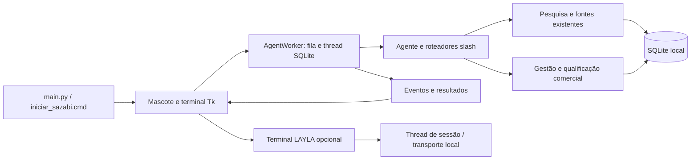

> Migração para Groq: configure `AI_PROVIDER=groq`, `GROQ_API_KEY` e `GROQ_MODEL=llama-3.3-70b-versatile` no `.env` e reinicie. `/groq` envia evidências à API Groq. Consulte o README para a configuração atual.

> Registro da fase 4. A atualização posterior de tema e credenciais está em [ATUALIZACAO_DESKTOP.md](ATUALIZACAO_DESKTOP.md); substitui o visual vermelho e a edição de chaves na interface descritos aqui.

# Fase 4 — desktop e confiabilidade

Entrega de 15/10/2026. O SAZABI permanece um aplicativo nativo Windows com mascote, terminal compacto e SQLite local. Nenhum site, painel em tela cheia, novo serviço de monitoramento ou envio automático de mensagens foi introduzido.

## Auditoria e correções integradas

| Problema observado no código | Correção |
|---|---|
| Respostas e eventos antigos acumulavam junto à tarefa atual. | Cada solicitação abre uma seção limpa, numerada no cabeçalho. Histórico persistente continua em `/history`, `/results` e `/leads`; **Último** recupera a última tentativa de pesquisa desta sessão. |
| Falhas de skills recebiam `RESPONSE_READY` e podiam apresentar pose de sucesso. | Worker não emite esse evento para resultados estruturados sem sucesso; erro legado também impede a reação de conclusão. Cancelamento permanece cancelamento. |
| Cancelamento HTTP estava restrito à Search Skill. | Pesquisa legada e investigação usam checkpoints entre etapas e nos clientes HTTP. Cancelar fica disponível também nesses fluxos e não desaparece ao reabrir o terminal. |
| Datas de cache inválidas causavam exceção; datas futuras podiam parecer recentes. | Datas inválidas/futuras são tratadas como cache vencido, sem renovação fictícia. |
| Queda abrupta podia deixar pesquisas `running` indefinidamente. | Na inicialização, pesquisas órfãs recebem falha de interrupção, com preservação de registros já confirmados. Um bloqueio do sistema operacional distingue execução viva de pesquisa interrompida. |
| Duas instâncias podiam iniciar pesquisas no mesmo banco. | Bloqueio por banco durante a pesquisa impede concorrência indevida e é liberado pelo sistema operacional em caso de queda. |
| Dois cliques rápidos alternavam abrir/fechar, deixando a aplicação inacessível pelo duplo clique. | Clique simples mantém a alternância; duplo clique deixa o terminal aberto, respeitando o intervalo de duplo clique do Windows. |
| Mudanças de monitor/resolução podiam deixar a posição salva fora da área útil. | Reavaliação leve da área útil enquanto a janela está ativa; posição é limitada à área disponível, sem pesquisar ou monitorar fontes. |
| Transições desenhavam duas poses sobrepostas. | Uma única pose é exibida por vez, com opacidade entre 55% e 100%; a arte nunca fica totalmente invisível durante a transição. |
| Controles horizontais eram vulneráveis a fontes maiores. | Ações do terminal em duas linhas; configurações dimensionadas conforme conteúdo e área útil. |
| Preferências usavam o mesmo arquivo temporário em gravações concorrentes. | Temporário exclusivo, flush/fsync e substituição atômica. |
| Eventos pendentes podiam abrir janelas durante o encerramento. | Cancelamento de callbacks e descarte de resultados visuais após iniciar o fechamento; worker finaliza e fecha seu SQLite. |

Não foi criada uma segunda camada de pesquisa ou de gestão de leads. Os indicadores antigos de prioridade de investigação continuam distintos da qualificação comercial da fase 3.

## Arquitetura final

- `ui/companion.py`: ciclo de vida, interação, estados reais e preferências. A thread gráfica não executa pesquisas nem consultas SQLite.
- `ui/terminal.py`, `ui/autocomplete.py`: saída atual, navegação, comandos, cancelamento e último resultado. Saída limitada a 2.500 linhas; cópia do último resultado limitada a 200.000 caracteres.
- `ui/sprites.py`, `renderer.py`, `behavior.py`, `presentation.py`: arte original, regiões de clique, animações e cache limitado de apresentações. Não há geração de arte por IA.
- `ui/preferences.py`, `interaction.py`, `effects.py`: conexões, menu, notificações e efeitos discretos. Menu/configurações têm fundo preto avermelhado e acentos vermelhos; terminal conserva verde/preto.
- `core/worker.py`: uma solicitação de comando ativa por worker; mensagens entre threads. `core/agent.py` mantém o pipeline e as transações existentes.
- `skills/search/`, `research/`, `utils/http_client.py`: política da Search Skill, descoberta, cache, coleta pública, validação de endereços e transporte.
- `database/`: repositórios, migrações, backup e `recovery.py`, que protege pesquisa e recuperação entre instâncias.
- `analysis/`: regras, evidências e avaliações explicáveis. `core/commercial_commands.py` expõe a fase 3 no mesmo terminal.
- `integrations/layla/`: sessão independente, credenciais no backend, confirmação de envio pelo usuário. O menu **Terminal LAYLA** permite abrir a integração enquanto a pesquisa trabalha.
- `system_monitor/`: leituras locais sob demanda; fechar sua janela pausa a coleta.

## Inicialização e configuração

Instale Python com Tcl/Tk e as dependências de `requirements.txt`; execute `python main.py` ou `iniciar_sazabi.cmd`. A inicialização é manual: o aplicativo não cria tarefa agendada nem entrada automática no Windows. Sem API, mascote, configurações, histórico, leads, qualificação e rascunhos locais continuam disponíveis. Novas instalações começam sem leads.

Copie `.env.example` para `.env` somente se ainda não houver um arquivo privado configurado. Não publique chaves nem o diretório `data/`.

| Variável | Uso |
|---|---|
| `DATABASE_PATH` | SQLite; padrão `data/sazabi.db`. |
| `LOG_FILE`, `LOG_LEVEL` | Diagnóstico local; padrão de arquivo `logs/sazabi.log`. |
| `DEFAULT_REGION` | Região inicial; `/set region cidade` permite configurar a preferência persistente. |
| `SEARCH_API_KEY`, `SEARCH_LIMIT` | Pesquisa legada Tavily; limite de 1 a 20. Credenciais também podem ser salvas no campo mascarado das configurações. |
| `CACHE_TTL_HOURS` | Reutilização das investigações; padrão de 24 horas. |
| `COMMERCIAL_PROFILE_PATH` | Perfil comercial editável da fase 3. |
| `AI_PROVIDER`, `GROQ_MODEL`, `GROQ_API_KEY` | Interpretação opcional pelo Groq; `none` mantém desativada. |
| `LAYLA_URL`, `LAYLA_SESSION_COOKIE` | Integração opcional com a LAYLA local e sessão autorizada, quando necessária. |
| `TELEGRAM_BOT_TOKEN`, `TELEGRAM_ALLOWED_USER_IDS` | Apenas para o modo Telegram explicitamente iniciado, separado do desktop. |

O menu permite controlar **Sempre no topo**, **Notificações** e **Dormir após**. Essas preferências e a posição persistem em `companion.json`, ao lado do banco. A arte e a velocidade suave são preservadas; não existe opção de reduzir movimento. Configurações oferecem acesso ao perfil comercial; listas são alteradas por `/profile set`, e pesos/limites no JSON conforme a documentação da fase 3.

## Uso diário e identificação dos resultados

- Clique abre/fecha o terminal; duplo clique o mantém aberto. Arraste não abre resultados. Durante o sono, o primeiro clique apenas acorda, conforme o comportamento anterior.
- Cada comando recebe um número **local da sessão**. Não confunda esse número com o ID persistente de pesquisa: `/results` e `/history` mostram `Pesquisa #ID`, situação e datas do SQLite.
- **Último** recupera a última tentativa de pesquisa da sessão, inclusive falha/cancelamento. Após reiniciar, consulta `/results`. Durante uma tarefa, mostra o andamento atual, sem substituir a saída por resultados antigos.
- A conclusão não abre uma janela nem toma foco. Clique no aviso para consultar a saída correspondente; iniciar outro comando dispensa o aviso anterior. Notificações podem ser desativadas sem ocultar os resultados do terminal.
- `/leads status=qualified min_score=70 categoria=high ordem=score` filtra e ordena pela última avaliação **salva**. `categoria` aceita `high`, `moderate`, `low`, `insufficient`; `min_score` vai de 0 a 100; `ordem` aceita `name` ou `score`. Campos desconhecidos ou sem avaliação não recebem pontuação fictícia.
- `/lead ID`, `/qualify ID`, `/evaluations ID`, `/draft ID email|message|call`, `/draft-save` e `/export csv|json ID,ID` preservam os contratos das fases anteriores. Recomendações, fontes, datas e próximas ações aparecem sob demanda, sem abrir um painel maior.

## Cancelamento, limites e recuperação

O cancelamento é **cooperativo**. Interrompe entre etapas e requisições; uma conexão em andamento pode aguardar seu timeout de transporte (15 s no cliente público padrão). Resolução DNS e bibliotecas do sistema podem demorar além disso. Não se promete interrupção instantânea. Fechar o aplicativo solicita cancelamento e aguarda a thread proprietária do banco liberar seus recursos. Integrações têm seus próprios limites; a LAYLA fecha sua conexão ao encerrar.

A Search Skill respeita o limite configurado em `skills/search/config.json` (5–600 s); comandos legados usam limite cooperativo de 180 s. As configurações não se sobrepõem. O transporte mantém respostas limitadas, tentativas GET controladas e não repete automaticamente POSTs faturáveis. Cache e tentativas não inventam resultados indisponíveis.

O arquivo `.research.lock`, ao lado do banco, pode permanecer após encerrar: **a existência do arquivo não significa pesquisa ativa**. O bloqueio de byte é mantido pelo sistema operacional apenas durante pesquisa/recuperação. Não apague o arquivo para tentar contornar uma execução ativa. Outra instância pode consultar dados, mas não iniciar uma segunda pesquisa simultânea naquele banco.

Após uma queda, apenas quando o bloqueio está livre, registros `running` são marcados como falha de interrupção. A data de finalização nesse caso é a data da recuperação, não uma hora de queda inventada. As empresas e evidências confirmadas permanecem. Contagens podem estar incompletas e isso é informado. Transações SQLite impedem confirmação parcial do conjunto de evidências de uma empresa.

Migrações e backups seguem as fases anteriores. Para backup manual: `python main.py --backup`. Para restaurar, encerre as instâncias, preserve o banco atual e configure `DATABASE_PATH` para uma cópia do backup verificado. Não sobrescreva ou copie cegamente um banco aberto com arquivos WAL. Backups têm retenção manual, sem exclusão automática nesta fase.

## Diagnóstico e limites conhecidos

1. Consulte a situação da execução no terminal e `/history`; use `/status` para fontes/configuração.
2. Confira `logs/sazabi.log`. Credenciais conhecidas são redigidas pelo formatador; ainda assim, revise logs antes de compartilhar.
3. Erro de banco exige conferir espaço e permissões. A interface permanece responsiva; falhas não são apresentadas como sucesso.
4. `/search` continua retornando **unconfigured** em produção: ainda não há adaptador gratuito autorizado. A chave Tavily habilita `/research` e pesquisa legada, que consomem créditos. Esta fase não removeu essa política nem fingiu uma pesquisa gratuita.
5. A LAYLA real e uma pesquisa comercial autenticada não foram validadas nesta entrega. Testes de contrato e fixtures não equivalem a essa validação. Nenhuma mensagem foi enviada a empresas.
6. A prancha tem seis poses, sem um asset separado de mascote deitado/dormindo. O mapeamento atual de sono foi preservado com respiração e bolhas; não foi inventada uma pose nova.
7. Escalas de fonte e áreas úteis simuladas foram verificadas, mas isso não comprova todas as combinações de monitores físicos, DPI misto e drivers do Windows.

## Evidências de validação

- Suíte automatizada final: **257 testes passaram em 28,32 s** (`run_tests.py` com dependências locais), incluindo cancelamento durante investigação individual antes da gravação das novas evidências. `git diff --check` sem erros.
- `native_audit_check.py` e `native_leads_check.py`: **PASS** após os ajustes finais; prévia LAYLA sem envio automático, falha simulada da integração, qualificação, rascunhos, exportação e persistência após reabertura.
- `native_desktop_check.py --screenshots`: **PASS** sem chave e com fixtures; poses, transparência, transição sem sobreposição, arraste/pouso, sono, menu/teclado, configurações, métricas reais e encerramento. O teste de foco agora aguarda a conclusão da troca de foco do Windows após esconder a janela antes de comparar; a asserção de preservação do foreground permanece.
- `native_phase4_check.py`: **PASS** nas escalas Tk 1,333333 / 2 / 2,666667 (aproximação de fontes a 100% / 150% / 200% em 96 DPI), com área útil simulada de 800×600. Exercita cancelamento legado, isolamento da saída atual, último resultado, duplo clique, reposição nas bordas e controles das configurações.
- Amostras curtas do processo ocioso, após aquecimento: 0,141 / 0,047 / 0,094 s de CPU em aproximadamente 3 s de relógio por cenário. São medições locais, não uma garantia de consumo em outras máquinas. Saída, imagens transformadas e efeitos mantêm limites de memória; no máximo duas bolhas de sono.
- `public_network_check.py`: **PASS** em HTTPS/robots.txt/extração de HTML de python.org e rejeição 401 do endpoint Tavily sem credenciais. Não consumiu chave, não executou pesquisa comercial nem gravou leads.
- Capturas são apenas das janelas de teste, em `data/desktop-previews/`, fora do Git. O SHA-256 da arte original permanece verificado pela suíte.
