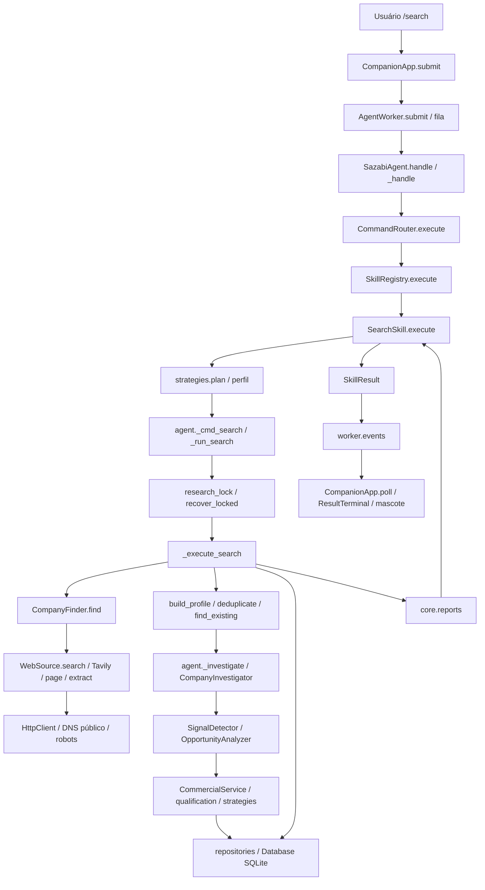

# Mapa técnico do SAZABI

Revisão estática do workspace em **16/10/2026**. O catálogo C ao final informa as contagens verificadas. Linhas referem-se ao conteúdo local desta data; revise-as após alterações. Para escolher anexos, comece em I e depois consulte C. Porta de entrada compacta: `docs/AI_CONTEXT.md`.

**Evidência:** “Confirmado” significa definição, import, chamada ou leitura/escrita localizada; não significa teste ao vivo. “Parcial” significa implementação existente com ativação/uso ainda não demonstrado. “Não confirmado / Precisa de investigação” indica lacuna. Imports não comprovam execução de um ramo. Relações de chamadas descritas nos fluxos foram conferidas nos pontos de ligação.


**Inventário verificado:** 175 arquivos relevantes catalogados: 145 fontes Python/PYW e 30 configurações, recursos e referências. Os dois documentos produzidos não entram nessa contagem.

## A. Visão geral

SAZABI é um assistente local de inteligência comercial: descobre empresas em páginas públicas, organiza observações com URL/data, detecta sinais por regras e produz hipóteses compatíveis com serviços configurados. Mantém empresas, histórico comercial, tarefas, avaliações e rascunhos em SQLite. Score não confirma necessidade nem interesse de compra.

`main.py:main` inicia o desktop por padrão; CLI, Telegram, comando único e backup são alternativas. `desktop.py:run_desktop` cria Tk e `ui/companion.py:CompanionApp` coordena mascote e janelas auxiliares. O launcher Windows usa pythonw. Não foi encontrado servidor HTTP do SAZABI: a comunicação visual/lógica usa chamadas Python, threads e filas.

`core/bootstrap.py:build_agent` monta os serviços. `core/worker.py:AgentWorker` cria, usa e fecha SQLite na própria thread. A UI consome eventos por `CompanionApp.poll`, agendado a cada 75 ms. O agente compartilha pipeline entre Search Skill, pesquisa legada e investigação. `/search` acrescenta estratégia, política de fontes/custo e resultado estruturado; `/research` entra no roteador legado. A análise principal é determinística. `/ai` abre conversa LAYLA local; `/groq` interpreta evidências pela API Groq.

Tecnologias confirmadas: Python, Tkinter/ttk/Tcl, SQLite via sqlite3 sem ORM, Win32/GDI+ via ctypes, HTTP/HTTPS/HTML/JSON da biblioteca padrão, psutil e pytest/unittest. JSON e YAML simples configuram recursos. Não foram encontrados Flask, frontend JavaScript, Node, Qt ou dependência PyYAML na produção inspecionada.

## B. Árvore de diretórios

```text
SAZABI/
├── main.py, desktop.py, iniciar_sazabi.cmd, iniciar_sazabi.pyw
├── .env (privado), .env.example, services.yaml, commercial_profile.json
├── requirements.txt, pytest.ini, run_tests.py
├── core/          agente, bootstrap, worker, relatórios, memória e comandos
│   └── commands/  parser, registro e despacho slash
├── skills/        contrato, registro
│   └── search/    skill.py, config.json, SKILL.md
├── research/      contratos, finder, investigator, web_source.py
├── analysis/      sinais, hipóteses, score, perfil, estratégias e Groq
├── database/      schema, modelos, repositórios, leads, migração e recuperação
├── integrations/layla/  bridge HTTP local e sessão independente
├── notifications/      console/null e Telegram
├── ui/            mascote, terminais, tema, Win32, sprites e animação
│   └── countdown/ motor manual, comandos, HUD e stopwatch de pesquisa
├── system_monitor/     sensores, formatação e sampler
├── utils/         normalização, dedup, HTTP público, logs e datas
├── assets/sazabi/ original.jpg, states.json, animation.json, README.md
├── tests/         regressões, fixtures e diagnósticos explícitos
├── scripts/       auditoria/revisão fase 5 e restore offline
├── reports/phase5/ review.csv, metrics.json (históricos)
├── data/          SQLite/WAL/SHM, preferências, locks, backups e saídas
├── logs/          logs privados
└── docs/          PROJECT_MAP.md, AI_CONTEXT.md
```

Excluídos do exame de conteúdo: `.git`, `.test-deps`, `.test-deps-companion`, caches, pyc, bancos/registros pessoais, backups, capturas, saídas de testes/previews, logs e `sazabi_before_v1.zip`. O contrato de persistência foi analisado no código, sem abrir bancos. `data/windowless_check.py` foi incluído excepcionalmente por conter um diagnóstico first-party; diretórios gerados de `data/` não foram tratados como código canônico. A arte foi verificada por presença/formato/hash e pelo leitor, sem avaliação visual nesta tarefa.

## C. Catálogo de arquivos

O catálogo abaixo é organizado por caminho para consulta. Dependências/dependentes são imports estáticos, incluindo imports dentro de funções e imports de testes; recursos por caminho estão nas entradas de configuração e seções D/G. Assinaturas mostram nomes de parâmetros sem valores default. Testes relacionados são recomendações por impacto, não afirmação de cobertura integral. A confirmação é estática, sem execução dos recursos.

### `analysis/__init__.py`

**Arquivo:** `analysis/__init__.py`

- **Responsabilidade:** Marca namespace de pacote; vazio, sem inicialização executável.
- **Funcionalidades / pontos de alteração:** Exports/inicialização somente se necessário.
- **Símbolos importantes / referências no código:** `analysis/__init__.py:1`: arquivo de pacote ou execução de nível de módulo, sem símbolo próprio.
- **Entradas:** importação.
- **Saídas:** namespace Python.
- **Dependências internas (imports):** Nenhum encontrado estaticamente; não prova ausência de uso por callback ou execução direta.
- **Dependentes (importadores):** Nenhum encontrado estaticamente; não prova ausência de uso por callback ou execução direta.
- **Riscos de alteração:** Afeta namespace python; revisar contratos com os importadores acima e impactos D/I.
- **Testes relacionados:** `tests/test_signals_and_hypotheses.py`, `tests/test_commercial.py`, `tests/test_phase7_strategies.py`
- **Grau de confiança:** Confirmado estaticamente; comportamento ao vivo não executado.

### `analysis/ai_provider.py`

**Arquivo:** `analysis/ai_provider.py`

- **Responsabilidade:** Cliente HTTPS Groq com modelos e resumo limitado; recusa truncamento, ferramentas/recusa e texto inválido.
- **Funcionalidades / pontos de alteração:** Contrato de IA e payload.
- **Símbolos importantes / referências no código:** `GroqError L7`; `request(path, payload, timeout, api_key) L11`; `list_models(api_key) L41`; `GroqProvider L49`; `GroqProvider.__init__(model, api_key) L50`; `GroqProvider.check_model() L56`; `GroqProvider.summarize(observations) L60`
- **Entradas:** modelo, chave backend, observações.
- **Saídas:** texto ou GroqError; sem escrita DB.
- **Dependências internas (imports):** Nenhum encontrado estaticamente; não prova ausência de uso por callback ou execução direta.
- **Dependentes (importadores):** `core/agent.py`, `core/connection.py`, `core/worker.py`, `tests/groq_connection_check.py`, `tests/test_groq.py`, `tests/test_v1_integrations.py`
- **Riscos de alteração:** Afeta texto ou groqerror; sem escrita db; revisar contratos com os importadores acima e impactos D/I.
- **Testes relacionados:** `tests/test_groq.py`, `tests/test_v1_integrations.py`
- **Grau de confiança:** Confirmado estaticamente; comportamento ao vivo não executado.

### `analysis/commercial.py`

**Arquivo:** `analysis/commercial.py`

- **Responsabilidade:** Hash/reuso de avaliação e snapshots; drafts explícitos e prompt reduzido/redigido para LAYLA.
- **Funcionalidades / pontos de alteração:** Cache, snapshots e rascunho obsoleto.
- **Símbolos importantes / referências no código:** `CommercialService L14`; `CommercialService.__init__(db, config) L15`; `CommercialService.inputs(identity, strategy_context) L18`; `CommercialService.qualify(identity, refresh, strategy_context) L29`; `CommercialService.unpack(row) L44`; `CommercialService.history(identity) L49`; `CommercialService.draft(identity, format) L53`; `CommercialService.save_draft(draft) L68`; `ai_prompt(result, task) L77`
- **Entradas:** DB, Config, ID, formato/tarefa.
- **Saídas:** avaliações, histórico, draft/prompt.
- **Dependências internas (imports):** `analysis/commercial_profile.py`, `analysis/qualification.py`, `database/leads.py`, `database/repositories.py`, `utils/timeutils.py`
- **Dependentes (importadores):** `core/agent.py`, `core/commercial_commands.py`, `database/leads.py`, `scripts/phase5_audit.py`, `tests/test_commercial.py`, `tests/test_phase4.py`
- **Riscos de alteração:** Afeta avaliações, histórico, draft/prompt; revisar contratos com os importadores acima e impactos D/I.
- **Testes relacionados:** `tests/test_signals_and_hypotheses.py`, `tests/test_commercial.py`, `tests/test_phase7_strategies.py`
- **Grau de confiança:** Confirmado estaticamente; comportamento ao vivo não executado.

**Chamadas através de imports identificadas:** `load` → `analysis/commercial_profile.py` (L22); `evaluate` → `analysis/qualification.py` (L35); `now_iso` → `utils/timeutils.py` (L36); `LeadRepository` → `database/leads.py` (L19); `CompanyRepository` → `database/repositories.py` (L20); `SourceRepository` → `database/repositories.py` (L21); `utcnow` → `utils/timeutils.py` (L25). Chamadas de instâncias/callbacks adicionais estão nos fluxos D/E.

### `analysis/commercial_profile.py`

**Arquivo:** `analysis/commercial_profile.py`

- **Responsabilidade:** Valida/carrega perfil, pesos, thresholds, estratégias e regras; edição atômica.
- **Funcionalidades / pontos de alteração:** Schema do perfil.
- **Símbolos importantes / referências no código:** `LIST_FIELDS L7`; `WEIGHTS L10`; `DEFAULT_PATH L12`; `validate(profile) L15`; `load(config) L64`; `update(config, field, values) L76`
- **Entradas:** Config, JSON, campo/valor.
- **Saídas:** perfil ou ValueError; arquivo salvo.
- **Dependências internas (imports):** `analysis/strategies.py`
- **Dependentes (importadores):** `analysis/commercial.py`, `core/commercial_commands.py`, `skills/search/skill.py`, `tests/native_phase7_check.py`, `tests/test_commercial.py`, `tests/test_phase5_quality.py`, `tests/test_phase7_strategies.py`
- **Riscos de alteração:** Afeta perfil ou valueerror; arquivo salvo; revisar contratos com os importadores acima e impactos D/I.
- **Testes relacionados:** `tests/test_signals_and_hypotheses.py`, `tests/test_commercial.py`, `tests/test_phase7_strategies.py`
- **Grau de confiança:** Confirmado estaticamente; comportamento ao vivo não executado.

**Chamadas através de imports identificadas:** `defaults` → `analysis/strategies.py` (L19). Chamadas de instâncias/callbacks adicionais estão nos fluxos D/E.

### `analysis/evidence_manager.py`

**Arquivo:** `analysis/evidence_manager.py`

- **Responsabilidade:** Pontua tipos de sinais e calcula/rótula nível de evidência.
- **Funcionalidades / pontos de alteração:** Critérios de confiança.
- **Símbolos importantes / referências no código:** `CONFIDENCE_WEIGHT L8`; `score(signals) L11`; `evidence_level(signals) L15`; `level_label(level) L32`; `rank(level) L36`
- **Entradas:** sinais/nível.
- **Saídas:** score, nível, ranking.
- **Dependências internas (imports):** `database/models.py`
- **Dependentes (importadores):** `analysis/opportunity_analyzer.py`, `core/agent.py`, `core/reports.py`, `tests/test_signals_and_hypotheses.py`
- **Riscos de alteração:** Afeta score, nível, ranking; revisar contratos com os importadores acima e impactos D/I.
- **Testes relacionados:** `tests/test_signals_and_hypotheses.py`, `tests/test_commercial.py`, `tests/test_phase7_strategies.py`
- **Grau de confiança:** Confirmado estaticamente; comportamento ao vivo não executado.

**Chamadas através de imports identificadas:** `EVIDENCE_RANK.get` → `database/models.py` (L37). Chamadas de instâncias/callbacks adicionais estão nos fluxos D/E.

### `analysis/opportunity_analyzer.py`

**Arquivo:** `analysis/opportunity_analyzer.py`

- **Responsabilidade:** Gera hipóteses por sinais primários/apoio, compatíveis com serviços e ordenadas por evidência.
- **Funcionalidades / pontos de alteração:** Soluções e aderência.
- **Símbolos importantes / referências no código:** `HypothesisRule L17`; `_r(solution, services, primary, supporting) L24`; `RULES L28`; `OpportunityAnalyzer L46`; `OpportunityAnalyzer.__init__(services) L47`; `OpportunityAnalyzer._offers(rule) L50`; `OpportunityAnalyzer.analyze(profile, signals) L54`
- **Entradas:** empresa, sinais, serviços.
- **Saídas:** Hypothesis.
- **Dependências internas (imports):** `analysis/evidence_manager.py`, `database/models.py`, `utils/normalization.py`, `utils/timeutils.py`
- **Dependentes (importadores):** `analysis/qualification.py`, `core/agent.py`, `core/bootstrap.py`, `tests/test_signals_and_hypotheses.py`, `tests/test_v1_integrations.py`
- **Riscos de alteração:** Afeta hypothesis; revisar contratos com os importadores acima e impactos D/I.
- **Testes relacionados:** `tests/test_signals_and_hypotheses.py`, `tests/test_commercial.py`, `tests/test_phase7_strategies.py`
- **Grau de confiança:** Confirmado estaticamente; comportamento ao vivo não executado.

**Chamadas através de imports identificadas:** `now_iso` → `utils/timeutils.py` (L56); `normalize_text` → `utils/normalization.py` (L48); `Hypothesis` → `database/models.py` (L69); `evidence_level` → `analysis/evidence_manager.py` (L70); `rank` → `analysis/evidence_manager.py` (L71). Chamadas de instâncias/callbacks adicionais estão nos fluxos D/E.

### `analysis/qualification.py`

**Arquivo:** `analysis/qualification.py`

- **Responsabilidade:** Avalia evidências públicas recentes, perfil e políticas; explica parcelas, caps e fatores contrários.
- **Funcionalidades / pontos de alteração:** Qualificação e elegibilidade.
- **Símbolos importantes / referências no código:** `VERSION L11`; `LABELS L12`; `public_url(value) L15`; `matches(value, options) L26`; `evaluate(company, observations, profile, now, strategy_context) L31`
- **Entradas:** empresa, fontes, perfil, data/estratégia.
- **Saídas:** score 0–100, categoria, fatos, hipóteses/lacunas.
- **Dependências internas (imports):** `analysis/opportunity_analyzer.py`, `analysis/signal_detector.py`, `analysis/strategies.py`, `utils/normalization.py`, `utils/timeutils.py`
- **Dependentes (importadores):** `analysis/commercial.py`, `core/agent.py`, `core/commercial_commands.py`, `core/lead_commands.py`, `tests/test_commercial.py`, `tests/test_phase5_quality.py`, `tests/test_phase7_strategies.py`
- **Riscos de alteração:** Afeta score 0–100, categoria, fatos, hipóteses/lacunas; revisar contratos com os importadores acima e impactos D/I.
- **Testes relacionados:** `tests/test_signals_and_hypotheses.py`, `tests/test_commercial.py`, `tests/test_phase7_strategies.py`
- **Grau de confiança:** Confirmado estaticamente; comportamento ao vivo não executado.

**Chamadas através de imports identificadas:** `normalize_text` → `utils/normalization.py` (L27); `existing_online_channels` → `analysis/signal_detector.py` (L54); `evidence_policy` → `analysis/strategies.py` (L62); `utcnow` → `utils/timeutils.py` (L32); `OpportunityAnalyzer` → `analysis/opportunity_analyzer.py` (L64); `parse_iso` → `utils/timeutils.py` (L38); `SignalDetector` → `analysis/signal_detector.py` (L48). Chamadas de instâncias/callbacks adicionais estão nos fluxos D/E.

### `analysis/scoring.py`

**Arquivo:** `analysis/scoring.py`

- **Responsabilidade:** Prioridade por tipos distintos de sinal; repetição não soma; não é o score comercial.
- **Funcionalidades / pontos de alteração:** Pesos de prioridade.
- **Símbolos importantes / referências no código:** `WEIGHTS L2`; `opportunity_score(signals) L7`
- **Entradas:** sinais.
- **Saídas:** prioridade numérica.
- **Dependências internas (imports):** Nenhum encontrado estaticamente; não prova ausência de uso por callback ou execução direta.
- **Dependentes (importadores):** `core/agent.py`, `core/reports.py`, `database/leads.py`, `tests/test_v1_integrations.py`
- **Riscos de alteração:** Afeta prioridade numérica; revisar contratos com os importadores acima e impactos D/I.
- **Testes relacionados:** `tests/test_signals_and_hypotheses.py`, `tests/test_commercial.py`, `tests/test_phase7_strategies.py`
- **Grau de confiança:** Confirmado estaticamente; comportamento ao vivo não executado.

### `analysis/signal_detector.py`

**Arquivo:** `analysis/signal_detector.py`

- **Responsabilidade:** Regex de sinais, negações, canais existentes e limites numéricos; vincula inferência à fonte.
- **Funcionalidades / pontos de alteração:** Regras de sinais.
- **Símbolos importantes / referências no código:** `NUM_WORDS L17`; `_NUM L19`; `SignalRule L23`; `RULES L31`; `_to_int(value) L62`; `existing_online_channels(observations) L66`; `SignalDetector L79`; `SignalDetector.__init__(rules) L80`; `SignalDetector.detect(profile, observations) L83`
- **Entradas:** empresa, observações.
- **Saídas:** Signals deduplicados.
- **Dependências internas (imports):** `database/models.py`, `utils/normalization.py`, `utils/timeutils.py`
- **Dependentes (importadores):** `analysis/qualification.py`, `core/agent.py`, `core/bootstrap.py`, `tests/test_phase5_quality.py`, `tests/test_signals_and_hypotheses.py`, `tests/test_v1_integrations.py`
- **Riscos de alteração:** Afeta signals deduplicados; revisar contratos com os importadores acima e impactos D/I.
- **Testes relacionados:** `tests/test_signals_and_hypotheses.py`, `tests/test_commercial.py`, `tests/test_phase7_strategies.py`
- **Grau de confiança:** Confirmado estaticamente; comportamento ao vivo não executado.

**Chamadas através de imports identificadas:** `normalize_text` → `utils/normalization.py` (L69); `now_iso` → `utils/timeutils.py` (L84); `Signal` → `database/models.py` (L108). Chamadas de instâncias/callbacks adicionais estão nos fluxos D/E.

### `analysis/strategies.py`

**Arquivo:** `analysis/strategies.py`

- **Responsabilidade:** Defaults declarativos, planejamento preservando intenção e filtro de sinais por evidência/exclusões.
- **Funcionalidades / pontos de alteração:** Estratégia de busca/análise.
- **Símbolos importantes / referências no código:** `defaults() L8`; `SIGNALS L23`; `contains(text, values) L27`; `applicable(strategy, services) L32`; `segment_rule(profile, segment) L36`; `plan(profile, criteria, query, explicit) L41`; `evidence_policy(profile, company, signals, context) L74`
- **Entradas:** perfil, critérios, consulta, sinais.
- **Saídas:** plano/snapshot e sinais elegíveis.
- **Dependências internas (imports):** `utils/normalization.py`
- **Dependentes (importadores):** `analysis/commercial_profile.py`, `analysis/qualification.py`, `core/agent.py`, `core/commercial_commands.py`, `skills/search/skill.py`, `tests/test_phase7_strategies.py`
- **Riscos de alteração:** Afeta plano/snapshot e sinais elegíveis; revisar contratos com os importadores acima e impactos D/I.
- **Testes relacionados:** `tests/test_signals_and_hypotheses.py`, `tests/test_commercial.py`, `tests/test_phase7_strategies.py`
- **Grau de confiança:** Confirmado estaticamente; comportamento ao vivo não executado.

**Chamadas através de imports identificadas:** `normalize_text` → `utils/normalization.py` (L28). Chamadas de instâncias/callbacks adicionais estão nos fluxos D/E.

### `core/__init__.py`

**Arquivo:** `core/__init__.py`

- **Responsabilidade:** Marca namespace de pacote; vazio, sem inicialização executável.
- **Funcionalidades / pontos de alteração:** Exports/inicialização somente se necessário.
- **Símbolos importantes / referências no código:** `core/__init__.py:1`: arquivo de pacote ou execução de nível de módulo, sem símbolo próprio.
- **Entradas:** importação.
- **Saídas:** namespace Python.
- **Dependências internas (imports):** Nenhum encontrado estaticamente; não prova ausência de uso por callback ou execução direta.
- **Dependentes (importadores):** `core/agent.py`
- **Riscos de alteração:** Afeta namespace python; revisar contratos com os importadores acima e impactos D/I.
- **Testes relacionados:** `tests/test_agent_flow.py`, `tests/test_slash_skills.py`, `tests/test_desktop.py`, `tests/test_phase4.py`
- **Grau de confiança:** Confirmado estaticamente; comportamento ao vivo não executado.

### `core/agent.py`

**Arquivo:** `core/agent.py`

- **Responsabilidade:** Coordena comandos, confirmação, memória, pesquisa/investigação transacional, relatórios e Groq.
- **Funcionalidades / pontos de alteração:** Pipeline e estados do agente.
- **Símbolos importantes / referências no código:** `OPPORTUNITY_MIN_RANK L34`; `YES L35`; `NO L36`; `Outcome L40`; `SazabiAgent L48`; `SazabiAgent.__init__(config, db, finder, investigator, detector, analyzer, notifier) L49`; `SazabiAgent.emit(kind) L76`; `SazabiAgent.handle(text, cancelled) L87`; `SazabiAgent._handle(text, cancelled) L117`; `SazabiAgent._ai_summary(target) L155`; `SazabiAgent._dispatch(cmd, text) L173`; `SazabiAgent._resolve_pending(cmd, text) L198`; `SazabiAgent._cmd_search(criteria) L239`; `SazabiAgent._run_search(criteria) L249`; `SazabiAgent._run_search_locked(criteria) L260`; `SazabiAgent._execute_search(criteria, run) L280`; `SazabiAgent._notify_run(run, criteria, ranked) L358`; `SazabiAgent._send(kind, message, company_id) L366`; `SazabiAgent._qualify_local(identity) L380`; `SazabiAgent._investigate(profile, refresh) L387`; `SazabiAgent._strategy_analysis(company, observations) L424`; `SazabiAgent._resolve_company(target, allow_lookup) L435`; `SazabiAgent._cmd_investigate(target, refresh) L471`; `SazabiAgent._company_report(profile, outcome) L488`; `SazabiAgent._cmd_company(target) L493`; `SazabiAgent._cmd_save(target) L506`; `SazabiAgent._cmd_ignore(target) L519`; `SazabiAgent._cmd_forget(target) L532`; `SazabiAgent._cmd_set(args) L540`; `SazabiAgent._entries(profiles) L549`; `SazabiAgent._runs_for(period) L557`; `SazabiAgent._cmd_results(period) L563`; `SazabiAgent._cmd_interesting() L579`; `SazabiAgent._cmd_history(period) L586`; `SazabiAgent._cmd_status() L593`
- **Entradas:** texto, cancelamento.
- **Saídas:** texto, eventos, last_skill_result, SQLite.
- **Dependências internas (imports):** `analysis/ai_provider.py`, `analysis/commercial.py`, `analysis/evidence_manager.py`, `analysis/opportunity_analyzer.py`, `analysis/qualification.py`, `analysis/scoring.py`, `analysis/signal_detector.py`, `analysis/strategies.py`, `core/__init__.py`, `core/command_router.py`, `core/commands/parser.py`, `core/commands/router.py`, `core/config.py`, `core/memory.py`, `core/reports.py`, `database/database.py`, `database/leads.py`, `database/models.py`, `database/recovery.py`, `database/repositories.py`, `notifications/notifier.py`, `research/company_finder.py`, `research/company_investigator.py`, `skills/base.py`, `skills/registry.py`, `skills/search/skill.py`, `utils/deduplication.py`, `utils/http_client.py`, `utils/normalization.py`, `utils/timeutils.py`
- **Dependentes (importadores):** `core/bootstrap.py`
- **Riscos de alteração:** Afeta texto, eventos, last_skill_result, sqlite; revisar contratos com os importadores acima e impactos D/I.
- **Testes relacionados:** `tests/test_agent_flow.py`, `tests/test_slash_skills.py`, `tests/test_desktop.py`, `tests/test_phase4.py`
- **Grau de confiança:** Confirmado estaticamente; comportamento ao vivo não executado.

**Chamadas através de imports identificadas:** `rank` → `analysis/evidence_manager.py` (L34); `CompanyRepository` → `database/repositories.py` (L55); `SourceRepository` → `database/repositories.py` (L56); `SignalRepository` → `database/repositories.py` (L57); `HypothesisRepository` → `database/repositories.py` (L58); `RunRepository` → `database/repositories.py` (L59); `IgnoredRepository` → `database/repositories.py` (L60); `SavedRepository` → `database/repositories.py` (L61); `NotificationRepository` → `database/repositories.py` (L62); `Memory` → `core/memory.py` (L63); `SkillRegistry` → `skills/registry.py` (L72); `CommandRouter` → `core/commands/router.py` (L74); `SkillContext` → `skills/base.py` (L91); `deduplicate` → `utils/deduplication.py` (L293); `reports.format_search_report` → `core/reports.py` (L338); `reports.format_discovery` → `core/reports.py` (L342); `evaluate` → `analysis/qualification.py` (L429); `evidence_policy` → `analysis/strategies.py` (L431); `reports.format_company_report` → `core/reports.py` (L489); `reports.format_company_list` → `core/reports.py` (L582); `reports.format_history` → `core/reports.py` (L591); `reports.format_status` → `core/reports.py` (L594); `SearchSkill` → `skills/search/skill.py` (L73); `parse` → `core/commands/parser.py` (L124); `build_profile` → `research/company_finder.py` (L292); `reports.format_summary_notification` → `core/reports.py` (L364); `title_case_pt` → `utils/normalization.py` (L543); `SkillResult` → `skills/base.py` (L103); `route` → `core/command_router.py` (L145); `research_lock` → `database/recovery.py` (L252); `recover_locked` → `database/recovery.py` (L253); `find_existing` → `utils/deduplication.py` (L301); `now_iso` → `utils/timeutils.py` (L416); `OpportunityAnalyzer` → `analysis/opportunity_analyzer.py` (L432); `GroqProvider` → `analysis/ai_provider.py` (L164); `normalize_text` → `utils/normalization.py` (L199); `reports.format_opportunity_notification` → `core/reports.py` (L362); `CommercialService` → `analysis/commercial.py` (L383); `reports.fmt_date` → `core/reports.py` (L484); `LeadRepository` → `database/leads.py` (L516); `day_bounds` → `utils/timeutils.py` (L559); `merge_profiles` → `research/company_finder.py` (L306); `normalize_name` → `utils/normalization.py` (L448); `opportunity_score` → `analysis/scoring.py` (L331). Chamadas de instâncias/callbacks adicionais estão nos fluxos D/E.

### `core/bootstrap.py`

**Arquivo:** `core/bootstrap.py`

- **Responsabilidade:** Monta Database, fontes Tavily opcionais, finder/investigator, detector/analyzer e agente; chama recover.
- **Funcionalidades / pontos de alteração:** Composição de serviços.
- **Símbolos importantes / referências no código:** `build_agent(config, notifier, sources) L17`
- **Entradas:** Config, fontes/notifier injetáveis.
- **Saídas:** SazabiAgent.
- **Dependências internas (imports):** `analysis/opportunity_analyzer.py`, `analysis/signal_detector.py`, `core/agent.py`, `core/config.py`, `database/database.py`, `database/recovery.py`, `notifications/notifier.py`, `research/base.py`, `research/company_finder.py`, `research/company_investigator.py`, `research/web_source.py`
- **Dependentes (importadores):** `core/worker.py`, `main.py`, `scripts/phase5_audit.py`, `tests/factories.py`, `tests/native_leads_check.py`, `tests/test_groq.py`, `tests/test_phase5_quality.py`, `tests/test_real_pipeline.py`, `tests/test_slash_skills.py`, `ui/companion.py`
- **Riscos de alteração:** Afeta sazabiagent; revisar contratos com os importadores acima e impactos D/I.
- **Testes relacionados:** `tests/test_agent_flow.py`, `tests/test_slash_skills.py`, `tests/test_desktop.py`, `tests/test_phase4.py`
- **Grau de confiança:** Confirmado estaticamente; comportamento ao vivo não executado.

**Chamadas através de imports identificadas:** `Database` → `database/database.py` (L24); `recover` → `database/recovery.py` (L27); `SazabiAgent` → `core/agent.py` (L28); `WebSource` → `research/web_source.py` (L23); `CompanyFinder` → `research/company_finder.py` (L29); `CompanyInvestigator` → `research/company_investigator.py` (L30); `SignalDetector` → `analysis/signal_detector.py` (L30); `OpportunityAnalyzer` → `analysis/opportunity_analyzer.py` (L31); `TavilySearch` → `research/web_source.py` (L23); `ConsoleNotifier` → `notifications/notifier.py` (L31). Chamadas de instâncias/callbacks adicionais estão nos fluxos D/E.

### `core/command_router.py`

**Arquivo:** `core/command_router.py`

- **Responsabilidade:** Regex de comandos legados/linguagem natural; extrai critérios e períodos; alias research.
- **Funcionalidades / pontos de alteração:** Intenções, aliases e extração.
- **Símbolos importantes / referências no código:** `Command L16`; `SLASH_ALIASES L26`; `SEGMENTS L39`; `SIZES L47`; `NEEDS L49`; `_GREETING L52`; `_CITY_CUT L53`; `_SAVE L55`; `_IGNORE L56`; `_FORGET L57`; `_INVESTIGATE L58`; `_INVESTIGATE_COMPANY L62`; `_SHOW_COMPANY L63`; `_SEARCH_VERB L64`; `_period(n) L68`; `_clean_target(text, strip_article) L78`; `parse_criteria(text) L87`; `route(text) L118`; `_route_slash(raw) L127`; `_route_natural(raw) L147`
- **Entradas:** texto.
- **Saídas:** Command, SearchCriteria.
- **Dependências internas (imports):** `database/models.py`, `utils/normalization.py`
- **Dependentes (importadores):** `core/agent.py`, `main.py`, `skills/search/skill.py`, `tests/test_backend_recovery.py`, `tests/test_command_router.py`, `tests/test_phase7_strategies.py`, `ui/companion.py`
- **Riscos de alteração:** Afeta command, searchcriteria; revisar contratos com os importadores acima e impactos D/I.
- **Testes relacionados:** `tests/test_command_router.py`, `tests/test_agent_flow.py`
- **Grau de confiança:** Confirmado estaticamente; comportamento ao vivo não executado.

**Chamadas através de imports identificadas:** `normalize_text` → `utils/normalization.py` (L88); `SearchCriteria` → `database/models.py` (L89); `title_case_pt` → `utils/normalization.py` (L114). Chamadas de instâncias/callbacks adicionais estão nos fluxos D/E.

### `core/commands/__init__.py`

**Arquivo:** `core/commands/__init__.py`

- **Responsabilidade:** Marca namespace de pacote; vazio, sem inicialização executável.
- **Funcionalidades / pontos de alteração:** Exports/inicialização somente se necessário.
- **Símbolos importantes / referências no código:** `core/commands/__init__.py:1`: arquivo de pacote ou execução de nível de módulo, sem símbolo próprio.
- **Entradas:** importação.
- **Saídas:** namespace Python.
- **Dependências internas (imports):** Nenhum encontrado estaticamente; não prova ausência de uso por callback ou execução direta.
- **Dependentes (importadores):** Nenhum encontrado estaticamente; não prova ausência de uso por callback ou execução direta.
- **Riscos de alteração:** Afeta namespace python; revisar contratos com os importadores acima e impactos D/I.
- **Testes relacionados:** `tests/test_agent_flow.py`, `tests/test_slash_skills.py`, `tests/test_desktop.py`, `tests/test_phase4.py`
- **Grau de confiança:** Confirmado estaticamente; comportamento ao vivo não executado.

### `core/commands/parser.py`

**Arquivo:** `core/commands/parser.py`

- **Responsabilidade:** Separa nome/argumentos slash e valida entrada, sem lógica de pesquisa.
- **Funcionalidades / pontos de alteração:** Sintaxe slash.
- **Símbolos importantes / referências no código:** `MAX_INPUT L5`; `SlashCommand L8`; `parse(text) L13`
- **Entradas:** texto.
- **Saídas:** SlashCommand, None, ValueError.
- **Dependências internas (imports):** Nenhum encontrado estaticamente; não prova ausência de uso por callback ou execução direta.
- **Dependentes (importadores):** `core/agent.py`, `core/commands/router.py`, `core/worker.py`, `tests/test_slash_skills.py`, `ui/companion.py`
- **Riscos de alteração:** Afeta slashcommand, none, valueerror; revisar contratos com os importadores acima e impactos D/I.
- **Testes relacionados:** `tests/test_agent_flow.py`, `tests/test_slash_skills.py`, `tests/test_desktop.py`, `tests/test_phase4.py`
- **Grau de confiança:** Confirmado estaticamente; comportamento ao vivo não executado.

### `core/commands/registry.py`

**Arquivo:** `core/commands/registry.py`

- **Responsabilidade:** Registra metadados search/ai, leads, comercial e manutenção; sugere prefixos.
- **Funcionalidades / pontos de alteração:** Novos comandos/autocomplete.
- **Símbolos importantes / referências no código:** `CommandDefinition L4`; `CommandRegistry L10`; `CommandRegistry.__init__() L11`; `CommandRegistry.register(command) L14`; `CommandRegistry.get(name) L19`; `CommandRegistry.suggestions(prefix) L22`; `default_registry() L26`
- **Entradas:** CommandDefinition, prefixo.
- **Saídas:** registro e sugestões.
- **Dependências internas (imports):** `core/commercial_commands.py`, `core/lead_commands.py`, `core/maintenance_commands.py`
- **Dependentes (importadores):** `core/commands/router.py`, `tests/test_slash_skills.py`, `ui/autocomplete.py`
- **Riscos de alteração:** Afeta registro e sugestões; revisar contratos com os importadores acima e impactos D/I.
- **Testes relacionados:** `tests/test_agent_flow.py`, `tests/test_slash_skills.py`, `tests/test_desktop.py`, `tests/test_phase4.py`
- **Grau de confiança:** Confirmado estaticamente; comportamento ao vivo não executado.

**Chamadas através de imports identificadas:** `COMMANDS.items` → `core/lead_commands.py` (L31); `COMMERCIAL.items` → `core/commercial_commands.py` (L34); `MAINTENANCE.items` → `core/maintenance_commands.py` (L37). Chamadas de instâncias/callbacks adicionais estão nos fluxos D/E.

### `core/commands/router.py`

**Arquivo:** `core/commands/router.py`

- **Responsabilidade:** Encaminha comando registrado para Skill ou handlers; ai retorna action=open_ai.
- **Funcionalidades / pontos de alteração:** Despacho entre famílias.
- **Símbolos importantes / referências no código:** `CommandRouter L5`; `CommandRouter.__init__(skills, registry) L6`; `CommandRouter.execute(text, context) L9`
- **Entradas:** texto, SkillContext.
- **Saídas:** SkillResult ou None.
- **Dependências internas (imports):** `core/commands/parser.py`, `core/commands/registry.py`, `core/commercial_commands.py`, `core/lead_commands.py`, `core/maintenance_commands.py`, `skills/base.py`
- **Dependentes (importadores):** `core/agent.py`, `tests/test_slash_skills.py`
- **Riscos de alteração:** Afeta skillresult ou none; revisar contratos com os importadores acima e impactos D/I.
- **Testes relacionados:** `tests/test_agent_flow.py`, `tests/test_slash_skills.py`, `tests/test_desktop.py`, `tests/test_phase4.py`
- **Grau de confiança:** Confirmado estaticamente; comportamento ao vivo não executado.

**Chamadas através de imports identificadas:** `parse` → `core/commands/parser.py` (L10); `SkillResult` → `skills/base.py` (L28); `execute` → `core/maintenance_commands.py` (L24); `default_registry` → `core/commands/registry.py` (L7); `LeadCommands` → `core/lead_commands.py` (L18); `CommercialCommands` → `core/commercial_commands.py` (L21). Chamadas de instâncias/callbacks adicionais estão nos fluxos D/E.

### `core/commercial_commands.py`

**Arquivo:** `core/commercial_commands.py`

- **Responsabilidade:** Perfil/estratégias, qualificação/histórico, draft explícito e preparação para LAYLA.
- **Funcionalidades / pontos de alteração:** Uso da inteligência comercial.
- **Símbolos importantes / referências no código:** `COMMANDS L10`; `render(result) L20`; `CommercialCommands L36`; `CommercialCommands.__init__(agent) L37`; `CommercialCommands.execute(name, args) L41`; `CommercialCommands._execute(name, args) L48`
- **Entradas:** nome e argumentos.
- **Saídas:** SkillResult, avaliação/rascunho, open_ai.
- **Dependências internas (imports):** `analysis/commercial.py`, `analysis/commercial_profile.py`, `analysis/qualification.py`, `analysis/strategies.py`, `database/leads.py`, `skills/base.py`
- **Dependentes (importadores):** `core/commands/registry.py`, `core/commands/router.py`
- **Riscos de alteração:** Afeta skillresult, avaliação/rascunho, open_ai; revisar contratos com os importadores acima e impactos D/I.
- **Testes relacionados:** `tests/test_commercial.py`, `tests/test_phase7_strategies.py`
- **Grau de confiança:** Confirmado estaticamente; comportamento ao vivo não executado.

**Chamadas através de imports identificadas:** `CommercialService` → `analysis/commercial.py` (L39); `SkillResult` → `skills/base.py` (L118); `load` → `analysis/commercial_profile.py` (L57); `update` → `analysis/commercial_profile.py` (L62); `defaults` → `analysis/strategies.py` (L71); `LeadRepository` → `database/leads.py` (L88); `ai_prompt` → `analysis/commercial.py` (L115). Chamadas de instâncias/callbacks adicionais estão nos fluxos D/E.

### `core/config.py`

**Arquivo:** `core/config.py`

- **Responsabilidade:** Lê env com BOM, ambiente prioritário e YAML simples; valida TTL, allowlist e limite.
- **Funcionalidades / pontos de alteração:** Novas opções/defaults.
- **Símbolos importantes / referências no código:** `DEFAULT_SERVICES L12`; `DEFAULT_DB L15`; `MOCK_DB L16`; `Config L20`; `read_env_file(path) L43`; `read_services(path) L57`; `load_config(env_file, services_file, mock, db_path) L77`
- **Entradas:** env/services, overrides.
- **Saídas:** Config.
- **Dependências internas (imports):** Nenhum encontrado estaticamente; não prova ausência de uso por callback ou execução direta.
- **Dependentes (importadores):** `core/agent.py`, `core/bootstrap.py`, `desktop.py`, `main.py`, `scripts/phase5_audit.py`, `tests/conftest.py`, `tests/groq_connection_check.py`, `tests/native_audit_check.py`, `tests/native_countdown_check.py`, `tests/native_desktop_check.py`, `tests/native_leads_check.py`, `tests/native_phase4_check.py`, `tests/native_phase6_check.py`, `tests/native_phase7_check.py`, `tests/native_phase9_check.py`, `tests/native_theme_check.py`, `tests/test_agent_flow.py`, `tests/test_backend_recovery.py`, `tests/test_commercial.py`, `tests/test_desktop.py`, `tests/test_groq.py`, `tests/test_layla_bridge.py`, `tests/test_leads.py`, `tests/test_misc.py`, `tests/test_phase4.py`, `tests/test_phase5_quality.py`, `tests/test_phase6_workflow.py`, `tests/test_phase7_strategies.py`, `tests/test_phase9_maintenance.py`, `tests/test_real_pipeline.py`, `tests/test_signals_and_hypotheses.py`, `tests/test_slash_skills.py`, `tests/test_v1_integrations.py`
- **Riscos de alteração:** Afeta config; revisar contratos com os importadores acima e impactos D/I.
- **Testes relacionados:** `tests/test_agent_flow.py`, `tests/test_slash_skills.py`, `tests/test_desktop.py`, `tests/test_phase4.py`
- **Grau de confiança:** Confirmado estaticamente; comportamento ao vivo não executado.

### `core/connection.py`

**Arquivo:** `core/connection.py`

- **Responsabilidade:** Valida Tavily e troca fontes; salva env atomicamente; valida/ativa modelo Groq.
- **Funcionalidades / pontos de alteração:** Ativação de provedores.
- **Símbolos importantes / referências no código:** `save_key(path, key) L10`; `save_values(path, values) L16`; `connect(agent, key) L36`; `configure_groq(agent, model) L52`
- **Entradas:** agente, credencial ou modelo.
- **Saídas:** configuração/env e fontes atualizados.
- **Dependências internas (imports):** `analysis/ai_provider.py`, `research/web_source.py`
- **Dependentes (importadores):** `core/worker.py`, `tests/test_groq.py`, `tests/test_real_pipeline.py`
- **Riscos de alteração:** Afeta configuração/env e fontes atualizados; revisar contratos com os importadores acima e impactos D/I.
- **Testes relacionados:** `tests/test_groq.py`, `tests/test_real_pipeline.py`
- **Grau de confiança:** Confirmado estaticamente; comportamento ao vivo não executado.

**Chamadas através de imports identificadas:** `TavilySearch` → `research/web_source.py` (L40); `WebSource` → `research/web_source.py` (L46); `GroqProvider` → `analysis/ai_provider.py` (L55). Chamadas de instâncias/callbacks adicionais estão nos fluxos D/E.

### `core/dashboard.py`

**Arquivo:** `core/dashboard.py`

- **Responsabilidade:** Projeção somente leitura de métricas SQLite; não inicia servidor.
- **Funcionalidades / pontos de alteração:** Métricas opcionais.
- **Símbolos importantes / referências no código:** `dashboard_snapshot(db) L4`
- **Entradas:** Database.
- **Saídas:** dicionário de contagens.
- **Dependências internas (imports):** Nenhum encontrado estaticamente; não prova ausência de uso por callback ou execução direta.
- **Dependentes (importadores):** `core/worker.py`, `tests/test_dashboard.py`
- **Riscos de alteração:** Afeta dicionário de contagens; revisar contratos com os importadores acima e impactos D/I.
- **Testes relacionados:** `tests/test_agent_flow.py`, `tests/test_slash_skills.py`, `tests/test_desktop.py`, `tests/test_phase4.py`
- **Grau de confiança:** Parcial quanto à ativação/uso normal; implementação confirmada.

### `core/lead_commands.py`

**Arquivo:** `core/lead_commands.py`

- **Responsabilidade:** Comandos de leads, filtros, notas/campos, etapas, arquivo, tarefas e export; pede confirmação de archive.
- **Funcionalidades / pontos de alteração:** Workflow comercial.
- **Símbolos importantes / referências no código:** `COMMANDS L9`; `LeadCommands L23`; `LeadCommands.__init__(agent) L24`; `LeadCommands.execute(name, arguments) L28`; `LeadCommands.usage(name) L39`; `LeadCommands._execute(name, args) L51`; `LeadCommands.event_line(event) L175`; `LeadCommands.task_lines(rows) L189`
- **Entradas:** nome e argumentos.
- **Saídas:** SkillResult e chamadas LeadRepository.
- **Dependências internas (imports):** `analysis/qualification.py`, `database/leads.py`, `skills/base.py`
- **Dependentes (importadores):** `core/commands/registry.py`, `core/commands/router.py`
- **Riscos de alteração:** Afeta skillresult e chamadas leadrepository; revisar contratos com os importadores acima e impactos D/I.
- **Testes relacionados:** `tests/test_leads.py`, `tests/test_phase6_workflow.py`
- **Grau de confiança:** Confirmado estaticamente; comportamento ao vivo não executado.

**Chamadas através de imports identificadas:** `LeadRepository` → `database/leads.py` (L26); `SkillResult` → `skills/base.py` (L31). Chamadas de instâncias/callbacks adicionais estão nos fluxos D/E.

### `core/maintenance.py`

**Arquivo:** `core/maintenance.py`

- **Responsabilidade:** Backup/retention, integridade/saúde, alertas e refresh opcional com recuo de falhas.
- **Funcionalidades / pontos de alteração:** Políticas operacionais.
- **Símbolos importantes / referências no código:** `DEFAULTS L12`; `Maintenance L16`; `Maintenance.__init__(agent, alert) L17`; `Maintenance.get(key, default) L20`; `Maintenance.put(key, value) L24`; `Maintenance.options() L26`; `Maintenance.configure(key, value) L35`; `Maintenance.journal(kind, status, detail) L46`; `Maintenance.alert(key, message) L53`; `Maintenance.backups() L61`; `Maintenance.backup() L66`; `Maintenance.integrity() L83`; `Maintenance.health() L89`; `Maintenance.due(stamp, seconds) L115`; `Maintenance.tick(cancelled, allow_refresh) L119`; `Maintenance.refresh_one(options, cancelled) L136`; `Maintenance.recover() L170`
- **Entradas:** agente, opções ops.*, tick.
- **Saídas:** backups, diário, alertas, atualização.
- **Dependências internas (imports):** `utils/logger.py`, `utils/timeutils.py`
- **Dependentes (importadores):** `core/maintenance_commands.py`, `core/worker.py`, `main.py`, `tests/test_phase9_maintenance.py`
- **Riscos de alteração:** Afeta backups, diário, alertas, atualização; revisar contratos com os importadores acima e impactos D/I.
- **Testes relacionados:** `tests/test_phase9_maintenance.py`, `tests/native_phase9_check.py`
- **Grau de confiança:** Confirmado estaticamente; comportamento ao vivo não executado.

**Chamadas através de imports identificadas:** `now_iso` → `utils/timeutils.py` (L67); `redact` → `utils/logger.py` (L48); `utcnow` → `utils/timeutils.py` (L104); `parse_iso` → `utils/timeutils.py` (L141). Chamadas de instâncias/callbacks adicionais estão nos fluxos D/E.

### `core/maintenance_commands.py`

**Arquivo:** `core/maintenance_commands.py`

- **Responsabilidade:** Expõe health/diagnostics/backup/backups/integrity/maintenance; restauração é offline.
- **Funcionalidades / pontos de alteração:** Operações explícitas.
- **Símbolos importantes / referências no código:** `COMMANDS L8`; `execute(agent, name, args) L14`
- **Entradas:** nome, argumentos JSON.
- **Saídas:** SkillResult sanitizado.
- **Dependências internas (imports):** `core/maintenance.py`, `database/leads.py`, `skills/base.py`
- **Dependentes (importadores):** `core/commands/registry.py`, `core/commands/router.py`
- **Riscos de alteração:** Afeta skillresult sanitizado; revisar contratos com os importadores acima e impactos D/I.
- **Testes relacionados:** `tests/test_phase9_maintenance.py`
- **Grau de confiança:** Confirmado estaticamente; comportamento ao vivo não executado.

**Chamadas através de imports identificadas:** `Maintenance` → `core/maintenance.py` (L15); `SkillResult` → `skills/base.py` (L43); `LeadRepository` → `database/leads.py` (L38). Chamadas de instâncias/callbacks adicionais estão nos fluxos D/E.

### `core/memory.py`

**Arquivo:** `core/memory.py`

- **Responsabilidade:** Persiste conversa e contexto última empresa/run; aplica scope às chaves de settings.
- **Funcionalidades / pontos de alteração:** Contexto e memória.
- **Símbolos importantes / referências no código:** `Memory L10`; `Memory.__init__(db, scope) L11`; `Memory.log_turn(role, text) L16`; `Memory.recent_turns(limit) L19`; `Memory.get_setting(key) L22`; `Memory.set_setting(key, value) L25`; `Memory.last_company_id() L28`; `Memory.set_last_company(company_id) L31`; `Memory.last_run_id() L34`; `Memory.set_last_run(run_id) L38`
- **Entradas:** turnos, chaves, IDs.
- **Saídas:** ConversationRepository/SettingsRepository.
- **Dependências internas (imports):** `database/database.py`, `database/repositories.py`
- **Dependentes (importadores):** `core/agent.py`, `tests/test_v1_integrations.py`
- **Riscos de alteração:** Afeta conversationrepository/settingsrepository; revisar contratos com os importadores acima e impactos D/I.
- **Testes relacionados:** `tests/test_agent_flow.py`, `tests/test_slash_skills.py`, `tests/test_desktop.py`, `tests/test_phase4.py`
- **Grau de confiança:** Confirmado estaticamente; comportamento ao vivo não executado.

**Chamadas através de imports identificadas:** `SettingsRepository` → `database/repositories.py` (L13); `ConversationRepository` → `database/repositories.py` (L14). Chamadas de instâncias/callbacks adicionais estão nos fluxos D/E.

### `core/reports.py`

**Arquivo:** `core/reports.py`

- **Responsabilidade:** Formata empresa, pesquisa, descoberta pendente, listas, histórico, notificações, ajuda e status.
- **Funcionalidades / pontos de alteração:** Resumos e mensagens.
- **Símbolos importantes / referências no código:** `NA L12`; `PLATFORM_NAMES L13`; `DISCLAIMER L14`; `_pl(n, one, many) L20`; `_bullets(items) L24`; `format_company_report(profile, observations, signals, hypotheses, ignored, saved) L28`; `format_search_report(run, criteria, ranked, errors, no_sources, mock) L81`; `format_discovery(hits) L117`; `format_company_list(title, entries) L130`; `format_history(runs) L141`; `format_opportunity_notification(profile, hypotheses) L154`; `format_summary_notification(run) L162`; `format_help() L170`; `format_status(info) L218`
- **Entradas:** modelos, contagens.
- **Saídas:** texto com fontes/ressalvas.
- **Dependências internas (imports):** `analysis/evidence_manager.py`, `analysis/scoring.py`, `database/models.py`, `utils/timeutils.py`
- **Dependentes (importadores):** `core/agent.py`
- **Riscos de alteração:** Afeta texto com fontes/ressalvas; revisar contratos com os importadores acima e impactos D/I.
- **Testes relacionados:** `tests/test_agent_flow.py`, `tests/test_slash_skills.py`, `tests/test_desktop.py`, `tests/test_phase4.py`
- **Grau de confiança:** Confirmado estaticamente; comportamento ao vivo não executado.

**Chamadas através de imports identificadas:** `level_label` → `analysis/evidence_manager.py` (L156); `fmt_date` → `utils/timeutils.py` (L43); `opportunity_score` → `analysis/scoring.py` (L45); `CONFIDENCE_LABELS.get` → `database/models.py` (L53). Chamadas de instâncias/callbacks adicionais estão nos fluxos D/E.

### `core/worker.py`

**Arquivo:** `core/worker.py`

- **Responsabilidade:** Thread proprietária de SQLite; serializa comandos, manutenção e cancelamento; publica eventos.
- **Funcionalidades / pontos de alteração:** Filas, exclusão e encerramento.
- **Símbolos importantes / referências no código:** `ConnectRequest L14`; `GroqRequest L19`; `CommandRequest L25`; `AgentWorker L30`; `AgentWorker.__init__(config, factory, snapshots, progress) L32`; `AgentWorker._run(config, factory) L43`; `AgentWorker._snapshot(agent) L149`; `AgentWorker.submit(text) L158`; `AgentWorker.cancel() L171`; `AgentWorker.close() L177`
- **Entradas:** CommandRequest/ConnectRequest/GroqRequest.
- **Saídas:** ready/activity/reply/command_result/closed e erros.
- **Dependências internas (imports):** `analysis/ai_provider.py`, `core/bootstrap.py`, `core/commands/parser.py`, `core/connection.py`, `core/dashboard.py`, `core/maintenance.py`, `database/recovery.py`, `notifications/notifier.py`, `utils/http_client.py`
- **Dependentes (importadores):** `desktop.py`, `tests/test_phase4.py`, `tests/test_phase9_maintenance.py`, `tests/test_slash_skills.py`, `ui/companion.py`, `ui/preferences.py`
- **Riscos de alteração:** Afeta ready/activity/reply/command_result/closed e erros; revisar contratos com os importadores acima e impactos D/I.
- **Testes relacionados:** `tests/test_agent_flow.py`, `tests/test_slash_skills.py`, `tests/test_desktop.py`, `tests/test_phase4.py`
- **Grau de confiança:** Confirmado estaticamente; comportamento ao vivo não executado.

**Chamadas através de imports identificadas:** `parse` → `core/commands/parser.py` (L160); `Maintenance` → `core/maintenance.py` (L51); `research_lock` → `database/recovery.py` (L48); `NullNotifier` → `notifications/notifier.py` (L49); `connect` → `core/connection.py` (L95); `dashboard_snapshot` → `core/dashboard.py` (L153); `configure_groq` → `core/connection.py` (L84); `list_models` → `analysis/ai_provider.py` (L82). Chamadas de instâncias/callbacks adicionais estão nos fluxos D/E.

### `data/windowless_check.py`

**Arquivo:** `data/windowless_check.py`

- **Responsabilidade:** Diagnóstico fora da produção chama smoke nativo em dois modos e redireciona saída.
- **Funcionalidades / pontos de alteração:** Diagnóstico sem referência no launcher.
- **Símbolos importantes / referências no código:** `data/windowless_check.py:1`: arquivo de pacote ou execução de nível de módulo, sem símbolo próprio.
- **Entradas:** execução direta.
- **Saídas:** data/windowless-check.log.
- **Dependências internas (imports):** `tests/native_desktop_check.py`
- **Dependentes (importadores):** Nenhum encontrado estaticamente; não prova ausência de uso por callback ou execução direta.
- **Riscos de alteração:** Afeta data/windowless-check.log; revisar contratos com os importadores acima e impactos D/I.
- **Testes relacionados:** `tests/test_desktop.py`, `tests/test_misc.py`
- **Grau de confiança:** Parcial quanto à ativação/uso normal; implementação confirmada.

**Chamadas através de imports identificadas:** `run` → `tests/native_desktop_check.py` (L8). Chamadas de instâncias/callbacks adicionais estão nos fluxos D/E.

### `database/__init__.py`

**Arquivo:** `database/__init__.py`

- **Responsabilidade:** Marca namespace de pacote; vazio, sem inicialização executável.
- **Funcionalidades / pontos de alteração:** Exports/inicialização somente se necessário.
- **Símbolos importantes / referências no código:** `database/__init__.py:1`: arquivo de pacote ou execução de nível de módulo, sem símbolo próprio.
- **Entradas:** importação.
- **Saídas:** namespace Python.
- **Dependências internas (imports):** Nenhum encontrado estaticamente; não prova ausência de uso por callback ou execução direta.
- **Dependentes (importadores):** Nenhum encontrado estaticamente; não prova ausência de uso por callback ou execução direta.
- **Riscos de alteração:** Afeta namespace python; revisar contratos com os importadores acima e impactos D/I.
- **Testes relacionados:** `tests/test_database.py`, `tests/test_leads.py`, `tests/test_phase6_workflow.py`, `tests/test_phase9_maintenance.py`
- **Grau de confiança:** Confirmado estaticamente; comportamento ao vivo não executado.

### `database/database.py`

**Arquivo:** `database/database.py`

- **Responsabilidade:** SQLite WAL/FKs/busy_timeout, schema, migrações, transações aninhadas e backup validado/atômico.
- **Funcionalidades / pontos de alteração:** Atomicidade/schema base.
- **Símbolos importantes / referências no código:** `SCHEMA L9`; `Database L112`; `Database.__init__(path) L113`; `Database.transaction() L138`; `Database.execute(sql, params) L152`; `Database.query(sql, params) L156`; `Database.query_one(sql, params) L159`; `Database.close() L162`; `Database.backup(directory) L165`
- **Entradas:** caminho, SQL e parâmetros.
- **Saídas:** conexão, linhas/cursores, backup.
- **Dependências internas (imports):** `database/migrations.py`
- **Dependentes (importadores):** `core/agent.py`, `core/bootstrap.py`, `core/memory.py`, `database/repositories.py`, `database/restore.py`, `tests/native_leads_check.py`, `tests/test_commercial.py`, `tests/test_dashboard.py`, `tests/test_database.py`, `tests/test_leads.py`, `tests/test_phase4.py`, `tests/test_phase6_workflow.py`, `tests/test_phase9_maintenance.py`, `tests/test_v1_integrations.py`
- **Riscos de alteração:** Afeta conexão, linhas/cursores, backup; revisar contratos com os importadores acima e impactos D/I.
- **Testes relacionados:** `tests/test_database.py`, `tests/test_leads.py`, `tests/test_phase6_workflow.py`, `tests/test_phase9_maintenance.py`
- **Grau de confiança:** Confirmado estaticamente; comportamento ao vivo não executado.

**Chamadas através de imports identificadas:** `migrate` → `database/migrations.py` (L132). Chamadas de instâncias/callbacks adicionais estão nos fluxos D/E.

### `database/leads.py`

**Arquivo:** `database/leads.py`

- **Responsabilidade:** Opera companies existentes: estágio, notas, manual_fields, arquivo, duplicatas revisáveis, tarefas e export.
- **Funcionalidades / pontos de alteração:** Workflow sem base paralela.
- **Símbolos importantes / referências no código:** `STAGES L15`; `EDITABLE L17`; `ACTIONS L18`; `LeadRepository L21`; `LeadRepository.__init__(db) L22`; `LeadRepository.resolve(identity) L25`; `LeadRepository.event(identity, kind, detail) L31`; `LeadRepository.events(identity) L38`; `LeadRepository.list(query, stage, city, segment, archived, saved, offset, min_score, category, order, max_score, discovered_from, discovered_to, overdue, insufficient, limit) L41`; `LeadRepository.stage(identity, value, reason) L81`; `LeadRepository.edit(identity, field, value) L102`; `LeadRepository.archive(identity, archived) L118`; `LeadRepository.duplicates(identity) L125`; `LeadRepository.flag_possible_duplicates(profile) L128`; `LeadRepository.detail(identity) L139`; `LeadRepository.validate_text(value, optional) L161`; `LeadRepository.validate_date(value) L166`; `LeadRepository.tasks(identity, include_completed, overdue) L170`; `LeadRepository.create_task(identity, title, due_date, description) L179`; `LeadRepository.change_task(task_id, completed, title, due_date, description) L191`; `LeadRepository.overview() L211`; `LeadRepository.export(format, identities, directory) L219`
- **Entradas:** IDs, filtros, datas/campos.
- **Saídas:** detalhes, eventos, CSV/JSON selecionados.
- **Dependências internas (imports):** `analysis/commercial.py`, `analysis/scoring.py`, `database/repositories.py`, `utils/deduplication.py`, `utils/normalization.py`, `utils/timeutils.py`
- **Dependentes (importadores):** `analysis/commercial.py`, `core/agent.py`, `core/commercial_commands.py`, `core/lead_commands.py`, `core/maintenance_commands.py`, `database/repositories.py`, `tests/native_leads_check.py`, `tests/test_commercial.py`, `tests/test_leads.py`, `tests/test_phase4.py`, `tests/test_phase6_workflow.py`, `tests/test_phase9_maintenance.py`
- **Riscos de alteração:** Afeta detalhes, eventos, csv/json selecionados; revisar contratos com os importadores acima e impactos D/I.
- **Testes relacionados:** `tests/test_database.py`, `tests/test_leads.py`, `tests/test_phase6_workflow.py`, `tests/test_phase9_maintenance.py`
- **Grau de confiança:** Confirmado estaticamente; comportamento ao vivo não executado.

**Chamadas através de imports identificadas:** `now_iso` → `utils/timeutils.py` (L32); `opportunity_score` → `analysis/scoring.py` (L144); `_to_profile` → `database/repositories.py` (L134); `possible_duplicate` → `utils/deduplication.py` (L135); `CommercialService.unpack` → `analysis/commercial.py` (L146); `normalize_name` → `utils/normalization.py` (L57); `normalize_city` → `utils/normalization.py` (L59); `SignalRepository` → `database/repositories.py` (L144); `normalize_phone` → `utils/normalization.py` (L110); `HypothesisRepository` → `database/repositories.py` (L149); `parse_iso` → `utils/timeutils.py` (L73). Chamadas de instâncias/callbacks adicionais estão nos fluxos D/E.

### `database/migrations.py`

**Arquivo:** `database/migrations.py`

- **Responsabilidade:** Migrações 1–4 de histórico, avaliações/drafts, tarefas/manual_fields e strategy_json; preserva índices/triggers.
- **Funcionalidades / pontos de alteração:** Evolução de bancos antigos.
- **Símbolos importantes / referências no código:** `migrate(db) L5`; `_v1(db) L30`; `_v4(db) L48`; `_v2(db) L53`; `_v3(db) L60`
- **Entradas:** DB/versão.
- **Saídas:** schema compatível, backup ou rollback.
- **Dependências internas (imports):** `utils/timeutils.py`
- **Dependentes (importadores):** `database/database.py`, `tests/test_phase6_workflow.py`
- **Riscos de alteração:** Afeta schema compatível, backup ou rollback; revisar contratos com os importadores acima e impactos D/I.
- **Testes relacionados:** `tests/test_database.py`, `tests/test_leads.py`, `tests/test_phase6_workflow.py`, `tests/test_phase9_maintenance.py`
- **Grau de confiança:** Confirmado estaticamente; comportamento ao vivo não executado.

**Chamadas através de imports identificadas:** `now_iso` → `utils/timeutils.py` (L43). Chamadas de instâncias/callbacks adicionais estão nos fluxos D/E.

### `database/models.py`

**Arquivo:** `database/models.py`

- **Responsabilidade:** Dataclasses e constantes de empresa, observação, critérios, sinal, hipótese e run.
- **Funcionalidades / pontos de alteração:** Contrato de dados/estados.
- **Símbolos importantes / referências no código:** `STATUSES L7`; `SIGNAL_TYPES L10`; `CONFIDENCE_LABELS L15`; `EVIDENCE_LEVELS L16`; `EVIDENCE_RANK L17`; `Observation L21`; `RawCompany L30`; `SearchCriteria L51`; `SearchCriteria.describe() L60`; `Signal L76`; `Hypothesis L89`; `CompanyProfile L99`; `CompanyProfile.location() L126`; `ResearchRun L133`
- **Entradas:** campos simples tipados.
- **Saídas:** modelos sem ORM.
- **Dependências internas (imports):** Nenhum encontrado estaticamente; não prova ausência de uso por callback ou execução direta.
- **Dependentes (importadores):** `analysis/evidence_manager.py`, `analysis/opportunity_analyzer.py`, `analysis/signal_detector.py`, `core/agent.py`, `core/command_router.py`, `core/reports.py`, `database/repositories.py`, `research/base.py`, `research/company_finder.py`, `research/company_investigator.py`, `research/web_source.py`, `tests/mock_source.py`, `tests/native_leads_check.py`, `tests/test_agent_flow.py`, `tests/test_audit_phase1.py`, `tests/test_backend_recovery.py`, `tests/test_commercial.py`, `tests/test_dashboard.py`, `tests/test_database.py`, `tests/test_deduplication.py`, `tests/test_groq.py`, `tests/test_leads.py`, `tests/test_misc.py`, `tests/test_phase4.py`, `tests/test_phase5_quality.py`, `tests/test_phase6_workflow.py`, `tests/test_phase7_strategies.py`, `tests/test_phase9_maintenance.py`, `tests/test_real_pipeline.py`, `tests/test_signals_and_hypotheses.py`, `tests/test_v1_integrations.py`
- **Riscos de alteração:** Afeta modelos sem orm; revisar contratos com os importadores acima e impactos D/I.
- **Testes relacionados:** `tests/test_database.py`, `tests/test_leads.py`, `tests/test_phase6_workflow.py`, `tests/test_phase9_maintenance.py`
- **Grau de confiança:** Confirmado estaticamente; comportamento ao vivo não executado.

### `database/recovery.py`

**Arquivo:** `database/recovery.py`

- **Responsabilidade:** Lock OS entre processos protege pesquisa/sessão; recover marca running órfão como failed.
- **Funcionalidades / pontos de alteração:** Concorrência e reinício.
- **Símbolos importantes / referências no código:** `ResearchBusy L8`; `research_lock(db, suffix) L13`; `recover_locked(db) L48`; `recover(db) L58`
- **Entradas:** DB, sufixo de lock.
- **Saídas:** context manager/ResearchBusy, recuperação.
- **Dependências internas (imports):** `utils/timeutils.py`
- **Dependentes (importadores):** `core/agent.py`, `core/bootstrap.py`, `core/worker.py`, `database/restore.py`, `main.py`, `tests/test_phase4.py`, `tests/test_phase9_maintenance.py`
- **Riscos de alteração:** Afeta context manager/researchbusy, recuperação; revisar contratos com os importadores acima e impactos D/I.
- **Testes relacionados:** `tests/test_database.py`, `tests/test_leads.py`, `tests/test_phase6_workflow.py`, `tests/test_phase9_maintenance.py`
- **Grau de confiança:** Confirmado estaticamente; comportamento ao vivo não executado.

**Chamadas através de imports identificadas:** `now_iso` → `utils/timeutils.py` (L54). Chamadas de instâncias/callbacks adicionais estão nos fluxos D/E.

### `database/repositories.py`

**Arquivo:** `database/repositories.py`

- **Responsabilidade:** CRUD de entidades, histórico de fontes, runs, memória e notificações; preserva campos manuais.
- **Funcionalidades / pontos de alteração:** Mapeamento modelos/banco.
- **Símbolos importantes / referências no código:** `_COLS L14`; `_values(p, now) L20`; `_to_profile(r) L29`; `_marks(n) L41`; `CompanyRepository L45`; `CompanyRepository.__init__(db) L46`; `CompanyRepository.add(p) L49`; `CompanyRepository.update(p) L60`; `CompanyRepository.get(company_id) L69`; `CompanyRepository.get_many(ids) L73`; `CompanyRepository.count() L77`; `CompanyRepository.search_by_name(text) L80`; `CompanyRepository.candidates_for(p) L90`; `CompanyRepository.set_status(company_id, status) L110`; `CompanyRepository.log_change(company_id, field, old, new) L127`; `CompanyRepository.list_changes(company_id) L131`; `CompanyRepository.delete(company_id) L136`; `SourceRepository L140`; `SourceRepository.__init__(db) L143`; `SourceRepository.remember(company_id, observations) L146`; `SourceRepository.replace_for_company(company_id, observations) L154`; `SourceRepository.list_for_company(company_id) L162`; `SignalRepository L167`; `SignalRepository.__init__(db) L168`; `SignalRepository.replace_for_company(company_id, signals) L171`; `SignalRepository.list_for_company(company_id) L180`; `SignalRepository.count_map(ids) L187`; `SignalRepository.total() L194`; `HypothesisRepository L198`; `HypothesisRepository.__init__(db) L199`; `HypothesisRepository.replace_for_company(company_id, hypotheses) L202`; `HypothesisRepository.list_for_company(company_id) L211`; `HypothesisRepository.best_level_map(ids) L218`; `HypothesisRepository.companies_with_min_level(min_level) L230`; `_RUN_COLS L243`; `_to_run(r) L247`; `RunRepository L254`; `RunRepository.__init__(db) L255`; `RunRepository.create(criteria, started_at) L258`; `RunRepository.finish(run) L270`; `RunRepository.add_company(run_id, company_id, is_new) L278`; `RunRepository.company_ids(run_id) L282`; `RunRepository.last() L286`; `RunRepository.recent(limit) L290`; `RunRepository.between(start_iso, end_iso) L293`; `RunRepository.count() L298`; `IgnoredRepository L302`; `IgnoredRepository.__init__(db) L303`; `IgnoredRepository.add(company_id, reason) L306`; `IgnoredRepository.remove(company_id) L310`; `IgnoredRepository.is_ignored(company_id) L313`; `SavedRepository L318`; `SavedRepository.__init__(db) L319`; `SavedRepository.add(company_id, note) L322`; `SavedRepository.remove(company_id) L326`; `SavedRepository.is_saved(company_id) L329`; `ConversationRepository L334`; `ConversationRepository.__init__(db) L335`; `ConversationRepository.add(role, text) L338`; `ConversationRepository.recent(limit) L342`; `NotificationRepository L347`; `NotificationRepository.__init__(db) L348`; `NotificationRepository.add(kind, channel, message, company_id) L351`; `NotificationRepository.count() L355`; `SettingsRepository L359`; `SettingsRepository.__init__(db) L360`; `SettingsRepository.get(key, default) L363`; `SettingsRepository.set(key, value) L367`
- **Entradas:** DB, modelos, IDs/filtros.
- **Saídas:** objetos/listas e SQL persistido.
- **Dependências internas (imports):** `database/database.py`, `database/leads.py`, `database/models.py`, `utils/normalization.py`, `utils/timeutils.py`
- **Dependentes (importadores):** `analysis/commercial.py`, `core/agent.py`, `core/memory.py`, `database/leads.py`, `tests/test_commercial.py`, `tests/test_dashboard.py`, `tests/test_database.py`, `tests/test_leads.py`, `tests/test_phase4.py`, `tests/test_phase6_workflow.py`
- **Riscos de alteração:** Afeta objetos/listas e sql persistido; revisar contratos com os importadores acima e impactos D/I.
- **Testes relacionados:** `tests/test_database.py`, `tests/test_leads.py`, `tests/test_phase6_workflow.py`, `tests/test_phase9_maintenance.py`
- **Grau de confiança:** Confirmado estaticamente; comportamento ao vivo não executado.

**Chamadas através de imports identificadas:** `CompanyProfile` → `database/models.py` (L30); `ResearchRun` → `database/models.py` (L248); `normalize_city` → `utils/normalization.py` (L22); `normalize_phone` → `utils/normalization.py` (L23); `now_iso` → `utils/timeutils.py` (L50); `normalize_name` → `utils/normalization.py` (L81); `LeadRepository` → `database/leads.py` (L121); `Observation` → `database/models.py` (L164); `Signal` → `database/models.py` (L182); `Hypothesis` → `database/models.py` (L213); `EVIDENCE_RANK.get` → `database/models.py` (L226). Chamadas de instâncias/callbacks adicionais estão nos fluxos D/E.

### `database/restore.py`

**Arquivo:** `database/restore.py`

- **Responsabilidade:** Valida cópia, exige confirmação e usa session lock/rescue ao restaurar offline.
- **Funcionalidades / pontos de alteração:** Restauração segura.
- **Símbolos importantes / referências no código:** `validate_backup(path) L11`; `restore_backup(target, backup, confirmed) L25`
- **Entradas:** caminhos/confirmed.
- **Saídas:** DB restaurado, cópia resgate.
- **Dependências internas (imports):** `database/database.py`, `database/recovery.py`
- **Dependentes (importadores):** `scripts/restore_backup.py`, `tests/test_phase9_maintenance.py`
- **Riscos de alteração:** Afeta db restaurado, cópia resgate; revisar contratos com os importadores acima e impactos D/I.
- **Testes relacionados:** `tests/test_database.py`, `tests/test_leads.py`, `tests/test_phase6_workflow.py`, `tests/test_phase9_maintenance.py`
- **Grau de confiança:** Confirmado estaticamente; comportamento ao vivo não executado.

**Chamadas através de imports identificadas:** `research_lock` → `database/recovery.py` (L31); `Database.__new__` → `database/database.py` (L37). Chamadas de instâncias/callbacks adicionais estão nos fluxos D/E.

### `desktop.py`

**Arquivo:** `desktop.py`

- **Responsabilidade:** Cria Tk, CompanionApp e mainloop; informa ausência/falha de Tcl/Tk.
- **Funcionalidades / pontos de alteração:** Boot gráfico.
- **Símbolos importantes / referências no código:** `DesktopApp() L9`; `main() L14`; `run_desktop(config) L28`
- **Entradas:** Config, sessão gráfica.
- **Saídas:** mascote ou diálogo de erro.
- **Dependências internas (imports):** `core/config.py`, `core/worker.py`, `ui/companion.py`, `utils/logger.py`
- **Dependentes (importadores):** `main.py`, `tests/native_audit_check.py`, `tests/native_countdown_check.py`, `tests/native_desktop_check.py`, `tests/native_leads_check.py`, `tests/native_phase4_check.py`, `tests/native_phase6_check.py`, `tests/native_phase7_check.py`, `tests/native_phase9_check.py`, `tests/native_theme_check.py`, `tests/test_desktop.py`
- **Riscos de alteração:** Afeta mascote ou diálogo de erro; revisar contratos com os importadores acima e impactos D/I.
- **Testes relacionados:** `tests/test_desktop.py`, `tests/test_misc.py`
- **Grau de confiança:** Confirmado estaticamente; comportamento ao vivo não executado.

**Chamadas através de imports identificadas:** `CompanionApp` → `ui/companion.py` (L11); `load_config` → `core/config.py` (L19); `setup_logging` → `utils/logger.py` (L24). Chamadas de instâncias/callbacks adicionais estão nos fluxos D/E.

### `iniciar_sazabi.pyw`

**Arquivo:** `iniciar_sazabi.pyw`

- **Responsabilidade:** Encapsula main sem console e registra/apresenta falhas de abertura.
- **Funcionalidades / pontos de alteração:** Launcher sem console.
- **Símbolos importantes / referências no código:** `iniciar_sazabi.pyw:1`: arquivo de pacote ou execução de nível de módulo, sem símbolo próprio.
- **Entradas:** execução pythonw.
- **Saídas:** desktop ou messagebox/log.
- **Dependências internas (imports):** `main.py`
- **Dependentes (importadores):** Nenhum encontrado estaticamente; não prova ausência de uso por callback ou execução direta.
- **Riscos de alteração:** Afeta desktop ou messagebox/log; revisar contratos com os importadores acima e impactos D/I.
- **Testes relacionados:** `tests/test_desktop.py`, `tests/test_misc.py`
- **Grau de confiança:** Confirmado estaticamente; comportamento ao vivo não executado.

**Chamadas através de imports identificadas:** `main` → `main.py` (L7). Chamadas de instâncias/callbacks adicionais estão nos fluxos D/E.

### `integrations/__init__.py`

**Arquivo:** `integrations/__init__.py`

- **Responsabilidade:** Marca namespace de pacote; vazio, sem inicialização executável.
- **Funcionalidades / pontos de alteração:** Exports/inicialização somente se necessário.
- **Símbolos importantes / referências no código:** `integrations/__init__.py:1`: arquivo de pacote ou execução de nível de módulo, sem símbolo próprio.
- **Entradas:** importação.
- **Saídas:** namespace Python.
- **Dependências internas (imports):** Nenhum encontrado estaticamente; não prova ausência de uso por callback ou execução direta.
- **Dependentes (importadores):** Nenhum encontrado estaticamente; não prova ausência de uso por callback ou execução direta.
- **Riscos de alteração:** Afeta namespace python; revisar contratos com os importadores acima e impactos D/I.
- **Testes relacionados:** `tests/test_layla_bridge.py`, `tests/native_audit_check.py`
- **Grau de confiança:** Confirmado estaticamente; comportamento ao vivo não executado.

### `integrations/layla/__init__.py`

**Arquivo:** `integrations/layla/__init__.py`

- **Responsabilidade:** Marca namespace de pacote; vazio, sem inicialização executável.
- **Funcionalidades / pontos de alteração:** Exports/inicialização somente se necessário.
- **Símbolos importantes / referências no código:** `integrations/layla/__init__.py:1`: arquivo de pacote ou execução de nível de módulo, sem símbolo próprio.
- **Entradas:** importação.
- **Saídas:** namespace Python.
- **Dependências internas (imports):** Nenhum encontrado estaticamente; não prova ausência de uso por callback ou execução direta.
- **Dependentes (importadores):** Nenhum encontrado estaticamente; não prova ausência de uso por callback ou execução direta.
- **Riscos de alteração:** Afeta namespace python; revisar contratos com os importadores acima e impactos D/I.
- **Testes relacionados:** `tests/test_layla_bridge.py`, `tests/native_audit_check.py`
- **Grau de confiança:** Confirmado estaticamente; comportamento ao vivo não executado.

### `integrations/layla/bridge.py`

**Arquivo:** `integrations/layla/bridge.py`

- **Responsabilidade:** Cliente loopback Mark 5, cookie/CSRF backend, tradução de auth/STANDBY/429 e encerramento de socket.
- **Funcionalidades / pontos de alteração:** Contrato HTTP e sessão.
- **Símbolos importantes / referências no código:** `LaylaError L10`; `LaylaError.__init__(message, status) L11`; `CSRFParser L15`; `CSRFParser.handle_starttag(tag, attrs) L17`; `LaylaBridge L22`; `LaylaBridge.__init__(url, session_cookie, timeout) L23`; `LaylaBridge._restore_cookie() L31`; `LaylaBridge._request(path, payload) L37`; `LaylaBridge._json(path, payload) L84`; `LaylaBridge.connect() L95`; `LaylaBridge.send(text) L110`; `LaylaBridge.new_session() L125`; `LaylaBridge.close() L130`
- **Entradas:** URL local, sessão, texto.
- **Saídas:** resposta/estado/LaylaError.
- **Dependências internas (imports):** Nenhum encontrado estaticamente; não prova ausência de uso por callback ou execução direta.
- **Dependentes (importadores):** `integrations/layla/session.py`, `tests/native_leads_check.py`, `tests/test_layla_bridge.py`
- **Riscos de alteração:** Afeta resposta/estado/laylaerror; revisar contratos com os importadores acima e impactos D/I.
- **Testes relacionados:** `tests/test_layla_bridge.py`, `tests/native_audit_check.py`
- **Grau de confiança:** Confirmado estaticamente; comportamento ao vivo não executado.

### `integrations/layla/session.py`

**Arquivo:** `integrations/layla/session.py`

- **Responsabilidade:** Thread/fila própria limitada, busy/closed, connect/send/reset; sem Tk na thread.
- **Funcionalidades / pontos de alteração:** Concorrência LAYLA.
- **Símbolos importantes / referências no código:** `LaylaSession L6`; `LaylaSession.__init__(config, bridge) L7`; `LaylaSession.submit(action, text) L15`; `LaylaSession._run() L25`; `LaylaSession.close() L53`
- **Entradas:** ação/texto.
- **Saídas:** eventos resposta/erro/estado.
- **Dependências internas (imports):** `integrations/layla/bridge.py`
- **Dependentes (importadores):** `tests/test_layla_bridge.py`, `ui/ai_terminal.py`
- **Riscos de alteração:** Afeta eventos resposta/erro/estado; revisar contratos com os importadores acima e impactos D/I.
- **Testes relacionados:** `tests/test_layla_bridge.py`, `tests/native_audit_check.py`
- **Grau de confiança:** Confirmado estaticamente; comportamento ao vivo não executado.

**Chamadas através de imports identificadas:** `LaylaBridge` → `integrations/layla/bridge.py` (L8). Chamadas de instâncias/callbacks adicionais estão nos fluxos D/E.

### `main.py`

**Arquivo:** `main.py`

- **Responsabilidade:** Seleciona desktop, CLI, comando único, Telegram ou backup; resolve caminhos e logs.
- **Funcionalidades / pontos de alteração:** Modos e opções de inicialização.
- **Símbolos importantes / referências no código:** `BANNER L13`; `main(argv) L18`; `run_cli(config, args) L55`
- **Entradas:** argv, Config.
- **Saídas:** código de saída, resposta CLI ou desktop.
- **Dependências internas (imports):** `core/bootstrap.py`, `core/command_router.py`, `core/config.py`, `core/maintenance.py`, `database/recovery.py`, `desktop.py`, `notifications/notifier.py`, `notifications/telegram.py`, `utils/logger.py`
- **Dependentes (importadores):** `iniciar_sazabi.pyw`, `tests/test_desktop.py`
- **Riscos de alteração:** Afeta código de saída, resposta cli ou desktop; revisar contratos com os importadores acima e impactos D/I.
- **Testes relacionados:** `tests/test_desktop.py`, `tests/test_misc.py`
- **Grau de confiança:** Confirmado estaticamente; comportamento ao vivo não executado.

**Chamadas através de imports identificadas:** `load_config` → `core/config.py` (L36); `setup_logging` → `utils/logger.py` (L41); `build_agent` → `core/bootstrap.py` (L56); `run_desktop` → `desktop.py` (L44); `research_lock` → `database/recovery.py` (L48); `route` → `core/command_router.py` (L103); `Maintenance` → `core/maintenance.py` (L67); `NullNotifier` → `notifications/notifier.py` (L75); `TelegramBot` → `notifications/telegram.py` (L77); `TelegramAPI` → `notifications/telegram.py` (L77). Chamadas de instâncias/callbacks adicionais estão nos fluxos D/E.

### `notifications/__init__.py`

**Arquivo:** `notifications/__init__.py`

- **Responsabilidade:** Marca namespace de pacote; vazio, sem inicialização executável.
- **Funcionalidades / pontos de alteração:** Exports/inicialização somente se necessário.
- **Símbolos importantes / referências no código:** `notifications/__init__.py:1`: arquivo de pacote ou execução de nível de módulo, sem símbolo próprio.
- **Entradas:** importação.
- **Saídas:** namespace Python.
- **Dependências internas (imports):** Nenhum encontrado estaticamente; não prova ausência de uso por callback ou execução direta.
- **Dependentes (importadores):** Nenhum encontrado estaticamente; não prova ausência de uso por callback ou execução direta.
- **Riscos de alteração:** Afeta namespace python; revisar contratos com os importadores acima e impactos D/I.
- **Testes relacionados:** `tests/test_v1_integrations.py`, `tests/test_misc.py`
- **Grau de confiança:** Confirmado estaticamente; comportamento ao vivo não executado.

### `notifications/notifier.py`

**Arquivo:** `notifications/notifier.py`

- **Responsabilidade:** Contrato Notifier e canais console/silencioso.
- **Funcionalidades / pontos de alteração:** Notificação do agente.
- **Símbolos importantes / referências no código:** `Notifier L7`; `Notifier.send(message) L11`; `ConsoleNotifier L15`; `ConsoleNotifier.__init__(prefix) L19`; `ConsoleNotifier.send(message) L22`; `NullNotifier L26`; `NullNotifier.send(message) L29`
- **Entradas:** mensagem.
- **Saídas:** print/histórico ou nenhum envio.
- **Dependências internas (imports):** Nenhum encontrado estaticamente; não prova ausência de uso por callback ou execução direta.
- **Dependentes (importadores):** `core/agent.py`, `core/bootstrap.py`, `core/worker.py`, `main.py`, `notifications/telegram.py`, `scripts/phase5_audit.py`, `tests/conftest.py`, `tests/test_misc.py`
- **Riscos de alteração:** Afeta print/histórico ou nenhum envio; revisar contratos com os importadores acima e impactos D/I.
- **Testes relacionados:** `tests/test_v1_integrations.py`, `tests/test_misc.py`
- **Grau de confiança:** Confirmado estaticamente; comportamento ao vivo não executado.

### `notifications/telegram.py`

**Arquivo:** `notifications/telegram.py`

- **Responsabilidade:** Bot API, fragmentação, polling privado; autoriza e limita antes de criar agente.
- **Funcionalidades / pontos de alteração:** Permissão/polling.
- **Símbolos importantes / referências no código:** `TelegramAPI L10`; `TelegramAPI.__init__(token, client) L11`; `TelegramAPI.call(method, payload) L16`; `TelegramAPI.send(chat, message) L22`; `TelegramNotifier L28`; `TelegramNotifier.__init__(api, user_id) L31`; `TelegramNotifier.send(message) L34`; `TelegramBot L38`; `TelegramBot.__init__(api, allowed_ids, agent_factory) L39`; `TelegramBot.process(update) L45`; `TelegramBot.run() L65`
- **Entradas:** token, allowlist, updates.
- **Saídas:** respostas e agentes por usuário.
- **Dependências internas (imports):** `notifications/notifier.py`, `utils/http_client.py`
- **Dependentes (importadores):** `main.py`, `tests/test_v1_integrations.py`
- **Riscos de alteração:** Afeta respostas e agentes por usuário; revisar contratos com os importadores acima e impactos D/I.
- **Testes relacionados:** `tests/test_v1_integrations.py`, `tests/test_misc.py`
- **Grau de confiança:** Confirmado estaticamente; comportamento ao vivo não executado.

**Chamadas através de imports identificadas:** `FetchError` → `utils/http_client.py` (L19); `HttpClient` → `utils/http_client.py` (L14). Chamadas de instâncias/callbacks adicionais estão nos fluxos D/E.

### `research/__init__.py`

**Arquivo:** `research/__init__.py`

- **Responsabilidade:** Marca namespace de pacote; vazio, sem inicialização executável.
- **Funcionalidades / pontos de alteração:** Exports/inicialização somente se necessário.
- **Símbolos importantes / referências no código:** `research/__init__.py:1`: arquivo de pacote ou execução de nível de módulo, sem símbolo próprio.
- **Entradas:** importação.
- **Saídas:** namespace Python.
- **Dependências internas (imports):** Nenhum encontrado estaticamente; não prova ausência de uso por callback ou execução direta.
- **Dependentes (importadores):** Nenhum encontrado estaticamente; não prova ausência de uso por callback ou execução direta.
- **Riscos de alteração:** Afeta namespace python; revisar contratos com os importadores acima e impactos D/I.
- **Testes relacionados:** `tests/test_real_pipeline.py`, `tests/test_phase5_quality.py`, `tests/test_backend_recovery.py`, `tests/test_agent_flow.py`
- **Grau de confiança:** Confirmado estaticamente; comportamento ao vivo não executado.

### `research/base.py`

**Arquivo:** `research/base.py`

- **Responsabilidade:** Contratos SearchProvider/CompanySource e dataclass SearchResult.
- **Funcionalidades / pontos de alteração:** Contrato de novos adaptadores.
- **Símbolos importantes / referências no código:** `SearchResult L12`; `SearchProvider L18`; `SearchProvider.search(query) L22`; `CompanySource L26`; `CompanySource.search(criteria) L32`; `CompanySource.fetch_observations(company) L36`; `CompanySource.lookup(name) L40`
- **Entradas:** critérios, nome, empresa.
- **Saídas:** interfaces de fontes.
- **Dependências internas (imports):** `database/models.py`
- **Dependentes (importadores):** `core/bootstrap.py`, `research/company_finder.py`, `research/company_investigator.py`, `research/web_source.py`, `scripts/phase5_audit.py`, `tests/mock_source.py`, `tests/test_agent_flow.py`, `tests/test_phase5_quality.py`, `tests/test_real_pipeline.py`, `tests/test_v1_integrations.py`
- **Riscos de alteração:** Afeta interfaces de fontes; revisar contratos com os importadores acima e impactos D/I.
- **Testes relacionados:** `tests/test_real_pipeline.py`, `tests/test_phase5_quality.py`, `tests/test_backend_recovery.py`, `tests/test_agent_flow.py`
- **Grau de confiança:** Confirmado estaticamente; comportamento ao vivo não executado.

### `research/company_finder.py`

**Arquivo:** `research/company_finder.py`

- **Responsabilidade:** Consulta fontes, agrega hits/erros e normaliza/combina campos sem inventar dados.
- **Funcionalidades / pontos de alteração:** Descoberta e lookup.
- **Símbolos importantes / referências no código:** `build_profile(raw) L14`; `merge_profiles(a, b) L25`; `CompanyFinder L45`; `CompanyFinder.__init__(sources) L46`; `CompanyFinder.find(criteria) L51`; `CompanyFinder.lookup(name) L77`
- **Entradas:** fontes, critérios/nome.
- **Saídas:** RawCompany/CompanyProfile e hits.
- **Dependências internas (imports):** `database/models.py`, `research/base.py`, `skills/base.py`, `utils/http_client.py`, `utils/normalization.py`
- **Dependentes (importadores):** `core/agent.py`, `core/bootstrap.py`, `tests/test_deduplication.py`
- **Riscos de alteração:** Afeta rawcompany/companyprofile e hits; revisar contratos com os importadores acima e impactos D/I.
- **Testes relacionados:** `tests/test_real_pipeline.py`, `tests/test_phase5_quality.py`, `tests/test_backend_recovery.py`, `tests/test_agent_flow.py`
- **Grau de confiança:** Confirmado estaticamente; comportamento ao vivo não executado.

**Chamadas através de imports identificadas:** `CompanyProfile` → `database/models.py` (L16); `normalize_name` → `utils/normalization.py` (L17); `company_domain` → `utils/normalization.py` (L18). Chamadas de instâncias/callbacks adicionais estão nos fluxos D/E.

### `research/company_investigator.py`

**Arquivo:** `research/company_investigator.py`

- **Responsabilidade:** TTL/cache e coleta; falhas parciais preservam observações anteriores.
- **Funcionalidades / pontos de alteração:** Fronteira de cache/coleta completa.
- **Símbolos importantes / referências no código:** `InvestigationResult L16`; `CompanyInvestigator L22`; `CompanyInvestigator.__init__(sources, cache_ttl_hours) L23`; `CompanyInvestigator.is_fresh(profile) L28`; `CompanyInvestigator.investigate(profile, refresh, stored) L35`
- **Entradas:** empresa, refresh, stored.
- **Saídas:** InvestigationResult.
- **Dependências internas (imports):** `database/models.py`, `research/base.py`, `skills/base.py`, `utils/http_client.py`, `utils/timeutils.py`
- **Dependentes (importadores):** `core/agent.py`, `core/bootstrap.py`, `tests/test_phase4.py`
- **Riscos de alteração:** Afeta investigationresult; revisar contratos com os importadores acima e impactos D/I.
- **Testes relacionados:** `tests/test_real_pipeline.py`, `tests/test_phase5_quality.py`, `tests/test_backend_recovery.py`, `tests/test_agent_flow.py`
- **Grau de confiança:** Confirmado estaticamente; comportamento ao vivo não executado.

**Chamadas através de imports identificadas:** `now_iso` → `utils/timeutils.py` (L62); `hours_since` → `utils/timeutils.py` (L31). Chamadas de instâncias/callbacks adicionais estão nos fluxos D/E.

### `research/web_source.py`

**Arquivo:** `research/web_source.py`

- **Responsabilidade:** Tavily, robots, cache HTML e identidade conservadora JSON-LD/og; cidade, diretórios/editoriais e páginas do site.
- **Funcionalidades / pontos de alteração:** Busca real e extração.
- **Símbolos importantes / referências no código:** `TavilySearch L17`; `TavilySearch.__init__(key, limit, client) L18`; `TavilySearch.search(query) L22`; `TavilySearch.check_connection() L43`; `PageParser L52`; `PageParser.__init__() L53`; `PageParser.handle_starttag(tag, attrs) L60`; `PageParser.handle_endtag(tag) L76`; `PageParser.handle_data(data) L88`; `organizations(document) L97`; `clean_url(url) L112`; `city_key(value) L127`; `schema_nodes(value) L133`; `declared_segment(name, page, item) L142`; `WebSource L159`; `WebSource.__init__(search, client) L162`; `WebSource._robots(url) L167`; `WebSource.page(url) L199`; `WebSource.search(criteria) L226`; `WebSource.extract(page, city_filter) L257`; `WebSource.lookup(name) L330`; `WebSource.fetch_observations(company) L339`
- **Entradas:** consulta e URLs públicas.
- **Saídas:** SearchResult, RawCompany, Observation, pendências.
- **Dependências internas (imports):** `database/models.py`, `research/base.py`, `utils/http_client.py`, `utils/normalization.py`, `utils/timeutils.py`
- **Dependentes (importadores):** `core/bootstrap.py`, `core/connection.py`, `scripts/phase5_audit.py`, `skills/search/skill.py`, `tests/public_network_check.py`, `tests/test_desktop.py`, `tests/test_phase5_quality.py`, `tests/test_real_pipeline.py`, `tests/test_slash_skills.py`, `tests/test_v1_integrations.py`
- **Riscos de alteração:** Afeta searchresult, rawcompany, observation, pendências; revisar contratos com os importadores acima e impactos D/I.
- **Testes relacionados:** `tests/test_real_pipeline.py`, `tests/test_phase5_quality.py`, `tests/test_backend_recovery.py`, `tests/test_agent_flow.py`
- **Grau de confiança:** Confirmado estaticamente; comportamento ao vivo não executado.

**Chamadas através de imports identificadas:** `normalize_text` → `utils/normalization.py` (L129); `FetchError` → `utils/http_client.py` (L224); `HttpClient` → `utils/http_client.py` (L20); `Observation` → `database/models.py` (L298); `RawCompany` → `database/models.py` (L308); `SearchResult` → `research/base.py` (L38); `now_iso` → `utils/timeutils.py` (L299); `SearchCriteria` → `database/models.py` (L335); `normalize_name` → `utils/normalization.py` (L336). Chamadas de instâncias/callbacks adicionais estão nos fluxos D/E.

### `run_tests.py`

**Arquivo:** `run_tests.py`

- **Responsabilidade:** Prepara dependências de teste locais e pytest em diretório novo sob data/test-runs.
- **Funcionalidades / pontos de alteração:** Runner de testes.
- **Símbolos importantes / referências no código:** `run_tests.py:1`: arquivo de pacote ou execução de nível de módulo, sem símbolo próprio.
- **Entradas:** SAZABI_TEST_DEPS, suíte.
- **Saídas:** status pytest, temporários isolados.
- **Dependências internas (imports):** Nenhum encontrado estaticamente; não prova ausência de uso por callback ou execução direta.
- **Dependentes (importadores):** Nenhum encontrado estaticamente; não prova ausência de uso por callback ou execução direta.
- **Riscos de alteração:** Afeta status pytest, temporários isolados; revisar contratos com os importadores acima e impactos D/I.
- **Testes relacionados:** `tests/test_desktop.py`, `tests/test_misc.py`
- **Grau de confiança:** Confirmado estaticamente; comportamento ao vivo não executado.

### `scripts/phase5_audit.py`

**Arquivo:** `scripts/phase5_audit.py`

- **Responsabilidade:** Auditoria live Tavily ou replay; banco novo e notificações silenciosas.
- **Funcionalidades / pontos de alteração:** Auditoria histórica; live usa créditos.
- **Símbolos importantes / referências no código:** `QUERIES L24`; `save(path, data) L29`; `AuditProvider L34`; `AuditProvider.__init__(key, capture, replay, persist) L35`; `AuditProvider.search(query) L40`; `AuditSource L60`; `AuditSource.__init__(provider, capture, replay, persist) L61`; `AuditSource._original_dates(observations) L65`; `AuditSource.extract(page, city_filter) L72`; `AuditSource.fetch_observations(company) L78`; `AuditSource.search(criteria) L81`; `AuditSource.page(url) L88`; `main() L111`
- **Entradas:** mode/capture/output.
- **Saídas:** captura, relatório, banco isolado.
- **Dependências internas (imports):** `analysis/commercial.py`, `core/bootstrap.py`, `core/config.py`, `notifications/notifier.py`, `research/base.py`, `research/web_source.py`, `utils/http_client.py`, `utils/timeutils.py`
- **Dependentes (importadores):** Nenhum encontrado estaticamente; não prova ausência de uso por callback ou execução direta.
- **Riscos de alteração:** Afeta captura, relatório, banco isolado; revisar contratos com os importadores acima e impactos D/I.
- **Testes relacionados:** `tests/test_phase5_quality.py`, `tests/test_phase9_maintenance.py`
- **Grau de confiança:** Confirmado estaticamente; comportamento ao vivo não executado.

**Chamadas através de imports identificadas:** `load_config` → `core/config.py` (L127); `build_agent` → `core/bootstrap.py` (L131); `now_iso` → `utils/timeutils.py` (L133); `CommercialService` → `analysis/commercial.py` (L153); `HttpClient` → `utils/http_client.py` (L62); `PageParser` → `research/web_source.py` (L95); `NullNotifier` → `notifications/notifier.py` (L131); `FetchError` → `utils/http_client.py` (L45); `SearchResult` → `research/base.py` (L46). Chamadas de instâncias/callbacks adicionais estão nos fluxos D/E.

### `scripts/phase5_review.py`

**Arquivo:** `scripts/phase5_review.py`

- **Responsabilidade:** Recalcula métricas da amostra congelada com decisões REVIEW explícitas.
- **Funcionalidades / pontos de alteração:** Revisão histórica sem prova jurídica.
- **Símbolos importantes / referências no código:** `ROOT L12`; `DATA L13`; `OUTPUT L14`; `REVIEW L17`; `main() L38`
- **Entradas:** capturas/replay locais.
- **Saídas:** reports/phase5 CSV/JSON.
- **Dependências internas (imports):** Nenhum encontrado estaticamente; não prova ausência de uso por callback ou execução direta.
- **Dependentes (importadores):** Nenhum encontrado estaticamente; não prova ausência de uso por callback ou execução direta.
- **Riscos de alteração:** Afeta reports/phase5 csv/json; revisar contratos com os importadores acima e impactos D/I.
- **Testes relacionados:** `tests/test_phase5_quality.py`, `tests/test_phase9_maintenance.py`
- **Grau de confiança:** Confirmado estaticamente; comportamento ao vivo não executado.

### `scripts/restore_backup.py`

**Arquivo:** `scripts/restore_backup.py`

- **Responsabilidade:** CLI offline pede RESTAURAR e valida/restaura com cópia rescue e log.
- **Funcionalidades / pontos de alteração:** Recuperação explícita.
- **Símbolos importantes / referências no código:** `main() L9`
- **Entradas:** --db/--backup/confirmação.
- **Saídas:** status/resgate.
- **Dependências internas (imports):** `database/restore.py`, `utils/logger.py`
- **Dependentes (importadores):** Nenhum encontrado estaticamente; não prova ausência de uso por callback ou execução direta.
- **Riscos de alteração:** Afeta status/resgate; revisar contratos com os importadores acima e impactos D/I.
- **Testes relacionados:** `tests/test_phase5_quality.py`, `tests/test_phase9_maintenance.py`
- **Grau de confiança:** Confirmado estaticamente; comportamento ao vivo não executado.

**Chamadas através de imports identificadas:** `setup_logging` → `utils/logger.py` (L15); `validate_backup` → `database/restore.py` (L17); `restore_backup` → `database/restore.py` (L22). Chamadas de instâncias/callbacks adicionais estão nos fluxos D/E.

### `skills/__init__.py`

**Arquivo:** `skills/__init__.py`

- **Responsabilidade:** Marca namespace de pacote; vazio, sem inicialização executável.
- **Funcionalidades / pontos de alteração:** Exports/inicialização somente se necessário.
- **Símbolos importantes / referências no código:** `skills/__init__.py:1`: arquivo de pacote ou execução de nível de módulo, sem símbolo próprio.
- **Entradas:** importação.
- **Saídas:** namespace Python.
- **Dependências internas (imports):** Nenhum encontrado estaticamente; não prova ausência de uso por callback ou execução direta.
- **Dependentes (importadores):** Nenhum encontrado estaticamente; não prova ausência de uso por callback ou execução direta.
- **Riscos de alteração:** Afeta namespace python; revisar contratos com os importadores acima e impactos D/I.
- **Testes relacionados:** `tests/test_slash_skills.py`, `tests/test_phase7_strategies.py`, `tests/test_phase4.py`
- **Grau de confiança:** Confirmado estaticamente; comportamento ao vivo não executado.

### `skills/base.py`

**Arquivo:** `skills/base.py`

- **Responsabilidade:** SkillResult serializável; contexto com timeout/checkpoint/cancelamento e ExecutionStopped.
- **Funcionalidades / pontos de alteração:** Contrato comum de execução.
- **Símbolos importantes / referências no código:** `ExecutionStopped L6`; `ExecutionStopped.__init__(status) L7`; `SkillResult L11`; `SkillResult.to_dict() L19`; `SkillContext L23`; `SkillContext.checkpoint() L30`; `SkillContext.state(status) L36`
- **Entradas:** agente, critérios, evento/relógio.
- **Saídas:** resultados, estados ou interrupção.
- **Dependências internas (imports):** Nenhum encontrado estaticamente; não prova ausência de uso por callback ou execução direta.
- **Dependentes (importadores):** `core/agent.py`, `core/commands/router.py`, `core/commercial_commands.py`, `core/lead_commands.py`, `core/maintenance_commands.py`, `research/company_finder.py`, `research/company_investigator.py`, `skills/registry.py`, `skills/search/skill.py`, `tests/test_leads.py`, `tests/test_phase4.py`, `tests/test_slash_skills.py`
- **Riscos de alteração:** Afeta resultados, estados ou interrupção; revisar contratos com os importadores acima e impactos D/I.
- **Testes relacionados:** `tests/test_slash_skills.py`, `tests/test_phase7_strategies.py`, `tests/test_phase4.py`
- **Grau de confiança:** Confirmado estaticamente; comportamento ao vivo não executado.

### `skills/registry.py`

**Arquivo:** `skills/registry.py`

- **Responsabilidade:** Registro/substituição explícita e execução protegida de Skills.
- **Funcionalidades / pontos de alteração:** Extensão e erros de Skills.
- **Símbolos importantes / referências no código:** `SkillRegistry L3`; `SkillRegistry.__init__() L4`; `SkillRegistry.register(skill, replace) L7`; `SkillRegistry.get(name) L12`; `SkillRegistry.available(name) L15`; `SkillRegistry.execute(name, query, context) L19`
- **Entradas:** nome, skill, consulta/contexto.
- **Saídas:** SkillResult e catálogo.
- **Dependências internas (imports):** `skills/base.py`
- **Dependentes (importadores):** `core/agent.py`, `tests/test_slash_skills.py`
- **Riscos de alteração:** Afeta skillresult e catálogo; revisar contratos com os importadores acima e impactos D/I.
- **Testes relacionados:** `tests/test_slash_skills.py`, `tests/test_phase7_strategies.py`, `tests/test_phase4.py`
- **Grau de confiança:** Confirmado estaticamente; comportamento ao vivo não executado.

**Chamadas através de imports identificadas:** `SkillResult` → `skills/base.py` (L22). Chamadas de instâncias/callbacks adicionais estão nos fluxos D/E.

### `skills/search/__init__.py`

**Arquivo:** `skills/search/__init__.py`

- **Responsabilidade:** Marca namespace de pacote; vazio, sem inicialização executável.
- **Funcionalidades / pontos de alteração:** Exports/inicialização somente se necessário.
- **Símbolos importantes / referências no código:** `skills/search/__init__.py:1`: arquivo de pacote ou execução de nível de módulo, sem símbolo próprio.
- **Entradas:** importação.
- **Saídas:** namespace Python.
- **Dependências internas (imports):** Nenhum encontrado estaticamente; não prova ausência de uso por callback ou execução direta.
- **Dependentes (importadores):** Nenhum encontrado estaticamente; não prova ausência de uso por callback ou execução direta.
- **Riscos de alteração:** Afeta namespace python; revisar contratos com os importadores acima e impactos D/I.
- **Testes relacionados:** `tests/test_slash_skills.py`, `tests/test_phase7_strategies.py`, `tests/test_phase4.py`
- **Grau de confiança:** Confirmado estaticamente; comportamento ao vivo não executado.

### `skills/search/skill.py`

**Arquivo:** `skills/search/skill.py`

- **Responsabilidade:** Adapta search ao pipeline; plano, região, autorização de custo/fontes, deadline e resumo da avaliação correspondente.
- **Funcionalidades / pontos de alteração:** Orquestração de /search.
- **Símbolos importantes / referências no código:** `SearchSkill L8`; `SearchSkill.__init__(config_path) L15`; `SearchSkill.execute(query, context) L31`
- **Entradas:** consulta, contexto, config/perfil.
- **Saídas:** SkillResult com run/empresas/estratégia.
- **Dependências internas (imports):** `analysis/commercial_profile.py`, `analysis/strategies.py`, `core/command_router.py`, `research/web_source.py`, `skills/base.py`, `utils/http_client.py`
- **Dependentes (importadores):** `core/agent.py`, `tests/test_slash_skills.py`
- **Riscos de alteração:** Afeta skillresult com run/empresas/estratégia; revisar contratos com os importadores acima e impactos D/I.
- **Testes relacionados:** `tests/test_slash_skills.py`, `tests/test_phase7_strategies.py`, `tests/test_phase4.py`
- **Grau de confiança:** Confirmado estaticamente; comportamento ao vivo não executado.

**Chamadas através de imports identificadas:** `parse_criteria` → `core/command_router.py` (L39); `plan` → `analysis/strategies.py` (L41); `SkillResult` → `skills/base.py` (L50); `load` → `analysis/commercial_profile.py` (L41). Chamadas de instâncias/callbacks adicionais estão nos fluxos D/E.

### `system_monitor/__init__.py`

**Arquivo:** `system_monitor/__init__.py`

- **Responsabilidade:** Marca namespace de pacote; vazio, sem inicialização executável.
- **Funcionalidades / pontos de alteração:** Exports/inicialização somente se necessário.
- **Símbolos importantes / referências no código:** `system_monitor/__init__.py:1`: arquivo de pacote ou execução de nível de módulo, sem símbolo próprio.
- **Entradas:** importação.
- **Saídas:** namespace Python.
- **Dependências internas (imports):** Nenhum encontrado estaticamente; não prova ausência de uso por callback ou execução direta.
- **Dependentes (importadores):** `system_monitor/service.py`
- **Riscos de alteração:** Afeta namespace python; revisar contratos com os importadores acima e impactos D/I.
- **Testes relacionados:** `tests/test_system_monitor.py`
- **Grau de confiança:** Confirmado estaticamente; comportamento ao vivo não executado.

### `system_monitor/cpu.py`

**Arquivo:** `system_monitor/cpu.py`

- **Responsabilidade:** Priming e leitura psutil de uso, núcleos e frequência opcional.
- **Funcionalidades / pontos de alteração:** Medição por intervalo.
- **Símbolos importantes / referências no código:** `start_cpu_measurement() L4`; `get_cpu_usage() L13`; `get_physical_cores() L19`; `get_logical_cores() L24`; `get_cpu_frequency_mhz() L29`
- **Entradas:** sensores locais.
- **Saídas:** CPU real disponível.
- **Dependências internas (imports):** Nenhum encontrado estaticamente; não prova ausência de uso por callback ou execução direta.
- **Dependentes (importadores):** `system_monitor/service.py`
- **Riscos de alteração:** Afeta cpu real disponível; revisar contratos com os importadores acima e impactos D/I.
- **Testes relacionados:** `tests/test_system_monitor.py`
- **Grau de confiança:** Confirmado estaticamente; comportamento ao vivo não executado.

### `system_monitor/disk.py`

**Arquivo:** `system_monitor/disk.py`

- **Responsabilidade:** Seleciona raiz da unidade atual e lê disk_usage.
- **Funcionalidades / pontos de alteração:** Escolha do disco.
- **Símbolos importantes / referências no código:** `get_disk_path() L6`; `get_disk_info() L14`
- **Entradas:** unidade corrente.
- **Saídas:** capacidade/uso.
- **Dependências internas (imports):** Nenhum encontrado estaticamente; não prova ausência de uso por callback ou execução direta.
- **Dependentes (importadores):** `system_monitor/service.py`
- **Riscos de alteração:** Afeta capacidade/uso; revisar contratos com os importadores acima e impactos D/I.
- **Testes relacionados:** `tests/test_system_monitor.py`
- **Grau de confiança:** Confirmado estaticamente; comportamento ao vivo não executado.

### `system_monitor/formatter.py`

**Arquivo:** `system_monitor/formatter.py`

- **Responsabilidade:** Formata bytes binários, barra limitada e uptime.
- **Funcionalidades / pontos de alteração:** Unidades/apresentação.
- **Símbolos importantes / referências no código:** `format_bytes(sizes_in_bat) L1`; `create_progress_bar(percent, width) L12`; `format_uptime(total_seconds) L24`
- **Entradas:** números.
- **Saídas:** strings.
- **Dependências internas (imports):** Nenhum encontrado estaticamente; não prova ausência de uso por callback ou execução direta.
- **Dependentes (importadores):** `tests/test_system_monitor.py`, `ui/system_monitor.py`
- **Riscos de alteração:** Afeta strings; revisar contratos com os importadores acima e impactos D/I.
- **Testes relacionados:** `tests/test_system_monitor.py`
- **Grau de confiança:** Confirmado estaticamente; comportamento ao vivo não executado.

### `system_monitor/memory.py`

**Arquivo:** `system_monitor/memory.py`

- **Responsabilidade:** Lê psutil.virtual_memory.
- **Funcionalidades / pontos de alteração:** Coletor RAM.
- **Símbolos importantes / referências no código:** `get_memory_info() L4`
- **Entradas:** sensor RAM.
- **Saídas:** bytes e percentual.
- **Dependências internas (imports):** Nenhum encontrado estaticamente; não prova ausência de uso por callback ou execução direta.
- **Dependentes (importadores):** `system_monitor/service.py`
- **Riscos de alteração:** Afeta bytes e percentual; revisar contratos com os importadores acima e impactos D/I.
- **Testes relacionados:** `tests/test_system_monitor.py`
- **Grau de confiança:** Confirmado estaticamente; comportamento ao vivo não executado.

### `system_monitor/service.py`

**Arquivo:** `system_monitor/service.py`

- **Responsabilidade:** Agrega sensores tolerando falhas; sampler pausável de uma thread e fila latest tamanho um.
- **Funcionalidades / pontos de alteração:** Coleta sem backlog.
- **Símbolos importantes / referências no código:** `SystemCollector L7`; `SystemCollector.__init__() L8`; `SystemCollector.prime() L14`; `SystemCollector.collect() L17`; `SystemCollector.system() L34`; `MonitorSampler L42`; `MonitorSampler.__init__(factory, interval) L44`; `MonitorSampler.set_active(active) L52`; `MonitorSampler.latest() L60`; `MonitorSampler.close() L66`; `MonitorSampler.run() L71`
- **Entradas:** atividade/coletores.
- **Saídas:** snapshot e worker reutilizado.
- **Dependências internas (imports):** `system_monitor/__init__.py`, `system_monitor/cpu.py`, `system_monitor/disk.py`, `system_monitor/memory.py`, `system_monitor/system_info.py`, `system_monitor/uptime.py`
- **Dependentes (importadores):** `tests/test_system_monitor.py`, `ui/system_monitor.py`
- **Riscos de alteração:** Afeta snapshot e worker reutilizado; revisar contratos com os importadores acima e impactos D/I.
- **Testes relacionados:** `tests/test_system_monitor.py`
- **Grau de confiança:** Confirmado estaticamente; comportamento ao vivo não executado.

### `system_monitor/system_info.py`

**Arquivo:** `system_monitor/system_info.py`

- **Responsabilidade:** SO/build, hostname, arquitetura/CPU com fallbacks registro/proc.
- **Funcionalidades / pontos de alteração:** Compatibilidade SO/hardware.
- **Símbolos importantes / referências no código:** `get_os_name() L4`; `get_windows_name() L14`; `get_hostname() L33`; `get_architecture() L38`; `get_processor_name() L43`; `read_windows_processor_name() L65`; `read_linux_processor_name() L79`
- **Entradas:** plataforma local.
- **Saídas:** identificação disponível.
- **Dependências internas (imports):** Nenhum encontrado estaticamente; não prova ausência de uso por callback ou execução direta.
- **Dependentes (importadores):** `system_monitor/service.py`
- **Riscos de alteração:** Afeta identificação disponível; revisar contratos com os importadores acima e impactos D/I.
- **Testes relacionados:** `tests/test_system_monitor.py`
- **Grau de confiança:** Confirmado estaticamente; comportamento ao vivo não executado.

### `system_monitor/uptime.py`

**Arquivo:** `system_monitor/uptime.py`

- **Responsabilidade:** Calcula tempo ligado por boot_time.
- **Funcionalidades / pontos de alteração:** Tempo ligado.
- **Símbolos importantes / referências no código:** `get_uptime_seconds() L6`
- **Entradas:** relógio/psutil.
- **Saídas:** segundos uptime.
- **Dependências internas (imports):** Nenhum encontrado estaticamente; não prova ausência de uso por callback ou execução direta.
- **Dependentes (importadores):** `system_monitor/service.py`
- **Riscos de alteração:** Afeta segundos uptime; revisar contratos com os importadores acima e impactos D/I.
- **Testes relacionados:** `tests/test_system_monitor.py`
- **Grau de confiança:** Confirmado estaticamente; comportamento ao vivo não executado.

### `tests/__init__.py`

**Arquivo:** `tests/__init__.py`

- **Responsabilidade:** Marca namespace de pacote; vazio, sem inicialização executável.
- **Funcionalidades / pontos de alteração:** Exports/inicialização somente se necessário.
- **Símbolos importantes / referências no código:** `tests/__init__.py:1`: arquivo de pacote ou execução de nível de módulo, sem símbolo próprio.
- **Entradas:** importação.
- **Saídas:** namespace Python.
- **Dependências internas (imports):** Nenhum encontrado estaticamente; não prova ausência de uso por callback ou execução direta.
- **Dependentes (importadores):** Nenhum encontrado estaticamente; não prova ausência de uso por callback ou execução direta.
- **Riscos de alteração:** Pode comprometer isolamento ou deixar regressões sem detecção; diagnóstico gráfico/rede deve ser executado explicitamente.
- **Testes relacionados:** Sem teste próprio identificado; verificar consumidores e protocolo manual H.
- **Grau de confiança:** Confirmado estaticamente; comportamento ao vivo não executado.

### `tests/conftest.py`

**Arquivo:** `tests/conftest.py`

- **Responsabilidade:** Fixtures pytest isoladas de agente e notifier.
- **Funcionalidades / pontos de alteração:** Cobertura e isolamento de testes.
- **Símbolos importantes / referências no código:** `RecordingNotifier L8`; `RecordingNotifier.__init__() L11`; `RecordingNotifier.send(message) L14`; `notifier() L19`; `agent(notifier) L24`
- **Entradas:** fixtures/mocks e temporários; diagnósticos podem usar argumentos próprios.
- **Saídas:** assertions ou resultado explícito de diagnóstico.
- **Dependências internas (imports):** `core/config.py`, `notifications/notifier.py`, `tests/factories.py`
- **Dependentes (importadores):** Nenhum encontrado estaticamente; não prova ausência de uso por callback ou execução direta.
- **Riscos de alteração:** Pode comprometer isolamento ou deixar regressões sem detecção; diagnóstico gráfico/rede deve ser executado explicitamente.
- **Testes relacionados:** Sem teste próprio identificado; verificar consumidores e protocolo manual H.
- **Grau de confiança:** Confirmado estaticamente; comportamento ao vivo não executado.

### `tests/factories.py`

**Arquivo:** `tests/factories.py`

- **Responsabilidade:** Synthetic data is explicitly injected only by automated tests.
- **Funcionalidades / pontos de alteração:** Cobertura e isolamento de testes.
- **Símbolos importantes / referências no código:** `build_agent(config, notifier, sources) L6`
- **Entradas:** fixtures/mocks e temporários; diagnósticos podem usar argumentos próprios.
- **Saídas:** assertions ou resultado explícito de diagnóstico.
- **Dependências internas (imports):** `core/bootstrap.py`, `tests/mock_source.py`
- **Dependentes (importadores):** `tests/conftest.py`, `tests/native_countdown_check.py`, `tests/native_desktop_check.py`, `tests/native_phase4_check.py`, `tests/native_phase6_check.py`, `tests/native_phase7_check.py`, `tests/native_phase9_check.py`, `tests/test_agent_flow.py`, `tests/test_desktop.py`, `tests/test_leads.py`, `tests/test_phase4.py`, `tests/test_phase6_workflow.py`, `tests/test_phase7_strategies.py`, `tests/test_phase9_maintenance.py`, `tests/test_slash_skills.py`, `tests/test_v1_integrations.py`
- **Riscos de alteração:** Pode comprometer isolamento ou deixar regressões sem detecção; diagnóstico gráfico/rede deve ser executado explicitamente.
- **Testes relacionados:** `tests/conftest.py`, `tests/native_countdown_check.py`, `tests/native_desktop_check.py`, `tests/native_phase4_check.py`, `tests/native_phase6_check.py`, `tests/native_phase7_check.py`, `tests/native_phase9_check.py`, `tests/test_agent_flow.py`, `tests/test_desktop.py`, `tests/test_leads.py`, `tests/test_phase4.py`, `tests/test_phase6_workflow.py`, `tests/test_phase7_strategies.py`, `tests/test_phase9_maintenance.py`, `tests/test_slash_skills.py`, `tests/test_v1_integrations.py`
- **Grau de confiança:** Confirmado estaticamente; comportamento ao vivo não executado.

### `tests/groq_connection_check.py`

**Arquivo:** `tests/groq_connection_check.py`

- **Responsabilidade:** Explicit Groq connectivity check; uses credentials from the private .env.
- **Funcionalidades / pontos de alteração:** Cobertura e isolamento de testes.
- **Símbolos importantes / referências no código:** `tests/groq_connection_check.py:1`: arquivo de pacote ou execução de nível de módulo, sem símbolo próprio.
- **Entradas:** fixtures/mocks e temporários; diagnósticos podem usar argumentos próprios.
- **Saídas:** assertions ou resultado explícito de diagnóstico.
- **Dependências internas (imports):** `analysis/ai_provider.py`, `core/config.py`
- **Dependentes (importadores):** Nenhum encontrado estaticamente; não prova ausência de uso por callback ou execução direta.
- **Riscos de alteração:** Pode comprometer isolamento ou deixar regressões sem detecção; diagnóstico gráfico/rede deve ser executado explicitamente.
- **Testes relacionados:** Sem teste próprio identificado; verificar consumidores e protocolo manual H.
- **Grau de confiança:** Confirmado estaticamente; comportamento ao vivo não executado.

### `tests/mock_source.py`

**Arquivo:** `tests/mock_source.py`

- **Responsabilidade:** Fonte MOCK: empresas FICTÍCIAS para desenvolver e testar sem nenhuma API externa.  Nenhuma empresa, site, telefone ou endereço daqui é real.
- **Funcionalidades / pontos de alteração:** Cobertura e isolamento de testes.
- **Símbolos importantes / referências no código:** `_entry(name, city, segment, size, domain, phone, units, obs, instagram, address, state) L18`; `MOCK_DATA L26`; `_social(entry) L105`; `_raw(entry) L113`; `MockSource L122`; `MockSource.__init__(data) L126`; `MockSource.search(criteria) L129`; `MockSource.fetch_observations(company) L141`; `MockSource.lookup(name) L156`
- **Entradas:** fixtures/mocks e temporários; diagnósticos podem usar argumentos próprios.
- **Saídas:** assertions ou resultado explícito de diagnóstico.
- **Dependências internas (imports):** `database/models.py`, `research/base.py`, `utils/deduplication.py`, `utils/normalization.py`
- **Dependentes (importadores):** `tests/factories.py`, `tests/test_misc.py`
- **Riscos de alteração:** Pode comprometer isolamento ou deixar regressões sem detecção; diagnóstico gráfico/rede deve ser executado explicitamente.
- **Testes relacionados:** `tests/factories.py`, `tests/test_misc.py`
- **Grau de confiança:** Confirmado estaticamente; comportamento ao vivo não executado.

### `tests/native_audit_check.py`

**Arquivo:** `tests/native_audit_check.py`

- **Responsabilidade:** Focused native audit: real Tk/worker, synthetic LAYLA, no external requests.
- **Funcionalidades / pontos de alteração:** Cobertura e isolamento de testes.
- **Símbolos importantes / referências no código:** `run() L13`
- **Entradas:** fixtures/mocks e temporários; diagnósticos podem usar argumentos próprios.
- **Saídas:** assertions ou resultado explícito de diagnóstico.
- **Dependências internas (imports):** `core/config.py`, `desktop.py`
- **Dependentes (importadores):** Nenhum encontrado estaticamente; não prova ausência de uso por callback ou execução direta.
- **Riscos de alteração:** Pode comprometer isolamento ou deixar regressões sem detecção; diagnóstico gráfico/rede deve ser executado explicitamente.
- **Testes relacionados:** Sem teste próprio identificado; verificar consumidores e protocolo manual H.
- **Grau de confiança:** Confirmado estaticamente; comportamento ao vivo não executado.

### `tests/native_countdown_check.py`

**Arquivo:** `tests/native_countdown_check.py`

- **Responsabilidade:** Real Tk HUD, manual controls and worker integration; no network or real DB.
- **Funcionalidades / pontos de alteração:** Cobertura e isolamento de testes.
- **Símbolos importantes / referências no código:** `main() L17`
- **Entradas:** fixtures/mocks e temporários; diagnósticos podem usar argumentos próprios.
- **Saídas:** assertions ou resultado explícito de diagnóstico.
- **Dependências internas (imports):** `core/config.py`, `desktop.py`, `tests/factories.py`, `tests/native_desktop_check.py`, `ui/countdown/timer_engine.py`
- **Dependentes (importadores):** Nenhum encontrado estaticamente; não prova ausência de uso por callback ou execução direta.
- **Riscos de alteração:** Pode comprometer isolamento ou deixar regressões sem detecção; diagnóstico gráfico/rede deve ser executado explicitamente.
- **Testes relacionados:** Sem teste próprio identificado; verificar consumidores e protocolo manual H.
- **Grau de confiança:** Confirmado estaticamente; comportamento ao vivo não executado.

### `tests/native_desktop_check.py`

**Arquivo:** `tests/native_desktop_check.py`

- **Responsabilidade:** Manual native smoke test: python tests/native_desktop_check.py [--screenshots].  Uses an in-memory database; never calls an external API. Screenshots capture only this test window, not the user's desktop or other applications.
- **Funcionalidades / pontos de alteração:** Cobertura e isolamento de testes.
- **Símbolos importantes / referências no código:** `screenshot(root, path) L25`; `freeze_motion(app) L72`; `resume_motion(app) L87`; `run(mock) L92`
- **Entradas:** fixtures/mocks e temporários; diagnósticos podem usar argumentos próprios.
- **Saídas:** assertions ou resultado explícito de diagnóstico.
- **Dependências internas (imports):** `core/config.py`, `desktop.py`, `tests/factories.py`, `ui/__init__.py`, `ui/native.py`, `ui/presentation.py`, `ui/sprites.py`
- **Dependentes (importadores):** `data/windowless_check.py`, `tests/native_countdown_check.py`, `tests/native_phase4_check.py`, `tests/native_phase6_check.py`, `tests/native_phase7_check.py`, `tests/native_phase9_check.py`, `tests/native_theme_check.py`
- **Riscos de alteração:** Pode comprometer isolamento ou deixar regressões sem detecção; diagnóstico gráfico/rede deve ser executado explicitamente.
- **Testes relacionados:** `tests/native_countdown_check.py`, `tests/native_phase4_check.py`, `tests/native_phase6_check.py`, `tests/native_phase7_check.py`, `tests/native_phase9_check.py`, `tests/native_theme_check.py`
- **Grau de confiança:** Confirmado estaticamente; comportamento ao vivo não executado.

### `tests/native_leads_check.py`

**Arquivo:** `tests/native_leads_check.py`

- **Responsabilidade:** Native phase-two smoke test: seeded fixture, isolated file DB, real worker/Tk.
- **Funcionalidades / pontos de alteração:** Cobertura e isolamento de testes.
- **Símbolos importantes / referências no código:** `run() L18`
- **Entradas:** fixtures/mocks e temporários; diagnósticos podem usar argumentos próprios.
- **Saídas:** assertions ou resultado explícito de diagnóstico.
- **Dependências internas (imports):** `core/bootstrap.py`, `core/config.py`, `database/database.py`, `database/leads.py`, `database/models.py`, `desktop.py`, `integrations/layla/bridge.py`, `utils/timeutils.py`
- **Dependentes (importadores):** Nenhum encontrado estaticamente; não prova ausência de uso por callback ou execução direta.
- **Riscos de alteração:** Pode comprometer isolamento ou deixar regressões sem detecção; diagnóstico gráfico/rede deve ser executado explicitamente.
- **Testes relacionados:** Sem teste próprio identificado; verificar consumidores e protocolo manual H.
- **Grau de confiança:** Confirmado estaticamente; comportamento ao vivo não executado.

### `tests/native_phase4_check.py`

**Arquivo:** `tests/native_phase4_check.py`

- **Responsabilidade:** Native integrated phase-four fixtures; no external APIs or user database.
- **Funcionalidades / pontos de alteração:** Cobertura e isolamento de testes.
- **Símbolos importantes / referências no código:** `run(scale) L17`
- **Entradas:** fixtures/mocks e temporários; diagnósticos podem usar argumentos próprios.
- **Saídas:** assertions ou resultado explícito de diagnóstico.
- **Dependências internas (imports):** `core/config.py`, `desktop.py`, `tests/factories.py`, `tests/native_desktop_check.py`
- **Dependentes (importadores):** Nenhum encontrado estaticamente; não prova ausência de uso por callback ou execução direta.
- **Riscos de alteração:** Pode comprometer isolamento ou deixar regressões sem detecção; diagnóstico gráfico/rede deve ser executado explicitamente.
- **Testes relacionados:** Sem teste próprio identificado; verificar consumidores e protocolo manual H.
- **Grau de confiança:** Confirmado estaticamente; comportamento ao vivo não executado.

### `tests/native_phase6_check.py`

**Arquivo:** `tests/native_phase6_check.py`

- **Responsabilidade:** Native workflow with a synthetic provider and in-memory DB; no network.
- **Funcionalidades / pontos de alteração:** Cobertura e isolamento de testes.
- **Símbolos importantes / referências no código:** `main() L15`
- **Entradas:** fixtures/mocks e temporários; diagnósticos podem usar argumentos próprios.
- **Saídas:** assertions ou resultado explícito de diagnóstico.
- **Dependências internas (imports):** `core/config.py`, `desktop.py`, `tests/factories.py`, `tests/native_desktop_check.py`
- **Dependentes (importadores):** Nenhum encontrado estaticamente; não prova ausência de uso por callback ou execução direta.
- **Riscos de alteração:** Pode comprometer isolamento ou deixar regressões sem detecção; diagnóstico gráfico/rede deve ser executado explicitamente.
- **Testes relacionados:** Sem teste próprio identificado; verificar consumidores e protocolo manual H.
- **Grau de confiança:** Confirmado estaticamente; comportamento ao vivo não executado.

### `tests/native_phase7_check.py`

**Arquivo:** `tests/native_phase7_check.py`

- **Responsabilidade:** Native strategy UI with synthetic sources and an isolated profile/database.
- **Funcionalidades / pontos de alteração:** Cobertura e isolamento de testes.
- **Símbolos importantes / referências no código:** `main() L15`
- **Entradas:** fixtures/mocks e temporários; diagnósticos podem usar argumentos próprios.
- **Saídas:** assertions ou resultado explícito de diagnóstico.
- **Dependências internas (imports):** `analysis/commercial_profile.py`, `core/config.py`, `desktop.py`, `tests/factories.py`, `tests/native_desktop_check.py`
- **Dependentes (importadores):** Nenhum encontrado estaticamente; não prova ausência de uso por callback ou execução direta.
- **Riscos de alteração:** Pode comprometer isolamento ou deixar regressões sem detecção; diagnóstico gráfico/rede deve ser executado explicitamente.
- **Testes relacionados:** Sem teste próprio identificado; verificar consumidores e protocolo manual H.
- **Grau de confiança:** Confirmado estaticamente; comportamento ao vivo não executado.

### `tests/native_phase9_check.py`

**Arquivo:** `tests/native_phase9_check.py`

- **Responsabilidade:** Native maintenance smoke with disposable data and injected disk failure.
- **Funcionalidades / pontos de alteração:** Cobertura e isolamento de testes.
- **Símbolos importantes / referências no código:** `main() L14`
- **Entradas:** fixtures/mocks e temporários; diagnósticos podem usar argumentos próprios.
- **Saídas:** assertions ou resultado explícito de diagnóstico.
- **Dependências internas (imports):** `core/config.py`, `desktop.py`, `tests/factories.py`, `tests/native_desktop_check.py`
- **Dependentes (importadores):** Nenhum encontrado estaticamente; não prova ausência de uso por callback ou execução direta.
- **Riscos de alteração:** Pode comprometer isolamento ou deixar regressões sem detecção; diagnóstico gráfico/rede deve ser executado explicitamente.
- **Testes relacionados:** Sem teste próprio identificado; verificar consumidores e protocolo manual H.
- **Grau de confiança:** Confirmado estaticamente; comportamento ao vivo não executado.

### `tests/native_theme_check.py`

**Arquivo:** `tests/native_theme_check.py`

- **Responsabilidade:** Real Tk theme/lifecycle checks; isolated DB and no network calls.  Run again with --probe to change the central foreground before UI imports.
- **Funcionalidades / pontos de alteração:** Cobertura e isolamento de testes.
- **Símbolos importantes / referências no código:** `tick(seconds) L27`
- **Entradas:** fixtures/mocks e temporários; diagnósticos podem usar argumentos próprios.
- **Saídas:** assertions ou resultado explícito de diagnóstico.
- **Dependências internas (imports):** `core/config.py`, `desktop.py`, `tests/native_desktop_check.py`, `ui/__init__.py`, `ui/native.py`, `ui/theme.py`
- **Dependentes (importadores):** Nenhum encontrado estaticamente; não prova ausência de uso por callback ou execução direta.
- **Riscos de alteração:** Pode comprometer isolamento ou deixar regressões sem detecção; diagnóstico gráfico/rede deve ser executado explicitamente.
- **Testes relacionados:** Sem teste próprio identificado; verificar consumidores e protocolo manual H.
- **Grau de confiança:** Confirmado estaticamente; comportamento ao vivo não executado.

### `tests/public_network_check.py`

**Arquivo:** `tests/public_network_check.py`

- **Responsabilidade:** Optional real network probe; no API key, no production database writes.
- **Funcionalidades / pontos de alteração:** Cobertura e isolamento de testes.
- **Símbolos importantes / referências no código:** `tests/public_network_check.py:1`: arquivo de pacote ou execução de nível de módulo, sem símbolo próprio.
- **Entradas:** fixtures/mocks e temporários; diagnósticos podem usar argumentos próprios.
- **Saídas:** assertions ou resultado explícito de diagnóstico.
- **Dependências internas (imports):** `research/web_source.py`, `utils/http_client.py`
- **Dependentes (importadores):** Nenhum encontrado estaticamente; não prova ausência de uso por callback ou execução direta.
- **Riscos de alteração:** Pode comprometer isolamento ou deixar regressões sem detecção; diagnóstico gráfico/rede deve ser executado explicitamente.
- **Testes relacionados:** Sem teste próprio identificado; verificar consumidores e protocolo manual H.
- **Grau de confiança:** Confirmado estaticamente; comportamento ao vivo não executado.

### `tests/test_agent_flow.py`

**Arquivo:** `tests/test_agent_flow.py`

- **Responsabilidade:** Regressões automatizadas dos casos reais listados nos símbolos abaixo.
- **Funcionalidades / pontos de alteração:** Cobertura e isolamento de testes.
- **Símbolos importantes / referências no código:** `test_full_search_flow_dedupes_investigates_and_persists(agent) L10`; `test_second_search_recognises_known_companies_and_uses_cache(agent) L22`; `test_missing_region_is_asked_once_then_search_runs(agent) L30`; `test_default_region_is_used_without_asking(agent) L36`; `test_ignored_company_is_not_presented_again(agent) L42`; `test_investigate_unknown_company_via_lookup_has_sources_and_disclaimer(agent) L49`; `test_unknown_company_is_not_invented(agent) L57`; `test_company_without_data_never_invents_fields(agent) L62`; `test_signal_without_enough_hypothesis_is_stated_plainly(agent) L70`; `test_cache_and_refresh(agent) L75`; `test_save_uses_last_company_context(agent) L81`; `test_forget_requires_confirmation(agent) L88`; `test_results_history_and_interesting(agent) L98`; `test_yesterday_runs_are_found_by_period(agent) L107`; `test_notifications_silent_vs_normal(agent, notifier) L115`; `test_failing_source_is_reported_not_fatal(notifier) L124`; `test_no_sources_configured_is_honest(notifier) L142`; `test_unknown_input_and_internal_errors_do_not_crash(agent, monkeypatch) L148`; `test_memory_persists_conversation_and_context(agent) L154`
- **Entradas:** fixtures/mocks e temporários; diagnósticos podem usar argumentos próprios.
- **Saídas:** assertions ou resultado explícito de diagnóstico.
- **Dependências internas (imports):** `core/config.py`, `database/models.py`, `research/base.py`, `tests/factories.py`, `utils/timeutils.py`
- **Dependentes (importadores):** Nenhum encontrado estaticamente; não prova ausência de uso por callback ou execução direta.
- **Riscos de alteração:** Pode comprometer isolamento ou deixar regressões sem detecção; diagnóstico gráfico/rede deve ser executado explicitamente.
- **Testes relacionados:** `tests/test_agent_flow.py`
- **Grau de confiança:** Confirmado estaticamente; comportamento ao vivo não executado.

### `tests/test_animation.py`

**Arquivo:** `tests/test_animation.py`

- **Responsabilidade:** Regressões automatizadas dos casos reais listados nos símbolos abaixo.
- **Funcionalidades / pontos de alteração:** Cobertura e isolamento de testes.
- **Símbolos importantes / referências no código:** `settings() L9`; `test_sleep_and_wake_obey_activity_and_tasks() L13`; `test_task_priority_does_not_lock_out_results() L28`; `test_interrupting_sleep_entry_does_not_snap_eyes_shut() L38`; `test_twelve_hour_behavior_is_bounded_and_never_sleeps_during_work() L47`; `test_blinks_vary_and_are_short() L58`; `test_jump_landing_and_work_scan_are_bounded() L73`; `test_sleep_has_no_painted_closed_eyes() L90`; `test_sleep_can_be_disabled_and_invalid_durations_rejected() L96`; `test_eye_overlay_ignores_background_and_keeps_original_rgb() L106`
- **Entradas:** fixtures/mocks e temporários; diagnósticos podem usar argumentos próprios.
- **Saídas:** assertions ou resultado explícito de diagnóstico.
- **Dependências internas (imports):** `ui/behavior.py`, `ui/renderer.py`, `ui/sprites.py`
- **Dependentes (importadores):** Nenhum encontrado estaticamente; não prova ausência de uso por callback ou execução direta.
- **Riscos de alteração:** Pode comprometer isolamento ou deixar regressões sem detecção; diagnóstico gráfico/rede deve ser executado explicitamente.
- **Testes relacionados:** `tests/test_animation.py`
- **Grau de confiança:** Confirmado estaticamente; comportamento ao vivo não executado.

### `tests/test_audit_phase1.py`

**Arquivo:** `tests/test_audit_phase1.py`

- **Responsabilidade:** Regressões automatizadas dos casos reais listados nos símbolos abaixo.
- **Funcionalidades / pontos de alteração:** Cobertura e isolamento de testes.
- **Símbolos importantes / referências no código:** `test_new_command_cancels_stale_delete_confirmation(agent, command) L10`; `test_unknown_cities_are_not_evidence_of_same_business() L18`; `test_log_redacts_exception_and_standalone_credential(tmp_path) L24`
- **Entradas:** fixtures/mocks e temporários; diagnósticos podem usar argumentos próprios.
- **Saídas:** assertions ou resultado explícito de diagnóstico.
- **Dependências internas (imports):** `database/models.py`, `utils/deduplication.py`, `utils/logger.py`
- **Dependentes (importadores):** Nenhum encontrado estaticamente; não prova ausência de uso por callback ou execução direta.
- **Riscos de alteração:** Pode comprometer isolamento ou deixar regressões sem detecção; diagnóstico gráfico/rede deve ser executado explicitamente.
- **Testes relacionados:** `tests/test_audit_phase1.py`
- **Grau de confiança:** Confirmado estaticamente; comportamento ao vivo não executado.

### `tests/test_backend_recovery.py`

**Arquivo:** `tests/test_backend_recovery.py`

- **Responsabilidade:** Regressões automatizadas dos casos reais listados nos símbolos abaixo.
- **Funcionalidades / pontos de alteração:** Cobertura e isolamento de testes.
- **Símbolos importantes / referências no código:** `seed(agent) L9`; `test_refresh_without_sources_preserves_evidence_and_timestamp(agent) L14`; `test_failed_first_collection_does_not_create_successful_cache(agent) L24`; `test_partial_collection_preserves_previous_complete_snapshot(agent) L40`; `test_investigation_write_failure_rolls_back_all_evidence(agent) L53`; `test_internal_search_failure_finishes_run_and_allows_next_command(agent) L67`; `response_connection() L76`; `test_connection_recovers_without_restarting_application() L84`; `test_rate_limit_can_recover_after_cooldown() L94`; `test_invalid_optional_settings_do_not_break_desktop(tmp_path, monkeypatch, ttl) L109`; `test_windows_bom_env_is_read(tmp_path, monkeypatch) L116`; `test_refresh_command_matches_real_company(phrase) L125`
- **Entradas:** fixtures/mocks e temporários; diagnósticos podem usar argumentos próprios.
- **Saídas:** assertions ou resultado explícito de diagnóstico.
- **Dependências internas (imports):** `core/command_router.py`, `core/config.py`, `database/models.py`, `utils/http_client.py`
- **Dependentes (importadores):** Nenhum encontrado estaticamente; não prova ausência de uso por callback ou execução direta.
- **Riscos de alteração:** Pode comprometer isolamento ou deixar regressões sem detecção; diagnóstico gráfico/rede deve ser executado explicitamente.
- **Testes relacionados:** `tests/test_backend_recovery.py`
- **Grau de confiança:** Confirmado estaticamente; comportamento ao vivo não executado.

### `tests/test_command_router.py`

**Arquivo:** `tests/test_command_router.py`

- **Responsabilidade:** Regressões automatizadas dos casos reais listados nos símbolos abaixo.
- **Funcionalidades / pontos de alteração:** Cobertura e isolamento de testes.
- **Símbolos importantes / referências no código:** `test_natural_search_extracts_criteria() L6`; `test_lowercase_city_and_state() L13`; `test_search_without_city_has_no_city() L18`; `test_silent_search() L22`; `test_need_based_search() L27`; `test_slash_and_natural_investigate_are_equivalent() L32`; `test_refresh_variants() L37`; `test_intents(text, name) L50`; `test_targets_and_periods() L54`; `test_pesquise_empresa_x_is_investigation_but_plural_is_search() L61`; `test_parse_criteria_size_variants() L66`
- **Entradas:** fixtures/mocks e temporários; diagnósticos podem usar argumentos próprios.
- **Saídas:** assertions ou resultado explícito de diagnóstico.
- **Dependências internas (imports):** `core/command_router.py`
- **Dependentes (importadores):** Nenhum encontrado estaticamente; não prova ausência de uso por callback ou execução direta.
- **Riscos de alteração:** Pode comprometer isolamento ou deixar regressões sem detecção; diagnóstico gráfico/rede deve ser executado explicitamente.
- **Testes relacionados:** `tests/test_command_router.py`
- **Grau de confiança:** Confirmado estaticamente; comportamento ao vivo não executado.

### `tests/test_commercial.py`

**Arquivo:** `tests/test_commercial.py`

- **Responsabilidade:** Regressões automatizadas dos casos reais listados nos símbolos abaixo.
- **Funcionalidades / pontos de alteração:** Cobertura e isolamento de testes.
- **Símbolos importantes / referências no código:** `profile() L17`; `observation(text, date) L21`; `seed(agent) L25`; `test_transparent_sum_and_evidence_links(profile) L32`; `test_category_boundaries(profile, high, moderate, expected) L43`; `test_missing_old_future_dates_never_inflate(profile, date) L49`; `test_missing_site_and_generic_text_are_not_opportunity(profile) L56`; `test_unsuccessful_lookup_not_a_confirmed_feature_gap(profile) L63`; `test_repeated_evidence_not_more_points(profile) L68`; `test_no_opportunity_caps_preferences_and_explains_adjustment(profile) L73`; `test_services_exclusions_and_accepted_projects(profile) L82`; `test_existing_feature_reduces_hypotheses(profile) L96`; `test_profile_preferences_and_public_contact(profile) L102`; `test_nonpublic_urls_rejected(url) L112`; `test_profile_atomic_edit_and_invalid_weights(tmp_path, profile) L116`; `test_restart_cache_recalculation_and_history(tmp_path) L128`; `test_profile_change_invalidates_cache(agent, tmp_path, profile) L148`; `test_drafts_are_personalized_preview_only_then_explicit_save(agent, format) L159`; `test_stale_draft_cannot_be_saved(agent) L169`; `test_no_opportunity_or_archived_no_outreach(agent) L177`; `test_optional_ai_never_auto_sends_and_excludes_private_notes(agent) L185`; `test_ai_payload_redacts_contacts(profile) L198`; `test_auto_research_and_export_evaluations(agent, tmp_path) L204`; `test_v1_to_v2_preserves_data_and_backs_up(tmp_path) L216`
- **Entradas:** fixtures/mocks e temporários; diagnósticos podem usar argumentos próprios.
- **Saídas:** assertions ou resultado explícito de diagnóstico.
- **Dependências internas (imports):** `analysis/commercial.py`, `analysis/commercial_profile.py`, `analysis/qualification.py`, `core/config.py`, `database/database.py`, `database/leads.py`, `database/models.py`, `database/repositories.py`, `utils/timeutils.py`
- **Dependentes (importadores):** `tests/test_phase4.py`
- **Riscos de alteração:** Pode comprometer isolamento ou deixar regressões sem detecção; diagnóstico gráfico/rede deve ser executado explicitamente.
- **Testes relacionados:** `tests/test_commercial.py`
- **Grau de confiança:** Confirmado estaticamente; comportamento ao vivo não executado.

### `tests/test_companion.py`

**Arquivo:** `tests/test_companion.py`

- **Responsabilidade:** Regressões automatizadas dos casos reais listados nos símbolos abaixo.
- **Funcionalidades / pontos de alteração:** Cobertura e isolamento de testes.
- **Símbolos importantes / referências no código:** `test_original_art_and_six_explicit_viewports() L8`; `test_background_region_preserves_enclosed_white_eyes_and_rgb() L18`; `test_terminal_position_stays_in_each_monitor_work_area() L32`; `test_mask_removes_white_matted_colored_fringe_without_editing_rgb() L40`; `test_motion_stays_bounded_and_celebration_settles() L53`; `test_real_pipeline_events_have_no_fabricated_success(agent) L62`; `test_no_results_never_emits_found(agent) L77`
- **Entradas:** fixtures/mocks e temporários; diagnósticos podem usar argumentos próprios.
- **Saídas:** assertions ou resultado explícito de diagnóstico.
- **Dependências internas (imports):** `ui/motion.py`, `ui/native.py`, `ui/sprites.py`
- **Dependentes (importadores):** Nenhum encontrado estaticamente; não prova ausência de uso por callback ou execução direta.
- **Riscos de alteração:** Pode comprometer isolamento ou deixar regressões sem detecção; diagnóstico gráfico/rede deve ser executado explicitamente.
- **Testes relacionados:** `tests/test_companion.py`
- **Grau de confiança:** Confirmado estaticamente; comportamento ao vivo não executado.

### `tests/test_countdown_language.py`

**Arquivo:** `tests/test_countdown_language.py`

- **Responsabilidade:** Regressões automatizadas dos casos reais listados nos símbolos abaixo.
- **Funcionalidades / pontos de alteração:** Cobertura e isolamento de testes.
- **Símbolos importantes / referências no código:** `test_duration(text, cs) L14`; `test_invalid_duration(text) L21`; `test_portuguese_commands_and_running_guard() L26`
- **Entradas:** fixtures/mocks e temporários; diagnósticos podem usar argumentos próprios.
- **Saídas:** assertions ou resultado explícito de diagnóstico.
- **Dependências internas (imports):** `ui/countdown/commands.py`, `ui/countdown/timer_engine.py`
- **Dependentes (importadores):** Nenhum encontrado estaticamente; não prova ausência de uso por callback ou execução direta.
- **Riscos de alteração:** Pode comprometer isolamento ou deixar regressões sem detecção; diagnóstico gráfico/rede deve ser executado explicitamente.
- **Testes relacionados:** `tests/test_countdown_language.py`
- **Grau de confiança:** Confirmado estaticamente; comportamento ao vivo não executado.

### `tests/test_countdown_logic.py`

**Arquivo:** `tests/test_countdown_logic.py`

- **Responsabilidade:** Regressões automatizadas dos casos reais listados nos símbolos abaixo.
- **Funcionalidades / pontos de alteração:** Cobertura e isolamento de testes.
- **Símbolos importantes / referências no código:** `SEC L12`; `FakeClock L15`; `FakeClock.__init__() L16`; `FakeClock.__call__() L19`; `FakeClock.advance(seconds) L22`; `make() L26`; `EngineTests L31`; `EngineTests.test_initial_state_is_zero_and_idle() L33`; `EngineTests.test_start_without_time_is_refused() L42`; `EngineTests.test_set_configures_without_starting() L49`; `EngineTests.test_zero_time_is_refused() L58`; `EngineTests.test_start_pause_resume() L64`; `EngineTests.test_reset_restores_configured_time_without_starting() L82`; `EngineTests.test_complete_never_negative_and_stays_until_user_acts() L95`; `EngineTests.test_dismiss_and_restart_after_complete() L111`; `EngineTests.test_set_blocked_while_running_allowed_when_paused_or_stopped() L124`; `EngineTests.test_pause_after_deadline_completes_instead_of_going_negative() L140`; `EngineTests.test_precision_with_irregular_ticks() L150`; `EngineTests.test_pause_resume_cycles_do_not_drift() L169`; `ParseTests L181`; `ParseTests.test_valid() L182`; `ParseTests.test_invalid() L189`; `CommandTests L196`; `CommandTests.setUp() L197`; `CommandTests._on_top(value) L203`; `CommandTests._exit() L207`; `CommandTests.test_full_flow_and_messages() L210`; `CommandTests.test_case_insensitive_and_whitespace() L221`; `CommandTests.test_invalid_time_message() L225`; `CommandTests.test_start_with_zero_time_refused() L232`; `CommandTests.test_set_while_running_refused() L237`; `CommandTests.test_garbage_never_raises() L245`; `CommandTests.test_extras() L255`
- **Entradas:** fixtures/mocks e temporários; diagnósticos podem usar argumentos próprios.
- **Saídas:** assertions ou resultado explícito de diagnóstico.
- **Dependências internas (imports):** `ui/countdown/commands.py`, `ui/countdown/timer_engine.py`
- **Dependentes (importadores):** Nenhum encontrado estaticamente; não prova ausência de uso por callback ou execução direta.
- **Riscos de alteração:** Pode comprometer isolamento ou deixar regressões sem detecção; diagnóstico gráfico/rede deve ser executado explicitamente.
- **Testes relacionados:** `tests/test_countdown_logic.py`
- **Grau de confiança:** Confirmado estaticamente; comportamento ao vivo não executado.

### `tests/test_dashboard.py`

**Arquivo:** `tests/test_dashboard.py`

- **Responsabilidade:** Regressões automatizadas dos casos reais listados nos símbolos abaixo.
- **Funcionalidades / pontos de alteração:** Cobertura e isolamento de testes.
- **Símbolos importantes / referências no código:** `test_dashboard_empty_is_zero_not_demo_data() L8`; `test_dashboard_distinguishes_qualified_processed_and_contacted() L16`
- **Entradas:** fixtures/mocks e temporários; diagnósticos podem usar argumentos próprios.
- **Saídas:** assertions ou resultado explícito de diagnóstico.
- **Dependências internas (imports):** `core/dashboard.py`, `database/database.py`, `database/models.py`, `database/repositories.py`, `utils/timeutils.py`
- **Dependentes (importadores):** Nenhum encontrado estaticamente; não prova ausência de uso por callback ou execução direta.
- **Riscos de alteração:** Pode comprometer isolamento ou deixar regressões sem detecção; diagnóstico gráfico/rede deve ser executado explicitamente.
- **Testes relacionados:** `tests/test_dashboard.py`
- **Grau de confiança:** Confirmado estaticamente; comportamento ao vivo não executado.

### `tests/test_database.py`

**Arquivo:** `tests/test_database.py`

- **Responsabilidade:** Regressões automatizadas dos casos reais listados nos símbolos abaixo.
- **Funcionalidades / pontos de alteração:** Cobertura e isolamento de testes.
- **Símbolos importantes / referências no código:** `db() L11`; `test_company_roundtrip_keeps_none_as_none(db) L15`; `test_search_by_name_and_candidates(db) L24`; `test_status_changes_are_logged_and_validated(db) L35`; `test_signals_hypotheses_sources_replace_and_cascade(db) L45`; `test_runs_and_ignored_and_settings(db) L60`
- **Entradas:** fixtures/mocks e temporários; diagnósticos podem usar argumentos próprios.
- **Saídas:** assertions ou resultado explícito de diagnóstico.
- **Dependências internas (imports):** `database/database.py`, `database/models.py`, `database/repositories.py`, `utils/timeutils.py`
- **Dependentes (importadores):** Nenhum encontrado estaticamente; não prova ausência de uso por callback ou execução direta.
- **Riscos de alteração:** Pode comprometer isolamento ou deixar regressões sem detecção; diagnóstico gráfico/rede deve ser executado explicitamente.
- **Testes relacionados:** `tests/test_database.py`
- **Grau de confiança:** Confirmado estaticamente; comportamento ao vivo não executado.

### `tests/test_deduplication.py`

**Arquivo:** `tests/test_deduplication.py`

- **Responsabilidade:** Regressões automatizadas dos casos reais listados nos símbolos abaixo.
- **Funcionalidades / pontos de alteração:** Cobertura e isolamento de testes.
- **Símbolos importantes / referências no código:** `co(name, city, domain, phone, address) L6`; `test_same_domain_is_same_company() L10`; `test_same_phone_is_same_company_even_with_different_name_and_format() L15`; `test_name_subset_without_strong_identity_requires_review() L19`; `test_different_city_is_not_same_company_by_name() L23`; `test_different_businesses_with_same_surname_are_kept_apart() L27`; `test_single_word_names_do_not_match_by_subset() L31`; `test_deduplicate_merges_missing_fields() L35`; `test_find_existing() L42`
- **Entradas:** fixtures/mocks e temporários; diagnósticos podem usar argumentos próprios.
- **Saídas:** assertions ou resultado explícito de diagnóstico.
- **Dependências internas (imports):** `database/models.py`, `research/company_finder.py`, `utils/deduplication.py`
- **Dependentes (importadores):** Nenhum encontrado estaticamente; não prova ausência de uso por callback ou execução direta.
- **Riscos de alteração:** Pode comprometer isolamento ou deixar regressões sem detecção; diagnóstico gráfico/rede deve ser executado explicitamente.
- **Testes relacionados:** `tests/test_deduplication.py`
- **Grau de confiança:** Confirmado estaticamente; comportamento ao vivo não executado.

### `tests/test_desktop.py`

**Arquivo:** `tests/test_desktop.py`

- **Responsabilidade:** Regressões automatizadas dos casos reais listados nos símbolos abaixo.
- **Funcionalidades / pontos de alteração:** Cobertura e isolamento de testes.
- **Símbolos importantes / referências no código:** `test_worker_persists_and_closes_database(tmp_path) L10`; `test_worker_startup_failure_is_reported() L26`; `test_main_defaults_to_desktop_without_key(tmp_path, monkeypatch) L35`; `test_real_worker_without_key_keeps_local_commands_available() L47`; `test_tavily_invalid_response_fails_without_inventing_results() L62`; `test_native_window_mock_flow() L70`
- **Entradas:** fixtures/mocks e temporários; diagnósticos podem usar argumentos próprios.
- **Saídas:** assertions ou resultado explícito de diagnóstico.
- **Dependências internas (imports):** `core/config.py`, `desktop.py`, `main.py`, `research/web_source.py`, `tests/factories.py`, `utils/http_client.py`
- **Dependentes (importadores):** Nenhum encontrado estaticamente; não prova ausência de uso por callback ou execução direta.
- **Riscos de alteração:** Pode comprometer isolamento ou deixar regressões sem detecção; diagnóstico gráfico/rede deve ser executado explicitamente.
- **Testes relacionados:** `tests/test_desktop.py`
- **Grau de confiança:** Confirmado estaticamente; comportamento ao vivo não executado.

### `tests/test_groq.py`

**Arquivo:** `tests/test_groq.py`

- **Responsabilidade:** Regressões automatizadas dos casos reais listados nos símbolos abaixo.
- **Funcionalidades / pontos de alteração:** Cobertura e isolamento de testes.
- **Símbolos importantes / referências no código:** `test_no_evidence_never_calls_model() L10`; `test_incomplete_or_nontext_response_rejected(choice) L23`; `test_list_filters_inactive_and_malformed_items() L29`; `test_configure_preserves_search_key_and_activates_without_restart(tmp_path, monkeypatch) L34`; `test_ai_does_not_mutate_evidence_score_or_history(agent) L53`; `test_http_errors_hide_provider_body_and_close(status) L67`; `test_missing_key_does_not_connect() L81`; `test_config_loads_key_without_exposing_it(tmp_path, monkeypatch) L89`
- **Entradas:** fixtures/mocks e temporários; diagnósticos podem usar argumentos próprios.
- **Saídas:** assertions ou resultado explícito de diagnóstico.
- **Dependências internas (imports):** `analysis/ai_provider.py`, `core/bootstrap.py`, `core/config.py`, `core/connection.py`, `database/models.py`
- **Dependentes (importadores):** Nenhum encontrado estaticamente; não prova ausência de uso por callback ou execução direta.
- **Riscos de alteração:** Pode comprometer isolamento ou deixar regressões sem detecção; diagnóstico gráfico/rede deve ser executado explicitamente.
- **Testes relacionados:** `tests/test_groq.py`
- **Grau de confiança:** Confirmado estaticamente; comportamento ao vivo não executado.

### `tests/test_layla_bridge.py`

**Arquivo:** `tests/test_layla_bridge.py`

- **Responsabilidade:** Regressões automatizadas dos casos reais listados nos símbolos abaixo.
- **Funcionalidades / pontos de alteração:** Cobertura e isolamento de testes.
- **Símbolos importantes / referências no código:** `server() L11`; `test_cookie_csrf_send_receive_reset_and_close(server) L53`; `test_boundaries_never_bypassed(server, status, state) L70`; `test_invalid_reply_not_displayed_as_success(server) L80`; `test_remote_and_credential_urls_rejected(url) L91`; `test_session_worker_roundtrip(server) L96`
- **Entradas:** fixtures/mocks e temporários; diagnósticos podem usar argumentos próprios.
- **Saídas:** assertions ou resultado explícito de diagnóstico.
- **Dependências internas (imports):** `core/config.py`, `integrations/layla/bridge.py`, `integrations/layla/session.py`
- **Dependentes (importadores):** Nenhum encontrado estaticamente; não prova ausência de uso por callback ou execução direta.
- **Riscos de alteração:** Pode comprometer isolamento ou deixar regressões sem detecção; diagnóstico gráfico/rede deve ser executado explicitamente.
- **Testes relacionados:** `tests/test_layla_bridge.py`
- **Grau de confiança:** Confirmado estaticamente; comportamento ao vivo não executado.

### `tests/test_leads.py`

**Arquivo:** `tests/test_leads.py`

- **Responsabilidade:** Regressões automatizadas dos casos reais listados nos símbolos abaixo.
- **Funcionalidades / pontos de alteração:** Cobertura e isolamento de testes.
- **Símbolos importantes / referências no código:** `test_restart_keeps_lead_stages_notes_sources_and_run(tmp_path) L15`; `test_migration_of_existing_database_preserves_data_and_backups(tmp_path) L45`; `test_similar_names_are_flagged_not_merged(agent) L66`; `test_archiving_is_confirmed_and_reversible(agent) L77`; `test_archive_confirmation_is_cancelled_by_new_command(agent) L92`; `test_filter_and_save_by_id(agent) L100`; `test_stage_history_and_no_auto_contact(agent) L111`; `test_exports_are_selected_utf8_and_csv_formula_safe(agent, tmp_path) L124`; `test_export_write_error_leaves_no_partial_file(agent, tmp_path) L141`; `test_lead_and_history_write_rollback_together(agent) L148`; `test_company_creation_failure_does_not_leave_partial_lead(agent) L156`; `test_locked_database_returns_safe_error(tmp_path) L165`; `test_source_versions_are_preserved(agent) L179`; `test_cancel_rolls_back_incomplete_company_and_association(agent) L187`; `test_export_command_and_invalid_fields(tmp_path) L197`; `test_backup_is_closed_and_restores_commercial_history(agent, tmp_path) L209`; `test_domain_variants_dedupe_but_conflicting_domains_do_not() L232`; `test_partial_investigation_keeps_discovery_evidence(agent) L241`; `test_archived_lead_is_not_recommended_or_reintroduced(agent) L254`
- **Entradas:** fixtures/mocks e temporários; diagnósticos podem usar argumentos próprios.
- **Saídas:** assertions ou resultado explícito de diagnóstico.
- **Dependências internas (imports):** `core/config.py`, `database/database.py`, `database/leads.py`, `database/models.py`, `database/repositories.py`, `skills/base.py`, `tests/factories.py`, `utils/deduplication.py`, `utils/http_client.py`
- **Dependentes (importadores):** Nenhum encontrado estaticamente; não prova ausência de uso por callback ou execução direta.
- **Riscos de alteração:** Pode comprometer isolamento ou deixar regressões sem detecção; diagnóstico gráfico/rede deve ser executado explicitamente.
- **Testes relacionados:** `tests/test_leads.py`
- **Grau de confiança:** Confirmado estaticamente; comportamento ao vivo não executado.

### `tests/test_misc.py`

**Arquivo:** `tests/test_misc.py`

- **Responsabilidade:** Regressões automatizadas dos casos reais listados nos símbolos abaixo.
- **Funcionalidades / pontos de alteração:** Cobertura e isolamento de testes.
- **Símbolos importantes / referências no código:** `test_config_reads_env_file_and_services(tmp_path, monkeypatch) L10`; `test_config_defaults_and_mock_uses_separate_db(tmp_path, monkeypatch) L22`; `test_log_filter_redacts_secrets() L29`; `test_console_and_null_notifiers(capsys) L35`; `test_mock_source_filters() L42`
- **Entradas:** fixtures/mocks e temporários; diagnósticos podem usar argumentos próprios.
- **Saídas:** assertions ou resultado explícito de diagnóstico.
- **Dependências internas (imports):** `core/config.py`, `database/models.py`, `notifications/notifier.py`, `tests/mock_source.py`, `utils/logger.py`
- **Dependentes (importadores):** Nenhum encontrado estaticamente; não prova ausência de uso por callback ou execução direta.
- **Riscos de alteração:** Pode comprometer isolamento ou deixar regressões sem detecção; diagnóstico gráfico/rede deve ser executado explicitamente.
- **Testes relacionados:** `tests/test_misc.py`
- **Grau de confiança:** Confirmado estaticamente; comportamento ao vivo não executado.

### `tests/test_normalization.py`

**Arquivo:** `tests/test_normalization.py`

- **Responsabilidade:** Regressões automatizadas dos casos reais listados nos símbolos abaixo.
- **Funcionalidades / pontos de alteração:** Cobertura e isolamento de testes.
- **Símbolos importantes / referências no código:** `test_normalize_text_removes_accents_and_case() L5`; `test_normalize_name_strips_legal_suffix_only_at_end() L9`; `test_domain_normalization() L14`; `test_social_networks_are_not_company_domains() L21`; `test_phone_normalization() L27`; `test_title_case_pt_keeps_prepositions_lower() L33`
- **Entradas:** fixtures/mocks e temporários; diagnósticos podem usar argumentos próprios.
- **Saídas:** assertions ou resultado explícito de diagnóstico.
- **Dependências internas (imports):** `utils/normalization.py`
- **Dependentes (importadores):** Nenhum encontrado estaticamente; não prova ausência de uso por callback ou execução direta.
- **Riscos de alteração:** Pode comprometer isolamento ou deixar regressões sem detecção; diagnóstico gráfico/rede deve ser executado explicitamente.
- **Testes relacionados:** `tests/test_normalization.py`
- **Grau de confiança:** Confirmado estaticamente; comportamento ao vivo não executado.

### `tests/test_phase4.py`

**Arquivo:** `tests/test_phase4.py`

- **Responsabilidade:** Regressões automatizadas dos casos reais listados nos símbolos abaixo.
- **Funcionalidades / pontos de alteração:** Cobertura e isolamento de testes.
- **Símbolos importantes / referências no código:** `test_legacy_cancel_marks_run_and_next_request_works(agent, command) L18`; `test_cancelled_transport_callbacks_are_restored(agent) L34`; `test_cancel_during_single_investigation_does_not_publish_new_evidence(agent) L43`; `test_search_skill_uses_its_configured_deadline_not_legacy_deadline(agent) L60`; `test_restart_marks_orphan_run_without_deleting_data(tmp_path) L70`; `test_recovery_does_not_mark_live_other_instance_as_crashed(tmp_path) L86`; `test_invalid_future_cache_dates_do_not_crash_or_count_as_fresh(stamp) L102`; `test_lead_filters_use_latest_saved_qualification(agent) L106`; `test_failed_worker_never_emits_response_ready() L118`
- **Entradas:** fixtures/mocks e temporários; diagnósticos podem usar argumentos próprios.
- **Saídas:** assertions ou resultado explícito de diagnóstico.
- **Dependências internas (imports):** `analysis/commercial.py`, `core/config.py`, `core/worker.py`, `database/database.py`, `database/leads.py`, `database/models.py`, `database/recovery.py`, `database/repositories.py`, `research/company_investigator.py`, `skills/base.py`, `tests/factories.py`, `tests/test_commercial.py`, `utils/http_client.py`
- **Dependentes (importadores):** Nenhum encontrado estaticamente; não prova ausência de uso por callback ou execução direta.
- **Riscos de alteração:** Pode comprometer isolamento ou deixar regressões sem detecção; diagnóstico gráfico/rede deve ser executado explicitamente.
- **Testes relacionados:** `tests/test_phase4.py`
- **Grau de confiança:** Confirmado estaticamente; comportamento ao vivo não executado.

### `tests/test_phase5_quality.py`

**Arquivo:** `tests/test_phase5_quality.py`

- **Responsabilidade:** Regressões automatizadas dos casos reais listados nos símbolos abaixo.
- **Funcionalidades / pontos de alteração:** Cobertura e isolamento de testes.
- **Símbolos importantes / referências no código:** `page(documents, text, meta) L18`; `test_city_label_normalizes_only_explicit_suffixes(city) L29`; `test_editorial_publisher_is_not_a_prospect() L34`; `test_brand_containing_city_is_not_location_evidence() L40`; `test_local_branch_wins_over_generic_organization() L47`; `test_missing_location_does_not_become_requested_city() L58`; `test_page_failure_is_partial_and_empty_query_is_completed() L65`; `test_malformed_provider_response_not_empty_success(response) L82`; `test_mixed_provider_response_exposes_discarded_record() L88`; `test_existing_online_scheduling_suppresses_contradictory_recommendation() L94`; `test_generic_hiring_link_and_historical_opening_do_not_score() L103`; `test_database_failure_does_not_report_completed(agent) L108`; `test_rate_limit_is_failed_not_zero_results() L117`; `test_query_preserves_city_and_disambiguates_workshop() L128`; `test_unavailable_optional_page_preserves_main_evidence() L138`
- **Entradas:** fixtures/mocks e temporários; diagnósticos podem usar argumentos próprios.
- **Saídas:** assertions ou resultado explícito de diagnóstico.
- **Dependências internas (imports):** `analysis/commercial_profile.py`, `analysis/qualification.py`, `analysis/signal_detector.py`, `core/bootstrap.py`, `core/config.py`, `database/models.py`, `research/base.py`, `research/web_source.py`, `utils/http_client.py`, `utils/timeutils.py`
- **Dependentes (importadores):** Nenhum encontrado estaticamente; não prova ausência de uso por callback ou execução direta.
- **Riscos de alteração:** Pode comprometer isolamento ou deixar regressões sem detecção; diagnóstico gráfico/rede deve ser executado explicitamente.
- **Testes relacionados:** `tests/test_phase5_quality.py`
- **Grau de confiança:** Confirmado estaticamente; comportamento ao vivo não executado.

### `tests/test_phase6_workflow.py`

**Arquivo:** `tests/test_phase6_workflow.py`

- **Responsabilidade:** Regressões automatizadas dos casos reais listados nos símbolos abaixo.
- **Funcionalidades / pontos de alteração:** Cobertura e isolamento de testes.
- **Símbolos importantes / referências no código:** `company(agent, name) L16`; `test_all_stages_manual_and_history_idempotent(agent) L22`; `test_tasks_overdue_today_completion_reopen_edit_and_overview(agent) L38`; `test_invalid_task_date_does_not_write(agent, due) L70`; `test_task_and_event_are_atomic(agent) L78`; `test_filter_sort_and_latest_score_use_real_records(agent) L89`; `test_restart_and_research_preserve_manual_fields_tasks_and_history(tmp_path) L110`; `test_v2_migration_keeps_children_indexes_triggers_and_rollback(tmp_path) L138`
- **Entradas:** fixtures/mocks e temporários; diagnósticos podem usar argumentos próprios.
- **Saídas:** assertions ou resultado explícito de diagnóstico.
- **Dependências internas (imports):** `core/config.py`, `database/database.py`, `database/leads.py`, `database/migrations.py`, `database/models.py`, `database/repositories.py`, `tests/factories.py`
- **Dependentes (importadores):** Nenhum encontrado estaticamente; não prova ausência de uso por callback ou execução direta.
- **Riscos de alteração:** Pode comprometer isolamento ou deixar regressões sem detecção; diagnóstico gráfico/rede deve ser executado explicitamente.
- **Testes relacionados:** `tests/test_phase6_workflow.py`
- **Grau de confiança:** Confirmado estaticamente; comportamento ao vivo não executado.

### `tests/test_phase7_strategies.py`

**Arquivo:** `tests/test_phase7_strategies.py`

- **Responsabilidade:** Regressões automatizadas dos casos reais listados nos símbolos abaixo.
- **Funcionalidades / pontos de alteração:** Cobertura e isolamento de testes.
- **Símbolos importantes / referências no código:** `config(tmp_path) L17`; `fact(text) L23`; `test_profile_backward_compatible_edit_and_restart(config) L27`; `test_intent_preserved_and_broad_query_explained(config) L53`; `test_segment_rule_and_explicit_strategy(config) L65`; `test_tools_are_observed_and_need_is_only_hypothesis(config) L76`; `test_exclusions_and_minimum_evidence(config) L89`; `test_search_profile_snapshot_cache_and_disabled_strategies(config) L103`; `test_incomplete_profile_does_not_invent_services(config) L136`; `test_new_declarative_strategy_without_engine_change(config) L147`; `test_invalid_configuration_is_atomic(config) L157`; `test_strategy_minimum_does_not_block_other_qualified_strategy(config) L165`; `test_profile_processes_only_guide_missing_goal(config) L172`; `test_unconfigured_source_and_invalid_profile_do_not_fetch(config) L181`
- **Entradas:** fixtures/mocks e temporários; diagnósticos podem usar argumentos próprios.
- **Saídas:** assertions ou resultado explícito de diagnóstico.
- **Dependências internas (imports):** `analysis/commercial_profile.py`, `analysis/qualification.py`, `analysis/strategies.py`, `core/command_router.py`, `core/config.py`, `database/models.py`, `tests/factories.py`, `utils/timeutils.py`
- **Dependentes (importadores):** Nenhum encontrado estaticamente; não prova ausência de uso por callback ou execução direta.
- **Riscos de alteração:** Pode comprometer isolamento ou deixar regressões sem detecção; diagnóstico gráfico/rede deve ser executado explicitamente.
- **Testes relacionados:** `tests/test_phase7_strategies.py`
- **Grau de confiança:** Confirmado estaticamente; comportamento ao vivo não executado.

### `tests/test_phase9_maintenance.py`

**Arquivo:** `tests/test_phase9_maintenance.py`

- **Responsabilidade:** Regressões automatizadas dos casos reais listados nos símbolos abaixo.
- **Funcionalidades / pontos de alteração:** Cobertura e isolamento de testes.
- **Símbolos importantes / referências no código:** `persistent(tmp_path) L24`; `test_verified_backup_retention_and_failure_preserve_old(persistent) L30`; `test_backup_publish_failure_cleans_partial(persistent) L44`; `test_restore_confirmation_integrity_rescue_and_session_lock(tmp_path) L50`; `test_corrupt_unrelated_and_future_backup_refused_without_mutating(tmp_path, persistent) L74`; `test_options_persist_validate_and_health_is_sanitized(persistent) L86`; `agent_command(agent, text) L103`; `test_due_notifications_are_deduplicated_and_configurable(persistent) L108`; `test_backup_failure_alert_is_deduplicated(persistent) L122`; `test_periodic_opt_in_limit_failures_and_manual_reset(persistent) L130`; `test_refresh_success_preserves_business_context_and_tracks_unconfirmed(persistent) L148`; `test_unknown_refresh_not_retried_and_pending_user_input_not_overridden(persistent) L169`; `test_logs_redact_tracebacks_and_rotate(tmp_path) L184`; `test_worker_backup_failure_still_ready_and_releases_session(tmp_path) L201`
- **Entradas:** fixtures/mocks e temporários; diagnósticos podem usar argumentos próprios.
- **Saídas:** assertions ou resultado explícito de diagnóstico.
- **Dependências internas (imports):** `core/config.py`, `core/maintenance.py`, `core/worker.py`, `database/database.py`, `database/leads.py`, `database/models.py`, `database/recovery.py`, `database/restore.py`, `tests/factories.py`, `utils/logger.py`, `utils/timeutils.py`
- **Dependentes (importadores):** Nenhum encontrado estaticamente; não prova ausência de uso por callback ou execução direta.
- **Riscos de alteração:** Pode comprometer isolamento ou deixar regressões sem detecção; diagnóstico gráfico/rede deve ser executado explicitamente.
- **Testes relacionados:** `tests/test_phase9_maintenance.py`
- **Grau de confiança:** Confirmado estaticamente; comportamento ao vivo não executado.

### `tests/test_presentation.py`

**Arquivo:** `tests/test_presentation.py`

- **Responsabilidade:** Regressões automatizadas dos casos reais listados nos símbolos abaixo.
- **Funcionalidades / pontos de alteração:** Cobertura e isolamento de testes.
- **Símbolos importantes / referências no código:** `test_transform_preserves_original_data_and_palette() L5`; `test_presentation_animates_each_pose_with_bounded_whole_body_transforms() L17`; `test_presentation_eyelids_and_art_share_the_same_transform() L32`; `test_exterior_is_transparent_key_in_every_transformed_frame() L44`
- **Entradas:** fixtures/mocks e temporários; diagnósticos podem usar argumentos próprios.
- **Saídas:** assertions ou resultado explícito de diagnóstico.
- **Dependências internas (imports):** `ui/presentation.py`, `ui/sprites.py`
- **Dependentes (importadores):** Nenhum encontrado estaticamente; não prova ausência de uso por callback ou execução direta.
- **Riscos de alteração:** Pode comprometer isolamento ou deixar regressões sem detecção; diagnóstico gráfico/rede deve ser executado explicitamente.
- **Testes relacionados:** `tests/test_presentation.py`
- **Grau de confiança:** Confirmado estaticamente; comportamento ao vivo não executado.

### `tests/test_real_pipeline.py`

**Arquivo:** `tests/test_real_pipeline.py`

- **Responsabilidade:** Regressões automatizadas dos casos reais listados nos símbolos abaixo.
- **Funcionalidades / pontos de alteração:** Cobertura e isolamento de testes.
- **Símbolos importantes / referências no código:** `test_http_gzip_is_decoded_and_expansion_bounded() L15`; `test_missing_robots_redirect_and_declared_identity() L28`; `test_pending_real_hits_survive_restart_without_fake_companies(tmp_path) L41`; `test_bad_key_records_failure_not_success() L60`; `test_connect_saves_key_without_history_and_reuses_database(tmp_path, monkeypatch) L73`; `test_failed_connection_preserves_previous_key(tmp_path) L94`; `test_production_never_loads_test_data() L109`; `test_production_pipeline_uses_attributed_web_evidence_and_persists(tmp_path) L120`; `test_cli_without_key_from_another_directory_is_real_and_persistent(tmp_path, monkeypatch) L147`
- **Entradas:** fixtures/mocks e temporários; diagnósticos podem usar argumentos próprios.
- **Saídas:** assertions ou resultado explícito de diagnóstico.
- **Dependências internas (imports):** `core/bootstrap.py`, `core/config.py`, `core/connection.py`, `database/models.py`, `research/base.py`, `research/web_source.py`, `utils/http_client.py`
- **Dependentes (importadores):** Nenhum encontrado estaticamente; não prova ausência de uso por callback ou execução direta.
- **Riscos de alteração:** Pode comprometer isolamento ou deixar regressões sem detecção; diagnóstico gráfico/rede deve ser executado explicitamente.
- **Testes relacionados:** `tests/test_real_pipeline.py`
- **Grau de confiança:** Confirmado estaticamente; comportamento ao vivo não executado.

### `tests/test_research_stopwatch.py`

**Arquivo:** `tests/test_research_stopwatch.py`

- **Responsabilidade:** Regressões automatizadas dos casos reais listados nos símbolos abaixo.
- **Funcionalidades / pontos de alteração:** Cobertura e isolamento de testes.
- **Símbolos importantes / referências no código:** `test_elapsed_time_is_monotonic_and_frozen_until_next_search() L4`; `test_elapsed_time_does_not_depend_on_refresh_frequency() L21`
- **Entradas:** fixtures/mocks e temporários; diagnósticos podem usar argumentos próprios.
- **Saídas:** assertions ou resultado explícito de diagnóstico.
- **Dependências internas (imports):** `ui/countdown/stopwatch.py`
- **Dependentes (importadores):** Nenhum encontrado estaticamente; não prova ausência de uso por callback ou execução direta.
- **Riscos de alteração:** Pode comprometer isolamento ou deixar regressões sem detecção; diagnóstico gráfico/rede deve ser executado explicitamente.
- **Testes relacionados:** `tests/test_research_stopwatch.py`
- **Grau de confiança:** Confirmado estaticamente; comportamento ao vivo não executado.

### `tests/test_signals_and_hypotheses.py`

**Arquivo:** `tests/test_signals_and_hypotheses.py`

- **Responsabilidade:** Regressões automatizadas dos casos reais listados nos símbolos abaixo.
- **Funcionalidades / pontos de alteração:** Cobertura e isolamento de testes.
- **Símbolos importantes / referências no código:** `obs(text) L9`; `detect(texts) L13`; `types(signals) L18`; `test_detects_basic_signals_with_fact_and_source() L22`; `test_number_thresholds() L29`; `test_no_observations_means_no_invented_signals() L35`; `test_missing_website_is_flagged_only_as_not_identified() L39`; `test_units_field_creates_signal_when_text_does_not() L46`; `test_duplicated_observation_does_not_duplicate_signal() L50`; `sig(t, c) L54`; `test_evidence_levels() L58`; `test_hypothesis_requires_primary_signal_and_uses_cautious_wording() L66`; `test_hypotheses_respect_configured_services() L75`
- **Entradas:** fixtures/mocks e temporários; diagnósticos podem usar argumentos próprios.
- **Saídas:** assertions ou resultado explícito de diagnóstico.
- **Dependências internas (imports):** `analysis/evidence_manager.py`, `analysis/opportunity_analyzer.py`, `analysis/signal_detector.py`, `core/config.py`, `database/models.py`, `utils/timeutils.py`
- **Dependentes (importadores):** Nenhum encontrado estaticamente; não prova ausência de uso por callback ou execução direta.
- **Riscos de alteração:** Pode comprometer isolamento ou deixar regressões sem detecção; diagnóstico gráfico/rede deve ser executado explicitamente.
- **Testes relacionados:** `tests/test_signals_and_hypotheses.py`
- **Grau de confiança:** Confirmado estaticamente; comportamento ao vivo não executado.

### `tests/test_slash_skills.py`

**Arquivo:** `tests/test_slash_skills.py`

- **Responsabilidade:** Regressões automatizadas dos casos reais listados nos símbolos abaixo.
- **Funcionalidades / pontos de alteração:** Cobertura e isolamento de testes.
- **Símbolos importantes / referências no código:** `test_parser_preserves_arguments_and_normalizes_command() L16`; `test_parser_rejects_invalid_input(text) L25`; `test_registry_supports_new_skill_and_command_without_parser_changes() L30`; `test_search_uses_existing_services_and_structured_output(agent) L48`; `test_no_key_is_unconfigured_not_fake_success() L62`; `test_skill_config_error_is_safe(agent, tmp_path) L73`; `test_ai_only_requests_terminal_and_groq_remains_separate(agent) L80`; `test_cancelled_before_execution_creates_no_run(agent) L87`; `test_timeout_finishes_real_run_and_allows_retry(agent) L95`; `test_worker_rejects_duplicate_and_cancels_running_skill() L112`; `test_failing_future_skill_returns_safe_standard_error() L144`; `test_search_restores_transport_after_cancel(agent) L155`; `test_http_checkpoint_stops_before_network() L169`; `test_status_does_not_expose_internal_database_path(agent) L180`; `test_region_answer_continues_the_same_skill(agent) L184`; `test_tavily_can_be_disabled_even_with_key() L194`; `test_empty_search_asks_only_region_then_checks_provider() L209`; `test_empty_search_uses_saved_region(agent) L219`; `test_fixture_not_authorized_in_production(agent) L226`; `test_paid_enrichment_cannot_bypass_free_discovery(agent) L232`; `test_authorized_tavily_search_uses_pipeline_and_saves_run() L240`
- **Entradas:** fixtures/mocks e temporários; diagnósticos podem usar argumentos próprios.
- **Saídas:** assertions ou resultado explícito de diagnóstico.
- **Dependências internas (imports):** `core/bootstrap.py`, `core/commands/parser.py`, `core/commands/registry.py`, `core/commands/router.py`, `core/config.py`, `core/worker.py`, `research/web_source.py`, `skills/base.py`, `skills/registry.py`, `skills/search/skill.py`, `tests/factories.py`, `utils/http_client.py`
- **Dependentes (importadores):** Nenhum encontrado estaticamente; não prova ausência de uso por callback ou execução direta.
- **Riscos de alteração:** Pode comprometer isolamento ou deixar regressões sem detecção; diagnóstico gráfico/rede deve ser executado explicitamente.
- **Testes relacionados:** `tests/test_slash_skills.py`
- **Grau de confiança:** Confirmado estaticamente; comportamento ao vivo não executado.

### `tests/test_system_monitor.py`

**Arquivo:** `tests/test_system_monitor.py`

- **Responsabilidade:** Regressões automatizadas dos casos reais listados nos símbolos abaixo.
- **Funcionalidades / pontos de alteração:** Cobertura e isolamento de testes.
- **Símbolos importantes / referências no código:** `wait_for(predicate, timeout) L9`; `test_formatters_fix_negative_bars_and_binary_units() L16`; `test_collector_keeps_available_metrics_after_one_sensor_fails() L24`; `test_sampler_pauses_restarts_and_uses_only_one_thread_and_slot() L42`; `test_inflight_read_is_discarded_when_monitor_closes() L67`; `test_missing_dependency_is_an_explicit_error_not_fake_metrics() L89`; `test_monitor_poll_recovers_after_display_exception() L103`
- **Entradas:** fixtures/mocks e temporários; diagnósticos podem usar argumentos próprios.
- **Saídas:** assertions ou resultado explícito de diagnóstico.
- **Dependências internas (imports):** `system_monitor/formatter.py`, `system_monitor/service.py`, `ui/system_monitor.py`
- **Dependentes (importadores):** Nenhum encontrado estaticamente; não prova ausência de uso por callback ou execução direta.
- **Riscos de alteração:** Pode comprometer isolamento ou deixar regressões sem detecção; diagnóstico gráfico/rede deve ser executado explicitamente.
- **Testes relacionados:** `tests/test_system_monitor.py`
- **Grau de confiança:** Confirmado estaticamente; comportamento ao vivo não executado.

### `tests/test_v1_integrations.py`

**Arquivo:** `tests/test_v1_integrations.py`

- **Responsabilidade:** Regressões automatizadas dos casos reais listados nos símbolos abaixo.
- **Funcionalidades / pontos de alteração:** Cobertura e isolamento de testes.
- **Símbolos importantes / referências no código:** `test_backup_restores_real_sqlite(tmp_path) L20`; `test_context_separated_by_user() L30`; `test_no_evidence_no_hypothesis_or_priority() L39`; `update(uid, chat_type, text) L47`; `test_telegram_denies_before_factory_and_limits_rate() L51`; `test_allowlist_required_and_telegram_chunking() L64`; `test_mock_never_builds_network_providers() L73`; `test_public_address_rejects_private_and_mixed_dns() L80`; `test_429_stops_without_retry_and_blocks_next_call() L89`; `test_web_does_not_invent_companies_from_snippets() L100`; `test_web_extracts_attributed_company_and_respects_robots() L108`; `test_tavily_limits_results_and_keeps_key_in_header() L123`; `test_explicit_negation_does_not_become_positive_signal() L135`; `test_groq_uses_bounded_evidence_and_has_no_database_access() L144`; `test_http_get_retries_are_bounded_and_post_is_not_retried() L158`
- **Entradas:** fixtures/mocks e temporários; diagnósticos podem usar argumentos próprios.
- **Saídas:** assertions ou resultado explícito de diagnóstico.
- **Dependências internas (imports):** `analysis/ai_provider.py`, `analysis/opportunity_analyzer.py`, `analysis/scoring.py`, `analysis/signal_detector.py`, `core/config.py`, `core/memory.py`, `database/database.py`, `database/models.py`, `notifications/telegram.py`, `research/base.py`, `research/web_source.py`, `tests/factories.py`, `utils/http_client.py`
- **Dependentes (importadores):** Nenhum encontrado estaticamente; não prova ausência de uso por callback ou execução direta.
- **Riscos de alteração:** Pode comprometer isolamento ou deixar regressões sem detecção; diagnóstico gráfico/rede deve ser executado explicitamente.
- **Testes relacionados:** `tests/test_v1_integrations.py`
- **Grau de confiança:** Confirmado estaticamente; comportamento ao vivo não executado.

### `ui/__init__.py`

**Arquivo:** `ui/__init__.py`

- **Responsabilidade:** Marca namespace de pacote; somente docstring.
- **Funcionalidades / pontos de alteração:** Exports/inicialização somente se necessário.
- **Símbolos importantes / referências no código:** `ui/__init__.py:1`: arquivo de pacote ou execução de nível de módulo, sem símbolo próprio.
- **Entradas:** importação.
- **Saídas:** namespace Python.
- **Dependências internas (imports):** Nenhum encontrado estaticamente; não prova ausência de uso por callback ou execução direta.
- **Dependentes (importadores):** `tests/native_desktop_check.py`, `tests/native_theme_check.py`, `ui/ai_terminal.py`, `ui/companion.py`, `ui/countdown/window.py`, `ui/effects.py`, `ui/interaction.py`, `ui/preferences.py`, `ui/renderer.py`, `ui/system_monitor.py`, `ui/terminal.py`, `ui/theme.py`
- **Riscos de alteração:** Afeta namespace python; revisar contratos com os importadores acima e impactos D/I.
- **Testes relacionados:** `tests/test_companion.py`, `tests/test_animation.py`, `tests/test_presentation.py`, `tests/native_desktop_check.py`, `tests/native_theme_check.py`
- **Grau de confiança:** Confirmado estaticamente; comportamento ao vivo não executado.

### `ui/ai_terminal.py`

**Arquivo:** `ui/ai_terminal.py`

- **Responsabilidade:** Terminal LAYLA com conectar/enviar/reset, draft revisável, histórico visual e polling próprio.
- **Funcionalidades / pontos de alteração:** UX LAYLA.
- **Símbolos importantes / referências no código:** `AITerminal L9`; `AITerminal.__init__(app, session_factory) L10`; `AITerminal.append(role, text) L55`; `AITerminal.show(draft) L66`; `AITerminal.busy(value) L84`; `AITerminal.apply_draft() L90`; `AITerminal.request(action, text) L96`; `AITerminal.send() L113`; `AITerminal.poll() L128`; `AITerminal.hide() L150`; `AITerminal.close() L153`
- **Entradas:** texto/draft/eventos.
- **Saídas:** conversa e estado exibidos.
- **Dependências internas (imports):** `integrations/layla/session.py`, `ui/__init__.py`, `ui/native.py`, `ui/theme.py`
- **Dependentes (importadores):** `ui/companion.py`
- **Riscos de alteração:** Afeta conversa e estado exibidos; revisar contratos com os importadores acima e impactos D/I.
- **Testes relacionados:** `tests/test_layla_bridge.py`, `tests/native_audit_check.py`
- **Grau de confiança:** Confirmado estaticamente; comportamento ao vivo não executado.

**Chamadas através de imports identificadas:** `titlebar` → `ui/theme.py` (L20); `button` → `ui/theme.py` (L29); `native.work_area` → `ui/native.py` (L67); `native.place_near` → `ui/native.py` (L69); `native.restore` → `ui/native.py` (L72); `native.position` → `ui/native.py` (L74). Chamadas de instâncias/callbacks adicionais estão nos fluxos D/E.

### `ui/autocomplete.py`

**Arquivo:** `ui/autocomplete.py`

- **Responsabilidade:** Overlay slash pelo registro, navegação de teclado e inserção sem redimensionar.
- **Funcionalidades / pontos de alteração:** Autocomplete.
- **Símbolos importantes / referências no código:** `SlashAutocomplete L6`; `SlashAutocomplete.__init__(terminal) L7`; `SlashAutocomplete.refresh(event) L23`; `SlashAutocomplete.move(direction) L40`; `SlashAutocomplete.accept(event) L49`; `SlashAutocomplete.escape(event) L61`; `SlashAutocomplete.hide() L66`
- **Entradas:** prefixo/teclas.
- **Saídas:** sugestões/complemento.
- **Dependências internas (imports):** `core/commands/registry.py`, `ui/theme.py`
- **Dependentes (importadores):** `ui/terminal.py`
- **Riscos de alteração:** Afeta sugestões/complemento; revisar contratos com os importadores acima e impactos D/I.
- **Testes relacionados:** `tests/test_companion.py`, `tests/test_animation.py`, `tests/test_presentation.py`, `tests/native_desktop_check.py`, `tests/native_theme_check.py`
- **Grau de confiança:** Confirmado estaticamente; comportamento ao vivo não executado.

**Chamadas através de imports identificadas:** `default_registry` → `core/commands/registry.py` (L9). Chamadas de instâncias/callbacks adicionais estão nos fluxos D/E.

### `ui/behavior.py`

**Arquivo:** `ui/behavior.py`

- **Responsabilidade:** Valida config e controla sono, prioridades, idle, trabalho e arraste/pulo/pouso.
- **Funcionalidades / pontos de alteração:** Autonomia e prioridade de eventos.
- **Símbolos importantes / referências no código:** `validate_settings(settings) L6`; `ease(value) L24`; `SazabiSleepController L29`; `SazabiSleepController.__init__(now, timeout, enter, wake) L30`; `SazabiSleepController.touch(now) L36`; `SazabiSleepController.update(now, blocked) L42`; `SazabiSleepController.depth(now) L53`; `SazabiStateManager L63`; `SazabiStateManager.resolve(task, busy, failed, phase, temporary) L69`; `SazabiIdleController L81`; `SazabiIdleController.__init__(now, rng) L82`; `SazabiIdleController.sample(now, activity) L88`; `SazabiAnimationController L110`; `SazabiAnimationController.__init__(now, settings, rng) L111`; `SazabiAnimationController.touch(now) L120`; `SazabiAnimationController.sample(now, task, busy, failed, interacting, temporary) L123`; `SazabiWorkController L138`; `SazabiWorkController.__init__(now, settings, rng) L139`; `SazabiWorkController.pause() L144`; `SazabiWorkController.sample(now) L147`; `SazabiDragController L160`; `SazabiDragController.__init__(settings) L161`; `SazabiDragController.start(now) L164`; `SazabiDragController.release(now) L167`; `SazabiDragController.sample(now) L170`
- **Entradas:** tempo/config/atividade.
- **Saídas:** estado/offset/blink/escala.
- **Dependências internas (imports):** Nenhum encontrado estaticamente; não prova ausência de uso por callback ou execução direta.
- **Dependentes (importadores):** `tests/test_animation.py`, `ui/companion.py`, `ui/effects.py`, `ui/renderer.py`
- **Riscos de alteração:** Afeta estado/offset/blink/escala; revisar contratos com os importadores acima e impactos D/I.
- **Testes relacionados:** `tests/test_companion.py`, `tests/test_animation.py`, `tests/test_presentation.py`, `tests/native_desktop_check.py`, `tests/native_theme_check.py`
- **Grau de confiança:** Confirmado estaticamente; comportamento ao vivo não executado.

### `ui/companion.py`

**Arquivo:** `ui/companion.py`

- **Responsabilidade:** Shell mascote, menus, janelas, worker, estado visual e posição/topmost/sono persistidos.
- **Funcionalidades / pontos de alteração:** Lifecycle/foco/cancelamento.
- **Símbolos importantes / referências no código:** `STATE_EVENTS L25`; `CompanionApp L33`; `CompanionApp.__init__(root, config, factory) L34`; `CompanionApp.hover(value) L113`; `CompanionApp.touch() L118`; `CompanionApp.wake_gate(action) L123`; `CompanionApp.temporary_state() L139`; `CompanionApp.refresh_visual() L147`; `CompanionApp.sleep_timeout_changed() L159`; `CompanionApp.life_tick() L164`; `CompanionApp.motion_tick() L182`; `CompanionApp._restore() L216`; `CompanionApp._save() L232`; `CompanionApp._clamp(area) L251`; `CompanionApp.press(event) L256`; `CompanionApp.drag(event) L267`; `CompanionApp.release(event) L282`; `CompanionApp.get_terminal() L305`; `CompanionApp.toggle_terminal() L310`; `CompanionApp.open_search() L322`; `CompanionApp.open_ai(draft) L342`; `CompanionApp.show_last_result() L348`; `CompanionApp.open_profile() L356`; `CompanionApp.cancel_search() L360`; `CompanionApp.notifications_changed() L367`; `CompanionApp.open_settings() L371`; `CompanionApp.menu_action(command) L382`; `CompanionApp.open_system_monitor() L396`; `CompanionApp.open_countdown() L403`; `CompanionApp.start_research_timer() L410`; `CompanionApp.finish_research_timer(status) L415`; `CompanionApp.context_menu(event) L419`; `CompanionApp.menu_toggle_terminal() L448`; `CompanionApp.topmost_changed() L455`; `CompanionApp.set_state(state) L465`; `CompanionApp.set_busy(value) L482`; `CompanionApp.submit(command) L491`; `CompanionApp.queue_request(request) L535`; `CompanionApp.notify(text) L550`; `CompanionApp.dismiss_bubble() L553`; `CompanionApp.activity(data) L556`; `CompanionApp.poll() L583`; `CompanionApp.to_idle() L652`; `CompanionApp._respond() L657`; `CompanionApp.close() L661`; `CompanionApp._destroyed(event) L693`
- **Entradas:** Tk/Config/fila worker.
- **Saídas:** janelas, comandos, companion.json.
- **Dependências internas (imports):** `core/bootstrap.py`, `core/command_router.py`, `core/commands/parser.py`, `core/worker.py`, `ui/__init__.py`, `ui/ai_terminal.py`, `ui/behavior.py`, `ui/countdown/window.py`, `ui/effects.py`, `ui/interaction.py`, `ui/motion.py`, `ui/native.py`, `ui/preferences.py`, `ui/presentation.py`, `ui/renderer.py`, `ui/sprites.py`, `ui/system_monitor.py`, `ui/terminal.py`, `ui/theme.py`
- **Dependentes (importadores):** `desktop.py`
- **Riscos de alteração:** Afeta janelas, comandos, companion.json; revisar contratos com os importadores acima e impactos D/I.
- **Testes relacionados:** `tests/test_companion.py`, `tests/test_animation.py`, `tests/test_presentation.py`, `tests/native_desktop_check.py`, `tests/native_theme_check.py`
- **Grau de confiança:** Confirmado estaticamente; comportamento ao vivo não executado.

**Chamadas através de imports identificadas:** `install` → `ui/theme.py` (L37); `SpriteAtlas` → `ui/sprites.py` (L57); `validate_settings` → `ui/behavior.py` (L58); `SazabiAnimationController` → `ui/behavior.py` (L59); `SazabiDragController` → `ui/behavior.py` (L60); `SazabiPresentationController` → `ui/presentation.py` (L61); `native.position` → `ui/native.py` (L81); `native.work_area` → `ui/native.py` (L82); `native.no_activate` → `ui/native.py` (L89); `native.shape` → `ui/native.py` (L90); `native.show_passive` → `ui/native.py` (L93); `SazabiRenderer` → `ui/renderer.py` (L95); `SazabiTransitionController` → `ui/renderer.py` (L96); `SazabiInteractionController` → `ui/interaction.py` (L97); `SleepBubbles` → `ui/effects.py` (L98); `SazabiNotificationController` → `ui/effects.py` (L99); `AgentWorker` → `core/worker.py` (L108); `Preferences` → `ui/preferences.py` (L379); `ResultTerminal` → `ui/terminal.py` (L307); `AITerminal` → `ui/ai_terminal.py` (L345); `SystemMonitorWindow` → `ui/system_monitor.py` (L400); `CountdownWindow` → `ui/countdown/window.py` (L407); `parse` → `core/commands/parser.py` (L506); `route` → `core/command_router.py` (L519); `offset` → `ui/motion.py` (L205); `native.api` → `ui/native.py` (L299). Chamadas de instâncias/callbacks adicionais estão nos fluxos D/E.

### `ui/countdown/__init__.py`

**Arquivo:** `ui/countdown/__init__.py`

- **Responsabilidade:** Marca namespace de pacote; somente docstring.
- **Funcionalidades / pontos de alteração:** Exports/inicialização somente se necessário.
- **Símbolos importantes / referências no código:** `ui/countdown/__init__.py:1`: arquivo de pacote ou execução de nível de módulo, sem símbolo próprio.
- **Entradas:** importação.
- **Saídas:** namespace Python.
- **Dependências internas (imports):** Nenhum encontrado estaticamente; não prova ausência de uso por callback ou execução direta.
- **Dependentes (importadores):** `ui/countdown/embedded.py`, `ui/countdown/renderer.py`, `ui/countdown/window.py`
- **Riscos de alteração:** Afeta namespace python; revisar contratos com os importadores acima e impactos D/I.
- **Testes relacionados:** `tests/test_countdown_logic.py`, `tests/test_countdown_language.py`, `tests/test_research_stopwatch.py`, `tests/native_countdown_check.py`
- **Grau de confiança:** Confirmado estaticamente; comportamento ao vivo não executado.

### `ui/countdown/commands.py`

**Arquivo:** `ui/countdown/commands.py`

- **Responsabilidade:** Gramática mini terminal e duração HUD/português, sem Tk.
- **Funcionalidades / pontos de alteração:** Parsing de duração/comandos.
- **Símbolos importantes / referências no código:** `HELP_LINES L19`; `TimeFormatError L27`; `TimeFormatError.__init__(message) L28`; `parse_time(text) L33`; `normalize(text) L60`; `number(text) L65`; `parse_duration(text) L88`; `CommandResult L123`; `CommandProcessor L129`; `CommandProcessor.__init__(engine, on_top, on_exit) L137`; `CommandProcessor.execute(text) L147`; `CommandProcessor._execute(text) L158`; `CommandProcessor._top(args) L219`
- **Entradas:** texto/motor/callbacks.
- **Saídas:** CommandResult e alteração do timer.
- **Dependências internas (imports):** `ui/countdown/timer_engine.py`
- **Dependentes (importadores):** `tests/test_countdown_language.py`, `tests/test_countdown_logic.py`, `ui/countdown/window.py`
- **Riscos de alteração:** Afeta commandresult e alteração do timer; revisar contratos com os importadores acima e impactos D/I.
- **Testes relacionados:** `tests/test_countdown_logic.py`, `tests/test_countdown_language.py`, `tests/test_research_stopwatch.py`, `tests/native_countdown_check.py`
- **Grau de confiança:** Confirmado estaticamente; comportamento ao vivo não executado.

**Chamadas através de imports identificadas:** `format_time` → `ui/countdown/timer_engine.py` (L217). Chamadas de instâncias/callbacks adicionais estão nos fluxos D/E.

### `ui/countdown/embedded.py`

**Arquivo:** `ui/countdown/embedded.py`

- **Responsabilidade:** HUD elapsed exclusivo do terminal de pesquisa.
- **Funcionalidades / pontos de alteração:** Tempo visível da pesquisa.
- **Símbolos importantes / referências no código:** `ResearchTimer L9`; `ResearchTimer.__init__(terminal) L10`; `ResearchTimer.start_research() L25`; `ResearchTimer.refresh() L33`; `ResearchTimer.finish_research(status) L41`; `ResearchTimer.close() L50`
- **Entradas:** início/fim/refresh.
- **Saídas:** stopwatch congelado no fim.
- **Dependências internas (imports):** `ui/countdown/__init__.py`, `ui/countdown/renderer.py`, `ui/countdown/stopwatch.py`, `ui/countdown/theme.py`
- **Dependentes (importadores):** `ui/terminal.py`
- **Riscos de alteração:** Afeta stopwatch congelado no fim; revisar contratos com os importadores acima e impactos D/I.
- **Testes relacionados:** `tests/test_countdown_logic.py`, `tests/test_countdown_language.py`, `tests/test_research_stopwatch.py`, `tests/native_countdown_check.py`
- **Grau de confiança:** Confirmado estaticamente; comportamento ao vivo não executado.

**Chamadas através de imports identificadas:** `Stopwatch` → `ui/countdown/stopwatch.py` (L14). Chamadas de instâncias/callbacks adicionais estão nos fluxos D/E.

### `ui/countdown/geometry.py`

**Arquivo:** `ui/countdown/geometry.py`

- **Responsabilidade:** Gera polígonos de segmentos para dígitos.
- **Funcionalidades / pontos de alteração:** Geometria HUD.
- **Símbolos importantes / referências no código:** `_poly(points) L2`; `SEGMENTS L5`; `_hseg(x0, x1, cy, t) L11`; `_vseg(y0, y1, cx, t) L16`; `digit_polygons(x, y, w, h, t, ch) L21`
- **Entradas:** caractere/retângulo.
- **Saídas:** coordenadas.
- **Dependências internas (imports):** Nenhum encontrado estaticamente; não prova ausência de uso por callback ou execução direta.
- **Dependentes (importadores):** `ui/countdown/renderer.py`
- **Riscos de alteração:** Afeta coordenadas; revisar contratos com os importadores acima e impactos D/I.
- **Testes relacionados:** `tests/test_countdown_logic.py`, `tests/test_countdown_language.py`, `tests/test_research_stopwatch.py`, `tests/native_countdown_check.py`
- **Grau de confiança:** Confirmado estaticamente; comportamento ao vivo não executado.

### `ui/countdown/renderer.py`

**Arquivo:** `ui/countdown/renderer.py`

- **Responsabilidade:** Desenha HUD em canvas para janela manual e embutida.
- **Funcionalidades / pontos de alteração:** Desenho compartilhado.
- **Símbolos importantes / referências no código:** `HudRenderer L8`; `HudRenderer.draw() L9`
- **Entradas:** dimensões/estado/tempo.
- **Saídas:** sete segmentos.
- **Dependências internas (imports):** `ui/countdown/__init__.py`, `ui/countdown/geometry.py`, `ui/countdown/theme.py`, `ui/countdown/timer_engine.py`
- **Dependentes (importadores):** `ui/countdown/embedded.py`, `ui/countdown/window.py`
- **Riscos de alteração:** Afeta sete segmentos; revisar contratos com os importadores acima e impactos D/I.
- **Testes relacionados:** `tests/test_countdown_logic.py`, `tests/test_countdown_language.py`, `tests/test_research_stopwatch.py`, `tests/native_countdown_check.py`
- **Grau de confiança:** Confirmado estaticamente; comportamento ao vivo não executado.

**Chamadas através de imports identificadas:** `split_cs` → `ui/countdown/timer_engine.py` (L41); `digit_polygons` → `ui/countdown/geometry.py` (L45). Chamadas de instâncias/callbacks adicionais estão nos fluxos D/E.

### `ui/countdown/stopwatch.py`

**Arquivo:** `ui/countdown/stopwatch.py`

- **Responsabilidade:** Tempo decorrido monotônico, congelado até novo início.
- **Funcionalidades / pontos de alteração:** Precisão sem depender de render.
- **Símbolos importantes / referências no código:** `Stopwatch L7`; `Stopwatch.__init__(clock_ns) L8`; `Stopwatch.running() L15`; `Stopwatch.start() L18`; `Stopwatch.elapsed_cs() L25`; `Stopwatch.finish(status) L29`
- **Entradas:** relógio/start/finish.
- **Saídas:** centésimos decorridos.
- **Dependências internas (imports):** `ui/countdown/timer_engine.py`
- **Dependentes (importadores):** `tests/test_research_stopwatch.py`, `ui/countdown/embedded.py`
- **Riscos de alteração:** Afeta centésimos decorridos; revisar contratos com os importadores acima e impactos D/I.
- **Testes relacionados:** `tests/test_countdown_logic.py`, `tests/test_countdown_language.py`, `tests/test_research_stopwatch.py`, `tests/native_countdown_check.py`
- **Grau de confiança:** Confirmado estaticamente; comportamento ao vivo não executado.

### `ui/countdown/theme.py`

**Arquivo:** `ui/countdown/theme.py`

- **Responsabilidade:** Cores, fontes e geometria lógica do HUD, sem Qt.
- **Funcionalidades / pontos de alteração:** Tema do relógio.
- **Símbolos importantes / referências no código:** `BG L9`; `GREEN L10`; `GREEN_LUM L11`; `GREEN_MID L12`; `GREEN_DIM L13`; `GREEN_DARK L14`; `PLATE_A L15`; `PLATE_B L16`; `PLATE_C L17`; `GRAY_LINE L18`; `RED L19`; `RED_DARK L20`; `MONO_FAMILIES L23`; `JP_FAMILIES L24`; `LOGICAL_W L30`; `LOGICAL_H L31`; `DEFAULT_WIDTH L32`; `MIN_WIDTH L33`; `MAX_WIDTH L34`; `TERMINAL_HEIGHT L35`; `SCREEN_MARGIN L36`; `TICK_INTERVAL_MS L39`; `BLINK_INTERVAL_MS L40`
- **Entradas:** constantes.
- **Saídas:** tokens.
- **Dependências internas (imports):** Nenhum encontrado estaticamente; não prova ausência de uso por callback ou execução direta.
- **Dependentes (importadores):** `ui/countdown/embedded.py`, `ui/countdown/renderer.py`, `ui/countdown/window.py`
- **Riscos de alteração:** Afeta tokens; revisar contratos com os importadores acima e impactos D/I.
- **Testes relacionados:** `tests/test_countdown_logic.py`, `tests/test_countdown_language.py`, `tests/test_research_stopwatch.py`, `tests/native_countdown_check.py`
- **Grau de confiança:** Confirmado estaticamente; comportamento ao vivo não executado.

### `ui/countdown/timer_engine.py`

**Arquivo:** `ui/countdown/timer_engine.py`

- **Responsabilidade:** Motor regressivo puro por deadline monotônico ns; estados e start/pause/resume/reset/stop/dismiss.
- **Funcionalidades / pontos de alteração:** Precisão/transições.
- **Símbolos importantes / referências no código:** `NS_PER_CS L17`; `CS_PER_SECOND L18`; `CS_PER_MINUTE L19`; `MAX_MINUTES L20`; `MAX_CS L21`; `State L24`; `EngineError L32`; `EngineError.__init__(message) L35`; `split_cs(cs) L40`; `format_time(cs) L47`; `TimerEngine L53`; `TimerEngine.__init__(clock_ns) L54`; `TimerEngine.state() L63`; `TimerEngine.configured_cs() L67`; `TimerEngine.remaining_ns() L70`; `TimerEngine.remaining_cs() L75`; `TimerEngine.tick() L84`; `TimerEngine.set_time(cs) L93`; `TimerEngine.start() L104`; `TimerEngine.pause() L116`; `TimerEngine.resume() L123`; `TimerEngine.reset() L128`; `TimerEngine.stop() L135`; `TimerEngine.dismiss() L141`; `TimerEngine._begin_run() L150`
- **Entradas:** relógio/tempo/operações.
- **Saídas:** State e tempo restante.
- **Dependências internas (imports):** Nenhum encontrado estaticamente; não prova ausência de uso por callback ou execução direta.
- **Dependentes (importadores):** `tests/native_countdown_check.py`, `tests/test_countdown_language.py`, `tests/test_countdown_logic.py`, `ui/countdown/commands.py`, `ui/countdown/renderer.py`, `ui/countdown/stopwatch.py`, `ui/countdown/window.py`
- **Riscos de alteração:** Afeta state e tempo restante; revisar contratos com os importadores acima e impactos D/I.
- **Testes relacionados:** `tests/test_countdown_logic.py`, `tests/test_countdown_language.py`, `tests/test_research_stopwatch.py`, `tests/native_countdown_check.py`
- **Grau de confiança:** Confirmado estaticamente; comportamento ao vivo não executado.

### `ui/countdown/window.py`

**Arquivo:** `ui/countdown/window.py`

- **Responsabilidade:** Countdown Tk com HUD, terminal, teclas, arraste e topmost.
- **Funcionalidades / pontos de alteração:** Layout/ciclo do timer manual.
- **Símbolos importantes / referências no código:** `CountdownWindow L13`; `CountdownWindow.__init__(root) L14`; `CountdownWindow.apply_size() L58`; `CountdownWindow.show(focus) L66`; `CountdownWindow.clamp() L79`; `CountdownWindow.hide() L85`; `CountdownWindow.close() L90`; `CountdownWindow.set_top(value) L100`; `CountdownWindow.log(text) L106`; `CountdownWindow.run_command(text) L114`; `CountdownWindow.enter(event) L125`; `CountdownWindow.toggle_terminal() L131`; `CountdownWindow.open_terminal_key(event) L143`; `CountdownWindow.space(event) L148`; `CountdownWindow.escape(event) L155`; `CountdownWindow.press(event) L163`; `CountdownWindow.move(event) L177`; `CountdownWindow.refresh() L188`
- **Entradas:** eventos/CommandProcessor.
- **Saídas:** janela/contagem.
- **Dependências internas (imports):** `ui/__init__.py`, `ui/countdown/__init__.py`, `ui/countdown/commands.py`, `ui/countdown/renderer.py`, `ui/countdown/theme.py`, `ui/countdown/timer_engine.py`, `ui/native.py`
- **Dependentes (importadores):** `ui/companion.py`
- **Riscos de alteração:** Afeta janela/contagem; revisar contratos com os importadores acima e impactos D/I.
- **Testes relacionados:** `tests/test_countdown_logic.py`, `tests/test_countdown_language.py`, `tests/test_research_stopwatch.py`, `tests/native_countdown_check.py`
- **Grau de confiança:** Confirmado estaticamente; comportamento ao vivo não executado.

**Chamadas através de imports identificadas:** `TimerEngine` → `ui/countdown/timer_engine.py` (L16); `CommandProcessor` → `ui/countdown/commands.py` (L48); `native.work_area` → `ui/native.py` (L54); `native.position` → `ui/native.py` (L83). Chamadas de instâncias/callbacks adicionais estão nos fluxos D/E.

### `ui/effects.py`

**Arquivo:** `ui/effects.py`

- **Responsabilidade:** Bolhas de sono passivas e avisos limitados com callback ao último resultado.
- **Funcionalidades / pontos de alteração:** Foco/duração de efeitos.
- **Símbolos importantes / referências no código:** `SleepBubbles L11`; `SleepBubbles.__init__(app, rng) L12`; `SleepBubbles.clear() L15`; `SleepBubbles.update(now, sleeping) L21`; `SazabiNotificationController L61`; `SazabiNotificationController.__init__(app) L62`; `SazabiNotificationController.clear() L65`; `SazabiNotificationController.show(text) L74`; `SazabiNotificationController.open_result() L99`; `SazabiNotificationController.dismiss() L103`; `SazabiNotificationController.tick() L117`
- **Entradas:** estado/tempo/mensagem.
- **Saídas:** balões e ações.
- **Dependências internas (imports):** `ui/__init__.py`, `ui/behavior.py`, `ui/native.py`, `ui/sprites.py`, `ui/theme.py`
- **Dependentes (importadores):** `ui/companion.py`
- **Riscos de alteração:** Afeta balões e ações; revisar contratos com os importadores acima e impactos D/I.
- **Testes relacionados:** `tests/test_companion.py`, `tests/test_animation.py`, `tests/test_presentation.py`, `tests/native_desktop_check.py`, `tests/native_theme_check.py`
- **Grau de confiança:** Confirmado estaticamente; comportamento ao vivo não executado.

**Chamadas através de imports identificadas:** `native.place_near` → `ui/native.py` (L88); `native.no_activate` → `ui/native.py` (L93); `native.show_passive` → `ui/native.py` (L95); `ease` → `ui/behavior.py` (L129); `native.position` → `ui/native.py` (L132); `native.click_through` → `ui/native.py` (L39). Chamadas de instâncias/callbacks adicionais estão nos fluxos D/E.

### `ui/interaction.py`

**Arquivo:** `ui/interaction.py`

- **Responsabilidade:** Popup não modal sobre modelo tk.Menu com teclas, foco e hover Encerrar.
- **Funcionalidades / pontos de alteração:** Interação sem congelar animação.
- **Símbolos importantes / referências no código:** `SazabiInteractionController L7`; `SazabiInteractionController.__init__(app) L8`; `SazabiInteractionController.open(model, x, y) L13`; `SazabiInteractionController.build(model, x, y, child) L19`; `SazabiInteractionController.leave() L73`; `SazabiInteractionController.highlight(row) L78`; `SazabiInteractionController.step(rows, direction) L86`; `SazabiInteractionController.activate(row) L90`; `SazabiInteractionController.close_child() L100`; `SazabiInteractionController.focus_out(event) L108`; `SazabiInteractionController.check_focus() L114`; `SazabiInteractionController.close() L119`
- **Entradas:** menu/coordenadas.
- **Saídas:** janelas e callbacks.
- **Dependências internas (imports):** `ui/__init__.py`, `ui/native.py`, `ui/theme.py`
- **Dependentes (importadores):** `ui/companion.py`
- **Riscos de alteração:** Afeta janelas e callbacks; revisar contratos com os importadores acima e impactos D/I.
- **Testes relacionados:** `tests/test_companion.py`, `tests/test_animation.py`, `tests/test_presentation.py`, `tests/native_desktop_check.py`, `tests/native_theme_check.py`
- **Grau de confiança:** Confirmado estaticamente; comportamento ao vivo não executado.

**Chamadas através de imports identificadas:** `native.work_area` → `ui/native.py` (L57); `native.position` → `ui/native.py` (L68); `native.place_near` → `ui/native.py` (L59); `native.is_foreground` → `ui/native.py` (L116). Chamadas de instâncias/callbacks adicionais estão nos fluxos D/E.

### `ui/motion.py`

**Arquivo:** `ui/motion.py`

- **Responsabilidade:** Desloca janela levemente conforme estado/tempo sem reamostrar arte.
- **Funcionalidades / pontos de alteração:** Movimento de resposta.
- **Símbolos importantes / referências no código:** `offset(state, elapsed) L5`
- **Entradas:** estado/elapsed.
- **Saídas:** offset x/y.
- **Dependências internas (imports):** Nenhum encontrado estaticamente; não prova ausência de uso por callback ou execução direta.
- **Dependentes (importadores):** `tests/test_companion.py`, `ui/companion.py`
- **Riscos de alteração:** Afeta offset x/y; revisar contratos com os importadores acima e impactos D/I.
- **Testes relacionados:** `tests/test_companion.py`, `tests/test_animation.py`, `tests/test_presentation.py`, `tests/native_desktop_check.py`, `tests/native_theme_check.py`
- **Grau de confiança:** Confirmado estaticamente; comportamento ao vivo não executado.

### `ui/native.py`

**Arquivo:** `ui/native.py`

- **Responsabilidade:** Win32: região, no-activate, click-through, topmost, work area, minimize/restore.
- **Funcionalidades / pontos de alteração:** Z-order e foco/monitores.
- **Símbolos importantes / referências no código:** `api() L9`; `hwnd(window) L25`; `shape(window, region) L29`; `no_activate(window) L41`; `show_passive(window, x, y, width, height, topmost) L48`; `click_through(window) L54`; `position(window, x, y) L61`; `minimize(window) L67`; `_show_window(window, command) L72`; `restore(window) L80`; `is_foreground(window) L87`; `work_area(window) L93`; `place_near(x, y, mascot_w, mascot_h, width, height, area) L107`
- **Entradas:** widgets/coordenadas/flags.
- **Saídas:** geometria/chamadas nativas.
- **Dependências internas (imports):** Nenhum encontrado estaticamente; não prova ausência de uso por callback ou execução direta.
- **Dependentes (importadores):** `tests/native_desktop_check.py`, `tests/native_theme_check.py`, `tests/test_companion.py`, `ui/ai_terminal.py`, `ui/companion.py`, `ui/countdown/window.py`, `ui/effects.py`, `ui/interaction.py`, `ui/preferences.py`, `ui/renderer.py`, `ui/system_monitor.py`, `ui/terminal.py`, `ui/theme.py`
- **Riscos de alteração:** Afeta geometria/chamadas nativas; revisar contratos com os importadores acima e impactos D/I.
- **Testes relacionados:** `tests/test_companion.py`, `tests/test_animation.py`, `tests/test_presentation.py`, `tests/native_desktop_check.py`, `tests/native_theme_check.py`
- **Grau de confiança:** Confirmado estaticamente; comportamento ao vivo não executado.

### `ui/preferences.py`

**Arquivo:** `ui/preferences.py`

- **Responsabilidade:** Janela opcional de conexões sem chave, seleção Groq/perfil; sem item no menu atual.
- **Funcionalidades / pontos de alteração:** Configuração existente, acesso normal parcial.
- **Símbolos importantes / referências no código:** `Preferences L9`; `Preferences.__init__(app) L10`; `Preferences.add_button(parent, text, command) L50`; `Preferences.show() L55`; `Preferences.busy(value) L62`; `Preferences.groq(action) L66`; `Preferences.event(kind, value) L76`
- **Entradas:** app/ações/eventos.
- **Saídas:** GroqRequest/status/modelos.
- **Dependências internas (imports):** `core/worker.py`, `ui/__init__.py`, `ui/native.py`, `ui/theme.py`
- **Dependentes (importadores):** `ui/companion.py`
- **Riscos de alteração:** Afeta groqrequest/status/modelos; revisar contratos com os importadores acima e impactos D/I.
- **Testes relacionados:** `tests/test_companion.py`, `tests/test_animation.py`, `tests/test_presentation.py`, `tests/native_desktop_check.py`, `tests/native_theme_check.py`
- **Grau de confiança:** Parcial quanto à ativação/uso normal; implementação confirmada.

**Chamadas através de imports identificadas:** `titlebar` → `ui/theme.py` (L16); `native.work_area` → `ui/native.py` (L18); `native.place_near` → `ui/native.py` (L19); `native.position` → `ui/native.py` (L47); `button` → `ui/theme.py` (L51); `native.restore` → `ui/native.py` (L56); `GroqRequest` → `core/worker.py` (L73). Chamadas de instâncias/callbacks adicionais estão nos fluxos D/E.

### `ui/presentation.py`

**Arquivo:** `ui/presentation.py`

- **Responsabilidade:** Transformação inteira de pontos/pixels preserva paleta/máscara; amostra ângulo/escala.
- **Funcionalidades / pontos de alteração:** Apresentação do corpo inteiro.
- **Símbolos importantes / referências no código:** `transform_point(x, y, width, height, angle, scale) L5`; `transform_pixels(rgb, mask, width, height, angle, scale) L13`; `SazabiPresentationController L34`; `SazabiPresentationController.__init__() L35`; `SazabiPresentationController.drag(delta_x) L39`; `SazabiPresentationController.reset() L42`; `SazabiPresentationController.sample(now, state, depth, work_x, landing_scale, state_elapsed) L45`
- **Entradas:** pixels/máscara/tempo/estado.
- **Saídas:** pixels e parâmetros.
- **Dependências internas (imports):** Nenhum encontrado estaticamente; não prova ausência de uso por callback ou execução direta.
- **Dependentes (importadores):** `tests/native_desktop_check.py`, `tests/test_presentation.py`, `ui/companion.py`, `ui/renderer.py`, `ui/sprites.py`
- **Riscos de alteração:** Afeta pixels e parâmetros; revisar contratos com os importadores acima e impactos D/I.
- **Testes relacionados:** `tests/test_companion.py`, `tests/test_animation.py`, `tests/test_presentation.py`, `tests/native_desktop_check.py`, `tests/native_theme_check.py`
- **Grau de confiança:** Confirmado estaticamente; comportamento ao vivo não executado.

### `ui/renderer.py`

**Arquivo:** `ui/renderer.py`

- **Responsabilidade:** Pose, pálpebra no RGB existente, transformações e transição opaca limitada.
- **Funcionalidades / pontos de alteração:** Renderização/transições.
- **Símbolos importantes / referências no código:** `eye_rows(rgb, mask, width, height) L9`; `SazabiRenderer L52`; `SazabiRenderer.__init__(app) L53`; `SazabiRenderer.pose(state) L67`; `SazabiRenderer.blink(amount) L78`; `SazabiRenderer.transform(angle, scale) L88`; `SazabiRenderer.current_frame() L103`; `SazabiTransitionController L107`; `SazabiTransitionController.__init__(app, renderer) L109`; `SazabiTransitionController.finish() L112`; `SazabiTransitionController.start(state, duration) L118`; `SazabiTransitionController.tick() L128`
- **Entradas:** atlas/estado/blink.
- **Saídas:** frame/máscara exibidos.
- **Dependências internas (imports):** `ui/__init__.py`, `ui/behavior.py`, `ui/native.py`, `ui/presentation.py`
- **Dependentes (importadores):** `tests/test_animation.py`, `ui/companion.py`
- **Riscos de alteração:** Afeta frame/máscara exibidos; revisar contratos com os importadores acima e impactos D/I.
- **Testes relacionados:** `tests/test_companion.py`, `tests/test_animation.py`, `tests/test_presentation.py`, `tests/native_desktop_check.py`, `tests/native_theme_check.py`
- **Grau de confiança:** Confirmado estaticamente; comportamento ao vivo não executado.

**Chamadas através de imports identificadas:** `native.shape` → `ui/native.py` (L76); `transform_point` → `ui/presentation.py` (L100); `ease` → `ui/behavior.py` (L134). Chamadas de instâncias/callbacks adicionais estão nos fluxos D/E.

### `ui/sprites.py`

**Arquivo:** `ui/sprites.py`

- **Responsabilidade:** GDI+ decodifica JPEG, valida hash e recorta seis poses; máscaras/regiões/cache sem regravar arte.
- **Funcionalidades / pontos de alteração:** Arte e transparência.
- **Símbolos importantes / referências no código:** `TRANSPARENT_COLOR L16`; `TRANSPARENT_RGB L17`; `display_ppm(rgb, mask, width, height) L20`; `ASSETS L29`; `decode_jpeg(path) L32`; `foreground_mask(rgb, width, height, threshold) L81`; `region_data(mask, width, height) L111`; `SpriteAtlas L127`; `SpriteAtlas.__init__(root, directory) L128`; `SpriteAtlas.frame(state, angle, scale) L162`
- **Entradas:** JPEG/states.json/root.
- **Saídas:** PhotoImage, pixels/regiões.
- **Dependências internas (imports):** `ui/presentation.py`
- **Dependentes (importadores):** `tests/native_desktop_check.py`, `tests/test_animation.py`, `tests/test_companion.py`, `tests/test_presentation.py`, `ui/companion.py`, `ui/effects.py`
- **Riscos de alteração:** Afeta photoimage, pixels/regiões; revisar contratos com os importadores acima e impactos D/I.
- **Testes relacionados:** `tests/test_companion.py`, `tests/test_animation.py`, `tests/test_presentation.py`, `tests/native_desktop_check.py`, `tests/native_theme_check.py`
- **Grau de confiança:** Confirmado estaticamente; comportamento ao vivo não executado.

**Chamadas através de imports identificadas:** `transform_pixels` → `ui/presentation.py` (L170). Chamadas de instâncias/callbacks adicionais estão nos fluxos D/E.

### `ui/system_monitor.py`

**Arquivo:** `ui/system_monitor.py`

- **Responsabilidade:** Janela sob demanda de sensores; pausa ao ocultar/minimizar, polling recuperável.
- **Funcionalidades / pontos de alteração:** Monitor e ciclo da janela.
- **Símbolos importantes / referências no código:** `SystemMonitorWindow L12`; `SystemMonitorWindow.__init__(app) L13`; `SystemMonitorWindow.show() L49`; `SystemMonitorWindow.mapped(event) L65`; `SystemMonitorWindow.unmapped(event) L69`; `SystemMonitorWindow.resume() L73`; `SystemMonitorWindow.pause() L82`; `SystemMonitorWindow.hide() L89`; `SystemMonitorWindow.clear_values() L94`; `SystemMonitorWindow.poll() L102`; `SystemMonitorWindow.render(value) L120`; `SystemMonitorWindow.close() L153`
- **Entradas:** visibilidade/amostras.
- **Saídas:** métricas/erros visuais.
- **Dependências internas (imports):** `system_monitor/formatter.py`, `system_monitor/service.py`, `ui/__init__.py`, `ui/native.py`, `ui/theme.py`
- **Dependentes (importadores):** `tests/test_system_monitor.py`, `ui/companion.py`
- **Riscos de alteração:** Afeta métricas/erros visuais; revisar contratos com os importadores acima e impactos D/I.
- **Testes relacionados:** `tests/test_system_monitor.py`
- **Grau de confiança:** Confirmado estaticamente; comportamento ao vivo não executado.

**Chamadas através de imports identificadas:** `titlebar` → `ui/theme.py` (L20); `MonitorSampler` → `system_monitor/service.py` (L23); `button` → `ui/theme.py` (L42); `native.place_near` → `ui/native.py` (L53); `native.restore` → `ui/native.py` (L57); `native.position` → `ui/native.py` (L60); `native.work_area` → `ui/native.py` (L54); `format_uptime` → `system_monitor/formatter.py` (L148); `format_bytes` → `system_monitor/formatter.py` (L145). Chamadas de instâncias/callbacks adicionais estão nos fluxos D/E.

### `ui/terminal.py`

**Arquivo:** `ui/terminal.py`

- **Responsabilidade:** Resultados secundários, ações, autocomplete, tentativa atual/última e HUD; esconder mantém worker.
- **Funcionalidades / pontos de alteração:** Layout/navegação de resultados.
- **Símbolos importantes / referências no código:** `ResultTerminal L9`; `ResultTerminal.__init__(app) L10`; `ResultTerminal.enter(event) L79`; `ResultTerminal.render_skill(result) L85`; `ResultTerminal.begin(query) L100`; `ResultTerminal.remember_result() L110`; `ResultTerminal.show_last_result() L113`; `ResultTerminal._focus_out(event) L124`; `ResultTerminal.check_focus() L130`; `ResultTerminal.append(text, tag) L135`; `ResultTerminal.show() L145`; `ResultTerminal.hide() L159`; `ResultTerminal.shutdown() L167`; `ResultTerminal.busy(busy) L173`
- **Entradas:** comandos/SkillResult.
- **Saídas:** widgets, texto e app.submit.
- **Dependências internas (imports):** `ui/__init__.py`, `ui/autocomplete.py`, `ui/countdown/embedded.py`, `ui/native.py`, `ui/theme.py`
- **Dependentes (importadores):** `ui/companion.py`
- **Riscos de alteração:** Afeta widgets, texto e app.submit; revisar contratos com os importadores acima e impactos D/I.
- **Testes relacionados:** `tests/test_companion.py`, `tests/test_animation.py`, `tests/test_presentation.py`, `tests/native_desktop_check.py`, `tests/native_theme_check.py`
- **Grau de confiança:** Confirmado estaticamente; comportamento ao vivo não executado.

**Chamadas através de imports identificadas:** `draggable` → `ui/theme.py` (L27); `button` → `ui/theme.py` (L35); `ResearchTimer` → `ui/countdown/embedded.py` (L54); `SlashAutocomplete` → `ui/autocomplete.py` (L72); `native.work_area` → `ui/native.py` (L146); `native.place_near` → `ui/native.py` (L148); `native.position` → `ui/native.py` (L155); `native.is_foreground` → `ui/native.py` (L132). Chamadas de instâncias/callbacks adicionais estão nos fluxos D/E.

### `ui/theme.py`

**Arquivo:** `ui/theme.py`

- **Responsabilidade:** Tokens preto/verde, opções Tk/ttk/popdown, botões, titlebar e arraste.
- **Funcionalidades / pontos de alteração:** Tema/foco/seleção.
- **Símbolos importantes / referências no código:** `BG L8`; `SHELL_BG L9`; `FG L10`; `MUTED L11`; `BORDER L12`; `ACCENT L13`; `FOCUS L14`; `HOVER L15`; `BRIGHT L16`; `SELECTION L17`; `LOADING L18`; `FONT L19`; `install(root) L22`; `button(parent, text, command) L57`; `titlebar(window, title, close) L65`; `draggable(window) L79`
- **Entradas:** root/widgets.
- **Saídas:** estilos compartilhados.
- **Dependências internas (imports):** `ui/__init__.py`, `ui/native.py`
- **Dependentes (importadores):** `tests/native_theme_check.py`, `ui/ai_terminal.py`, `ui/autocomplete.py`, `ui/companion.py`, `ui/effects.py`, `ui/interaction.py`, `ui/preferences.py`, `ui/system_monitor.py`, `ui/terminal.py`
- **Riscos de alteração:** Afeta estilos compartilhados; revisar contratos com os importadores acima e impactos D/I.
- **Testes relacionados:** `tests/test_companion.py`, `tests/test_animation.py`, `tests/test_presentation.py`, `tests/native_desktop_check.py`, `tests/native_theme_check.py`
- **Grau de confiança:** Confirmado estaticamente; comportamento ao vivo não executado.

**Chamadas através de imports identificadas:** `native.position` → `ui/native.py` (L87); `native.minimize` → `ui/native.py` (L74). Chamadas de instâncias/callbacks adicionais estão nos fluxos D/E.

### `utils/__init__.py`

**Arquivo:** `utils/__init__.py`

- **Responsabilidade:** Marca namespace de pacote; vazio, sem inicialização executável.
- **Funcionalidades / pontos de alteração:** Exports/inicialização somente se necessário.
- **Símbolos importantes / referências no código:** `utils/__init__.py:1`: arquivo de pacote ou execução de nível de módulo, sem símbolo próprio.
- **Entradas:** importação.
- **Saídas:** namespace Python.
- **Dependências internas (imports):** Nenhum encontrado estaticamente; não prova ausência de uso por callback ou execução direta.
- **Dependentes (importadores):** Nenhum encontrado estaticamente; não prova ausência de uso por callback ou execução direta.
- **Riscos de alteração:** Afeta namespace python; revisar contratos com os importadores acima e impactos D/I.
- **Testes relacionados:** `tests/test_normalization.py`, `tests/test_deduplication.py`, `tests/test_v1_integrations.py`, `tests/test_misc.py`
- **Grau de confiança:** Confirmado estaticamente; comportamento ao vivo não executado.

### `utils/deduplication.py`

**Arquivo:** `utils/deduplication.py`

- **Responsabilidade:** Comparação por domínio/telefone e combinações nome/local; hint de duplicata separado de merge.
- **Funcionalidades / pontos de alteração:** Fusão/identidade de empresas.
- **Símbolos importantes / referências no código:** `T L10`; `_domain(x) L13`; `_names_match(a, b) L17`; `is_same_company(a, b) L29`; `deduplicate(items, merge) L56`; `find_existing(item, candidates) L71`; `possible_duplicate(a, b) L75`
- **Entradas:** perfis, lote/candidatos.
- **Saídas:** equivalência e lista deduplicada.
- **Dependências internas (imports):** `utils/normalization.py`
- **Dependentes (importadores):** `core/agent.py`, `database/leads.py`, `tests/mock_source.py`, `tests/test_audit_phase1.py`, `tests/test_deduplication.py`, `tests/test_leads.py`
- **Riscos de alteração:** Afeta equivalência e lista deduplicada; revisar contratos com os importadores acima e impactos D/I.
- **Testes relacionados:** `tests/test_normalization.py`, `tests/test_deduplication.py`, `tests/test_v1_integrations.py`, `tests/test_misc.py`
- **Grau de confiança:** Confirmado estaticamente; comportamento ao vivo não executado.

**Chamadas através de imports identificadas:** `normalize_city` → `utils/normalization.py` (L41); `company_domain` → `utils/normalization.py` (L14); `normalize_phone` → `utils/normalization.py` (L38); `normalize_name` → `utils/normalization.py` (L45); `normalize_address` → `utils/normalization.py` (L46). Chamadas de instâncias/callbacks adicionais estão nos fluxos D/E.

### `utils/http_client.py`

**Arquivo:** `utils/http_client.py`

- **Responsabilidade:** HTTP público com DNS/IP validado e fixado, gzip limitado, timeouts/retries/429 e checkpoint.
- **Funcionalidades / pontos de alteração:** SSRF/transporte/cancelamento.
- **Símbolos importantes / referências no código:** `FetchError L13`; `FetchError.__init__(message, status, location) L14`; `public_address(host, port) L19`; `PinnedHTTPS L27`; `PinnedHTTPS.__init__(host, address, timeout) L28`; `PinnedHTTPS.connect() L32`; `PinnedHTTP L37`; `PinnedHTTP.__init__(host, address, timeout) L38`; `PinnedHTTP.connect() L42`; `HttpClient L46`; `HttpClient.__init__(interval, timeout, max_bytes) L47`; `HttpClient.request(url, payload, headers, allow_http) L52`; `HttpClient.json(url, payload, headers) L132`
- **Entradas:** URL/payload/headers.
- **Saídas:** texto/JSON ou FetchError.
- **Dependências internas (imports):** Nenhum encontrado estaticamente; não prova ausência de uso por callback ou execução direta.
- **Dependentes (importadores):** `core/agent.py`, `core/worker.py`, `notifications/telegram.py`, `research/company_finder.py`, `research/company_investigator.py`, `research/web_source.py`, `scripts/phase5_audit.py`, `skills/search/skill.py`, `tests/public_network_check.py`, `tests/test_backend_recovery.py`, `tests/test_desktop.py`, `tests/test_leads.py`, `tests/test_phase4.py`, `tests/test_phase5_quality.py`, `tests/test_real_pipeline.py`, `tests/test_slash_skills.py`, `tests/test_v1_integrations.py`
- **Riscos de alteração:** Afeta texto/json ou fetcherror; revisar contratos com os importadores acima e impactos D/I.
- **Testes relacionados:** `tests/test_normalization.py`, `tests/test_deduplication.py`, `tests/test_v1_integrations.py`, `tests/test_misc.py`
- **Grau de confiança:** Confirmado estaticamente; comportamento ao vivo não executado.

### `utils/logger.py`

**Arquivo:** `utils/logger.py`

- **Responsabilidade:** Arquivo rotativo/console opcional e redação de segredos em mensagens/tracebacks.
- **Funcionalidades / pontos de alteração:** Diagnóstico/credenciais.
- **Símbolos importantes / referências no código:** `_PATTERNS L9`; `redact(text) L23`; `RedactingFormatter L29`; `RedactingFormatter.format(record) L30`; `RedactFilter L35`; `RedactFilter.filter(record) L36`; `setup_logging(level, log_file, console) L42`
- **Entradas:** nível/caminho/eventos.
- **Saídas:** logs sanitizados.
- **Dependências internas (imports):** Nenhum encontrado estaticamente; não prova ausência de uso por callback ou execução direta.
- **Dependentes (importadores):** `core/maintenance.py`, `desktop.py`, `main.py`, `scripts/restore_backup.py`, `tests/test_audit_phase1.py`, `tests/test_misc.py`, `tests/test_phase9_maintenance.py`
- **Riscos de alteração:** Afeta logs sanitizados; revisar contratos com os importadores acima e impactos D/I.
- **Testes relacionados:** `tests/test_normalization.py`, `tests/test_deduplication.py`, `tests/test_v1_integrations.py`, `tests/test_misc.py`
- **Grau de confiança:** Confirmado estaticamente; comportamento ao vivo não executado.

### `utils/normalization.py`

**Arquivo:** `utils/normalization.py`

- **Responsabilidade:** Normaliza texto, razão/nome, domínio próprio/social, telefone, endereço e cidade.
- **Funcionalidades / pontos de alteração:** Identidade e correspondência.
- **Símbolos importantes / referências no código:** `LEGAL_SUFFIXES L9`; `SOCIAL_DOMAINS L10`; `LOWER_WORDS L14`; `strip_accents(text) L17`; `normalize_text(text) L21`; `normalize_name(name) L28`; `normalize_domain(url) L37`; `is_social_domain(domain) L49`; `company_domain(url) L53`; `normalize_phone(phone) L61`; `normalize_address(address) L70`; `normalize_city(city) L74`; `title_case_pt(text) L78`
- **Entradas:** strings.
- **Saídas:** chaves comparáveis.
- **Dependências internas (imports):** Nenhum encontrado estaticamente; não prova ausência de uso por callback ou execução direta.
- **Dependentes (importadores):** `analysis/opportunity_analyzer.py`, `analysis/qualification.py`, `analysis/signal_detector.py`, `analysis/strategies.py`, `core/agent.py`, `core/command_router.py`, `database/leads.py`, `database/repositories.py`, `research/company_finder.py`, `research/web_source.py`, `tests/mock_source.py`, `tests/test_normalization.py`, `utils/deduplication.py`
- **Riscos de alteração:** Afeta chaves comparáveis; revisar contratos com os importadores acima e impactos D/I.
- **Testes relacionados:** `tests/test_normalization.py`, `tests/test_deduplication.py`, `tests/test_v1_integrations.py`, `tests/test_misc.py`
- **Grau de confiança:** Confirmado estaticamente; comportamento ao vivo não executado.

### `utils/timeutils.py`

**Arquivo:** `utils/timeutils.py`

- **Responsabilidade:** UTC ISO, parsing, idade, data local e limites UTC do dia local.
- **Funcionalidades / pontos de alteração:** Cache e filtros temporais.
- **Símbolos importantes / referências no código:** `utcnow() L8`; `now_iso() L12`; `parse_iso(value) L16`; `fmt_date(value) L23`; `hours_since(value) L30`; `day_bounds(label, now) L34`
- **Entradas:** datas/período.
- **Saídas:** timestamps/idades/limites.
- **Dependências internas (imports):** Nenhum encontrado estaticamente; não prova ausência de uso por callback ou execução direta.
- **Dependentes (importadores):** `analysis/commercial.py`, `analysis/opportunity_analyzer.py`, `analysis/qualification.py`, `analysis/signal_detector.py`, `core/agent.py`, `core/maintenance.py`, `core/reports.py`, `database/leads.py`, `database/migrations.py`, `database/recovery.py`, `database/repositories.py`, `research/company_investigator.py`, `research/web_source.py`, `scripts/phase5_audit.py`, `tests/native_leads_check.py`, `tests/test_agent_flow.py`, `tests/test_commercial.py`, `tests/test_dashboard.py`, `tests/test_database.py`, `tests/test_phase5_quality.py`, `tests/test_phase7_strategies.py`, `tests/test_phase9_maintenance.py`, `tests/test_signals_and_hypotheses.py`
- **Riscos de alteração:** Afeta timestamps/idades/limites; revisar contratos com os importadores acima e impactos D/I.
- **Testes relacionados:** `tests/test_normalization.py`, `tests/test_deduplication.py`, `tests/test_v1_integrations.py`, `tests/test_misc.py`
- **Grau de confiança:** Confirmado estaticamente; comportamento ao vivo não executado.


### `.env`

**Arquivo:** `.env`

- **Responsabilidade / funcionalidades:** Configuração privada: somente os nomes de variáveis foram inspecionados, sem copiar valores.
- **Símbolos / referências no código:** Variáveis descritas em G; valores deliberadamente omitidos.
- **Entradas:** campos/recurso ou geração pela ferramenta indicada.
- **Saídas:** configuração/recurso consumido ou artefato publicado conforme responsabilidade.
- **Dependências internas / dependentes:** core/config.py:load_config; leitura backend; nunca enviar este arquivo a outra IA.
- **Pontos de alteração:** ajustar somente schema/formato aceito pelo consumidor; arquivos privados não são anexos compartilháveis.
- **Riscos de alteração:** incompatibilidade com consumidor, mudança de comportamento/arte ou exposição de dados se copiar arquivo privado.
- **Testes relacionados:** tests/test_misc.py; tests/test_desktop.py; testes do consumidor indicado, conforme alteração.
- **Grau de confiança:** Parcial: contrato confirmado, valores privados não auditados.

### `.env.example`

**Arquivo:** `.env.example`

- **Responsabilidade / funcionalidades:** Modelo público das variáveis aceitas, com credenciais vazias.
- **Símbolos / referências no código:** Nomes e comentários desde L1; contrato em core/config.py:77.
- **Entradas:** campos/recurso ou geração pela ferramenta indicada.
- **Saídas:** configuração/recurso consumido ou artefato publicado conforme responsabilidade.
- **Dependências internas / dependentes:** core/config.py:load_config; main.py/desktop.py.
- **Pontos de alteração:** ajustar somente schema/formato aceito pelo consumidor; arquivos privados não são anexos compartilháveis.
- **Riscos de alteração:** incompatibilidade com consumidor, mudança de comportamento/arte ou exposição de dados se copiar arquivo privado.
- **Testes relacionados:** tests/test_misc.py; tests/test_desktop.py; testes do consumidor indicado, conforme alteração.
- **Grau de confiança:** Confirmado como arquivo/configuração/referência; execução ao vivo não validada.

### `.gitignore`

**Arquivo:** `.gitignore`

- **Responsabilidade / funcionalidades:** Exclui env privado, dados, locks, logs, ZIPs, caches e dependências geradas.
- **Símbolos / referências no código:** Padrões desde L1.
- **Entradas:** campos/recurso ou geração pela ferramenta indicada.
- **Saídas:** configuração/recurso consumido ou artefato publicado conforme responsabilidade.
- **Dependências internas / dependentes:** Git; sem import em runtime.
- **Pontos de alteração:** ajustar somente schema/formato aceito pelo consumidor; arquivos privados não são anexos compartilháveis.
- **Riscos de alteração:** incompatibilidade com consumidor, mudança de comportamento/arte ou exposição de dados se copiar arquivo privado.
- **Testes relacionados:** tests/test_misc.py; tests/test_desktop.py; testes do consumidor indicado, conforme alteração.
- **Grau de confiança:** Confirmado como arquivo/configuração/referência; execução ao vivo não validada.

### `ATUALIZACAO_DESKTOP.md`

**Arquivo:** `ATUALIZACAO_DESKTOP.md`

- **Responsabilidade / funcionalidades:** Referência técnica/documental: Tema central e janelas desktop — 15/10/2026; Implementação; Arquitetura, sobreposição e foco; Credenciais e serviços; Validação e limites. Estados e testes históricos não substituem código atual.
- **Símbolos / referências no código:** L5: Tema central e janelas desktop — 15/10/2026; L7: Implementação; L18: Arquitetura, sobreposição e foco; L28: Credenciais e serviços; L43: Validação e limites
- **Entradas:** informações para leitura humana.
- **Saídas:** orientação de manutenção; sem execução.
- **Dependências internas / dependentes:** Leitura humana; não importado pelo executável.
- **Pontos de alteração:** atualizar descrição quando o código mudar; preservar datas/evidência histórica.
- **Riscos de alteração:** documentação antiga pode orientar implementação incorreta.
- **Testes relacionados:** Sem teste próprio; atualizar junto ao contrato documentado.
- **Grau de confiança:** Confirmado como arquivo/configuração/referência; execução ao vivo não validada.

### `AUDITORIA_FASE1.md`

**Arquivo:** `AUDITORIA_FASE1.md`

- **Responsabilidade / funcionalidades:** Referência técnica/documental: SAZABI — auditoria técnica de prospecção, fase 1; 1. Arquitetura identificada; 2. Fluxo real de `/search`; Pesquisa legada e qualidade dos dados; 3. Integração `/ai` / LAYLA. Estados e testes históricos não substituem código atual.
- **Símbolos / referências no código:** L1: SAZABI — auditoria técnica de prospecção, fase 1; L5: 1. Arquitetura identificada; L17: 2. Fluxo real de `/search`; L27: Pesquisa legada e qualidade dos dados; L37: 3. Integração `/ai` / LAYLA; L45: 4. Achados por gravidade; L57: 5. Segurança e limites verificados; L67: 6. Arquivos alterados; L81: 7. Testes executados
- **Entradas:** informações para leitura humana.
- **Saídas:** orientação de manutenção; sem execução.
- **Dependências internas / dependentes:** Leitura humana; não importado pelo executável.
- **Pontos de alteração:** atualizar descrição quando o código mudar; preservar datas/evidência histórica.
- **Riscos de alteração:** documentação antiga pode orientar implementação incorreta.
- **Testes relacionados:** Sem teste próprio; atualizar junto ao contrato documentado.
- **Grau de confiança:** Confirmado como arquivo/configuração/referência; execução ao vivo não validada.

### `DESIGN.md`

**Arquivo:** `DESIGN.md`

- **Responsabilidade / funcionalidades:** Referência técnica/documental: SAZABI — mascote primeiro, interface depois; Arte original; Poses e eventos; Sono e autonomia; Interação. Estados e testes históricos não substituem código atual.
- **Símbolos / referências no código:** L5: SAZABI — mascote primeiro, interface depois; L9: Arte original; L19: Poses e eventos; L48: Sono e autonomia; L60: Interação; L70: Terminal secundário; L82: Camadas; L104: Verificação e limites; L113: Transparência durante animações
- **Entradas:** informações para leitura humana.
- **Saídas:** orientação de manutenção; sem execução.
- **Dependências internas / dependentes:** Leitura humana; não importado pelo executável.
- **Pontos de alteração:** atualizar descrição quando o código mudar; preservar datas/evidência histórica.
- **Riscos de alteração:** documentação antiga pode orientar implementação incorreta.
- **Testes relacionados:** Sem teste próprio; atualizar junto ao contrato documentado.
- **Grau de confiança:** Confirmado como arquivo/configuração/referência; execução ao vivo não validada.

### `FASE2_LEADS.md`

**Arquivo:** `FASE2_LEADS.md`

- **Responsabilidade / funcionalidades:** Referência técnica/documental: SAZABI — fase 2: base local e gestão de leads; Uso no terminal existente; Banco único e caminho estável; Migração e preservação; Deduplicação e atualização. Estados e testes históricos não substituem código atual.
- **Símbolos / referências no código:** L1: SAZABI — fase 2: base local e gestão de leads; L3: Uso no terminal existente; L38: Banco único e caminho estável; L56: Migração e preservação; L66: Deduplicação e atualização; L72: Exportações locais; L78: Backup e recuperação; L97: Implementação e verificação; L105: Resultados finais desta fase
- **Entradas:** informações para leitura humana.
- **Saídas:** orientação de manutenção; sem execução.
- **Dependências internas / dependentes:** Leitura humana; não importado pelo executável.
- **Pontos de alteração:** atualizar descrição quando o código mudar; preservar datas/evidência histórica.
- **Riscos de alteração:** documentação antiga pode orientar implementação incorreta.
- **Testes relacionados:** Sem teste próprio; atualizar junto ao contrato documentado.
- **Grau de confiança:** Confirmado como arquivo/configuração/referência; execução ao vivo não validada.

### `FASE3_INTELIGENCIA.md`

**Arquivo:** `FASE3_INTELIGENCIA.md`

- **Responsabilidade / funcionalidades:** Referência técnica/documental: Fase 3 — inteligência comercial local; Uso; Perfil comercial; Pontuação, versão commercial-1; Persistência e atualização. Estados e testes históricos não substituem código atual.
- **Símbolos / referências no código:** L1: Fase 3 — inteligência comercial local; L5: Uso; L16: Perfil comercial; L26: Pontuação, versão commercial-1; L46: Persistência e atualização; L58: LAYLA, custos e limites; L66: Validação
- **Entradas:** informações para leitura humana.
- **Saídas:** orientação de manutenção; sem execução.
- **Dependências internas / dependentes:** Leitura humana; não importado pelo executável.
- **Pontos de alteração:** atualizar descrição quando o código mudar; preservar datas/evidência histórica.
- **Riscos de alteração:** documentação antiga pode orientar implementação incorreta.
- **Testes relacionados:** Sem teste próprio; atualizar junto ao contrato documentado.
- **Grau de confiança:** Confirmado como arquivo/configuração/referência; execução ao vivo não validada.

### `FASE4_DESKTOP.md`

**Arquivo:** `FASE4_DESKTOP.md`

- **Responsabilidade / funcionalidades:** Referência técnica/documental: Fase 4 — desktop e confiabilidade; Auditoria e correções integradas; Arquitetura final; Inicialização e configuração; Uso diário e identificação dos resultados. Estados e testes históricos não substituem código atual.
- **Símbolos / referências no código:** L5: Fase 4 — desktop e confiabilidade; L9: Auditoria e correções integradas; L28: Arquitetura final; L56: Inicialização e configuração; L76: Uso diário e identificação dos resultados; L85: Cancelamento, limites e recuperação; L97: Diagnóstico e limites conhecidos; L107: Evidências de validação
- **Entradas:** informações para leitura humana.
- **Saídas:** orientação de manutenção; sem execução.
- **Dependências internas / dependentes:** Leitura humana; não importado pelo executável.
- **Pontos de alteração:** atualizar descrição quando o código mudar; preservar datas/evidência histórica.
- **Riscos de alteração:** documentação antiga pode orientar implementação incorreta.
- **Testes relacionados:** Sem teste próprio; atualizar junto ao contrato documentado.
- **Grau de confiança:** Confirmado como arquivo/configuração/referência; execução ao vivo não validada.

### `FASE5_VALIDACAO.md`

**Arquivo:** `FASE5_VALIDACAO.md`

- **Responsabilidade / funcionalidades:** Referência técnica/documental: SAZABI — Fase 5: validação real da prospecção; Método e escopo; Amostra e revisão individual; Empresas examinadas; Erros encontrados e correções. Estados e testes históricos não substituem código atual.
- **Símbolos / referências no código:** L1: SAZABI — Fase 5: validação real da prospecção; L5: Método e escopo; L15: Amostra e revisão individual; L39: Empresas examinadas; L62: Erros encontrados e correções; L75: Classificação e limites remanescentes; L83: Falhas, testes e persistência; L96: Consultas reais complementares; L105: Reprodução e artefatos
- **Entradas:** informações para leitura humana.
- **Saídas:** orientação de manutenção; sem execução.
- **Dependências internas / dependentes:** Leitura humana; não importado pelo executável.
- **Pontos de alteração:** atualizar descrição quando o código mudar; preservar datas/evidência histórica.
- **Riscos de alteração:** documentação antiga pode orientar implementação incorreta.
- **Testes relacionados:** Sem teste próprio; atualizar junto ao contrato documentado.
- **Grau de confiança:** Confirmado como arquivo/configuração/referência; execução ao vivo não validada.

### `FASE6_LEADS.md`

**Arquivo:** `FASE6_LEADS.md`

- **Responsabilidade / funcionalidades:** Referência técnica/documental: Fase 6 — gestão e acompanhamento de leads; Acesso diário; Estados comerciais; Tarefas; Lista, filtros e ordenação. Estados e testes históricos não substituem código atual.
- **Símbolos / referências no código:** L1: Fase 6 — gestão e acompanhamento de leads; L5: Acesso diário; L17: Estados comerciais; L34: Tarefas; L52: Lista, filtros e ordenação; L70: Fontes, edição e histórico; L81: Auditoria e migração; L89: Validação
- **Entradas:** informações para leitura humana.
- **Saídas:** orientação de manutenção; sem execução.
- **Dependências internas / dependentes:** Leitura humana; não importado pelo executável.
- **Pontos de alteração:** atualizar descrição quando o código mudar; preservar datas/evidência histórica.
- **Riscos de alteração:** documentação antiga pode orientar implementação incorreta.
- **Testes relacionados:** Sem teste próprio; atualizar junto ao contrato documentado.
- **Grau de confiança:** Confirmado como arquivo/configuração/referência; execução ao vivo não validada.

### `FASE7_ESTRATEGIAS.md`

**Arquivo:** `FASE7_ESTRATEGIAS.md`

- **Responsabilidade / funcionalidades:** Referência técnica/documental: Fase 7 — perfil comercial e estratégias de prospecção; Configuração no terminal; Estratégias; Critérios por segmento; Ajustar ou adicionar uma estratégia. Estados e testes históricos não substituem código atual.
- **Símbolos / referências no código:** L1: Fase 7 — perfil comercial e estratégias de prospecção; L5: Configuração no terminal; L39: Estratégias; L61: Critérios por segmento; L73: Ajustar ou adicionar uma estratégia; L88: Intenção, pesquisa e evidência; L98: Histórico e restauração; L112: Custos e validação
- **Entradas:** informações para leitura humana.
- **Saídas:** orientação de manutenção; sem execução.
- **Dependências internas / dependentes:** Leitura humana; não importado pelo executável.
- **Pontos de alteração:** atualizar descrição quando o código mudar; preservar datas/evidência histórica.
- **Riscos de alteração:** documentação antiga pode orientar implementação incorreta.
- **Testes relacionados:** Sem teste próprio; atualizar junto ao contrato documentado.
- **Grau de confiança:** Confirmado como arquivo/configuração/referência; execução ao vivo não validada.

### `FASE9_CONFIABILIDADE.md`

**Arquivo:** `FASE9_CONFIABILIDADE.md`

- **Responsabilidade / funcionalidades:** Referência técnica/documental: Fase 9 — confiabilidade operacional; Auditoria e decisões; Uso; Backups e recuperação; Falhas, alertas e atualização opcional. Estados e testes históricos não substituem código atual.
- **Símbolos / referências no código:** L1: Fase 9 — confiabilidade operacional; L3: Auditoria e decisões; L18: Uso; L60: Backups e recuperação; L77: Falhas, alertas e atualização opcional; L87: Manutenção do projeto; L93: Arquivos desta fase; L103: Validação e limites
- **Entradas:** informações para leitura humana.
- **Saídas:** orientação de manutenção; sem execução.
- **Dependências internas / dependentes:** Leitura humana; não importado pelo executável.
- **Pontos de alteração:** atualizar descrição quando o código mudar; preservar datas/evidência histórica.
- **Riscos de alteração:** documentação antiga pode orientar implementação incorreta.
- **Testes relacionados:** Sem teste próprio; atualizar junto ao contrato documentado.
- **Grau de confiança:** Confirmado como arquivo/configuração/referência; execução ao vivo não validada.

### `OPERACAO.md`

**Arquivo:** `OPERACAO.md`

- **Responsabilidade / funcionalidades:** Referência técnica/documental: Operação do SAZABI; Primeira execução; Pesquisa e evidências; Rede e falhas; Interface local. Estados e testes históricos não substituem código atual.
- **Símbolos / referências no código:** L5: Operação do SAZABI; L7: Primeira execução; L15: Pesquisa e evidências; L27: Rede e falhas; L40: Interface local; L62: Monitor do computador; L68: Banco e recuperação; L76: Recursos opcionais; L87: Verificação
- **Entradas:** informações para leitura humana.
- **Saídas:** orientação de manutenção; sem execução.
- **Dependências internas / dependentes:** Leitura humana; não importado pelo executável.
- **Pontos de alteração:** atualizar descrição quando o código mudar; preservar datas/evidência histórica.
- **Riscos de alteração:** documentação antiga pode orientar implementação incorreta.
- **Testes relacionados:** Sem teste próprio; atualizar junto ao contrato documentado.
- **Grau de confiança:** Confirmado como arquivo/configuração/referência; execução ao vivo não validada.

### `README.md`

**Arquivo:** `README.md`

- **Responsabilidade / funcionalidades:** Referência técnica/documental: SAZABI — inteligência comercial local; Abrir e configurar; Usar o mascote; Monitor do sistema; O que a pesquisa entrega. Estados e testes históricos não substituem código atual.
- **Símbolos / referências no código:** L1: SAZABI — inteligência comercial local; L9: Abrir e configurar; L29: Usar o mascote; L41: Monitor do sistema; L53: O que a pesquisa entrega; L62: Comandos; L64: Qualificação comercial (fase 3); L94: Configuração opcional; L110: Interpretação com Groq
- **Entradas:** informações para leitura humana.
- **Saídas:** orientação de manutenção; sem execução.
- **Dependências internas / dependentes:** Leitura humana; não importado pelo executável.
- **Pontos de alteração:** atualizar descrição quando o código mudar; preservar datas/evidência histórica.
- **Riscos de alteração:** documentação antiga pode orientar implementação incorreta.
- **Testes relacionados:** Sem teste próprio; atualizar junto ao contrato documentado.
- **Grau de confiança:** Confirmado como arquivo/configuração/referência; execução ao vivo não validada.

### `assets/sazabi/README.md`

**Arquivo:** `assets/sazabi/README.md`

- **Responsabilidade / funcionalidades:** Referência técnica/documental: Arte do mascote. Estados e testes históricos não substituem código atual.
- **Símbolos / referências no código:** L1: Arte do mascote
- **Entradas:** informações para leitura humana.
- **Saídas:** orientação de manutenção; sem execução.
- **Dependências internas / dependentes:** Leitura humana; não importado pelo executável.
- **Pontos de alteração:** atualizar descrição quando o código mudar; preservar datas/evidência histórica.
- **Riscos de alteração:** documentação antiga pode orientar implementação incorreta.
- **Testes relacionados:** Sem teste próprio; atualizar junto ao contrato documentado.
- **Grau de confiança:** Confirmado como arquivo/configuração/referência; execução ao vivo não validada.

### `assets/sazabi/animation.json`

**Arquivo:** `assets/sazabi/animation.json`

- **Responsabilidade / funcionalidades:** Tempos de sono/transição/trabalho/pulo/pouso e flags hover_wakes/blink_enabled.
- **Símbolos / referências no código:** Chaves desde L2; parâmetros são validados antes do uso.
- **Entradas:** campos/recurso ou geração pela ferramenta indicada.
- **Saídas:** configuração/recurso consumido ou artefato publicado conforme responsabilidade.
- **Dependências internas / dependentes:** ui/behavior.py:validate_settings e controladores; ui/companion.py.
- **Pontos de alteração:** ajustar somente schema/formato aceito pelo consumidor; arquivos privados não são anexos compartilháveis.
- **Riscos de alteração:** incompatibilidade com consumidor, mudança de comportamento/arte ou exposição de dados se copiar arquivo privado.
- **Testes relacionados:** tests/test_companion.py; tests/test_animation.py; tests/test_presentation.py; native_desktop_check.py.
- **Grau de confiança:** Confirmado como arquivo/configuração/referência; execução ao vivo não validada.

### `assets/sazabi/original.jpg`

**Arquivo:** `assets/sazabi/original.jpg`

- **Responsabilidade / funcionalidades:** Prancha original com seis poses; não regravada. Inspeção por leitor/hash, sem revisão visual nesta tarefa.
- **Símbolos / referências no código:** SHA-256 conferido: 099f5270e553adf574061792cf5f3974318e97f00e9d489520f1fd1f7120cf57
- **Entradas:** campos/recurso ou geração pela ferramenta indicada.
- **Saídas:** configuração/recurso consumido ou artefato publicado conforme responsabilidade.
- **Dependências internas / dependentes:** ui/sprites.py:decode_jpeg/SpriteAtlas; states.json.
- **Pontos de alteração:** ajustar somente schema/formato aceito pelo consumidor; arquivos privados não são anexos compartilháveis.
- **Riscos de alteração:** incompatibilidade com consumidor, mudança de comportamento/arte ou exposição de dados se copiar arquivo privado.
- **Testes relacionados:** tests/test_companion.py; tests/test_animation.py; tests/test_presentation.py; native_desktop_check.py.
- **Grau de confiança:** Confirmado como arquivo/configuração/referência; execução ao vivo não validada.

### `assets/sazabi/states.json`

**Arquivo:** `assets/sazabi/states.json`

- **Responsabilidade / funcionalidades:** Imagem/hash, canvas 190×220, limiar de fundo e seis viewports; state_models reutiliza poses para estados lógicos.
- **Símbolos / referências no código:** image, sha256, canvas, background_threshold, states, state_models desde L1.
- **Entradas:** campos/recurso ou geração pela ferramenta indicada.
- **Saídas:** configuração/recurso consumido ou artefato publicado conforme responsabilidade.
- **Dependências internas / dependentes:** ui/sprites.py:SpriteAtlas; CompanionApp.refresh_visual.
- **Pontos de alteração:** ajustar somente schema/formato aceito pelo consumidor; arquivos privados não são anexos compartilháveis.
- **Riscos de alteração:** incompatibilidade com consumidor, mudança de comportamento/arte ou exposição de dados se copiar arquivo privado.
- **Testes relacionados:** tests/test_companion.py; tests/test_animation.py; tests/test_presentation.py; native_desktop_check.py.
- **Grau de confiança:** Confirmado como arquivo/configuração/referência; execução ao vivo não validada.

### `commercial_profile.json`

**Arquivo:** `commercial_profile.json`

- **Responsabilidade / funcionalidades:** Perfil: services=null herda Config.services; listas de prioridades/capacidades; weights, thresholds e fresh_days. Ausência de estratégias é preenchida pelos defaults do leitor.
- **Símbolos / referências no código:** Chaves JSON desde L1; thresholds moderate=40/high=70 e fresh_days=90 nesta cópia.
- **Entradas:** campos/recurso ou geração pela ferramenta indicada.
- **Saídas:** configuração/recurso consumido ou artefato publicado conforme responsabilidade.
- **Dependências internas / dependentes:** analysis/commercial_profile.py:load/validate/update; strategies.py, qualification.py, commercial.py.
- **Pontos de alteração:** ajustar somente schema/formato aceito pelo consumidor; arquivos privados não são anexos compartilháveis.
- **Riscos de alteração:** incompatibilidade com consumidor, mudança de comportamento/arte ou exposição de dados se copiar arquivo privado.
- **Testes relacionados:** tests/test_commercial.py; tests/test_phase7_strategies.py.
- **Grau de confiança:** Confirmado como arquivo/configuração/referência; execução ao vivo não validada.

### `data/companion.json`

**Arquivo:** `data/companion.json`

- **Responsabilidade / funcionalidades:** Preferências locais de posição/topmost/notificações/sono; contrato inspecionado no leitor/escritor, conteúdo pessoal não reproduzido.
- **Símbolos / referências no código:** Contrato em CompanionApp._restore L216 e _save L232.
- **Entradas:** campos/recurso ou geração pela ferramenta indicada.
- **Saídas:** configuração/recurso consumido ou artefato publicado conforme responsabilidade.
- **Dependências internas / dependentes:** ui/companion.py:_restore/_save; fica na pasta do banco configurado.
- **Pontos de alteração:** ajustar somente schema/formato aceito pelo consumidor; arquivos privados não são anexos compartilháveis.
- **Riscos de alteração:** incompatibilidade com consumidor, mudança de comportamento/arte ou exposição de dados se copiar arquivo privado.
- **Testes relacionados:** tests/native_desktop_check.py; tests/native_theme_check.py; reinício com preferências sanitizadas.
- **Grau de confiança:** Parcial: contrato confirmado, valores privados não auditados.

### `iniciar_sazabi.cmd`

**Arquivo:** `iniciar_sazabi.cmd`

- **Responsabilidade / funcionalidades:** Muda para própria pasta, prefere .venv/Scripts/pythonw.exe ou pythonw no PATH; inicia PY W sem console.
- **Símbolos / referências no código:** Condicionais e start desde L1.
- **Entradas:** campos/recurso ou geração pela ferramenta indicada.
- **Saídas:** configuração/recurso consumido ou artefato publicado conforme responsabilidade.
- **Dependências internas / dependentes:** iniciar_sazabi.pyw → main.py.
- **Pontos de alteração:** ajustar somente schema/formato aceito pelo consumidor; arquivos privados não são anexos compartilháveis.
- **Riscos de alteração:** incompatibilidade com consumidor, mudança de comportamento/arte ou exposição de dados se copiar arquivo privado.
- **Testes relacionados:** tests/test_misc.py; tests/test_desktop.py; testes do consumidor indicado, conforme alteração.
- **Grau de confiança:** Confirmado como arquivo/configuração/referência; execução ao vivo não validada.

### `pytest.ini`

**Arquivo:** `pytest.ini`

- **Responsabilidade / funcionalidades:** pythonpath=. e testpaths=tests para coleta pytest.
- **Símbolos / referências no código:** Seção pytest L1.
- **Entradas:** campos/recurso ou geração pela ferramenta indicada.
- **Saídas:** configuração/recurso consumido ou artefato publicado conforme responsabilidade.
- **Dependências internas / dependentes:** pytest e run_tests.py.
- **Pontos de alteração:** ajustar somente schema/formato aceito pelo consumidor; arquivos privados não são anexos compartilháveis.
- **Riscos de alteração:** incompatibilidade com consumidor, mudança de comportamento/arte ou exposição de dados se copiar arquivo privado.
- **Testes relacionados:** tests/test_misc.py; tests/test_desktop.py; testes do consumidor indicado, conforme alteração.
- **Grau de confiança:** Confirmado como arquivo/configuração/referência; execução ao vivo não validada.

### `reports/phase5/metrics.json`

**Arquivo:** `reports/phase5/metrics.json`

- **Responsabilidade / funcionalidades:** Métricas históricas geradas; não comprovam qualidade/conectividade atual ao vivo.
- **Símbolos / referências no código:** Estrutura do gerador; dados originais da amostra não revalidados nesta tarefa.
- **Entradas:** campos/recurso ou geração pela ferramenta indicada.
- **Saídas:** configuração/recurso consumido ou artefato publicado conforme responsabilidade.
- **Dependências internas / dependentes:** scripts/phase5_review.py; FASE5_VALIDACAO.md.
- **Pontos de alteração:** ajustar somente schema/formato aceito pelo consumidor; arquivos privados não são anexos compartilháveis.
- **Riscos de alteração:** incompatibilidade com consumidor, mudança de comportamento/arte ou exposição de dados se copiar arquivo privado.
- **Testes relacionados:** Sem teste próprio; atualizar junto ao contrato documentado.
- **Grau de confiança:** Confirmado como arquivo/configuração/referência; execução ao vivo não validada.

### `reports/phase5/review.csv`

**Arquivo:** `reports/phase5/review.csv`

- **Responsabilidade / funcionalidades:** Artefato gerado de revisão individual da amostra pública congelada; não alimenta produção.
- **Símbolos / referências no código:** Gerador e campos de saída em scripts/phase5_review.py; registros comerciais não transcritos.
- **Entradas:** campos/recurso ou geração pela ferramenta indicada.
- **Saídas:** configuração/recurso consumido ou artefato publicado conforme responsabilidade.
- **Dependências internas / dependentes:** scripts/phase5_review.py; FASE5_VALIDACAO.md.
- **Pontos de alteração:** ajustar somente schema/formato aceito pelo consumidor; arquivos privados não são anexos compartilháveis.
- **Riscos de alteração:** incompatibilidade com consumidor, mudança de comportamento/arte ou exposição de dados se copiar arquivo privado.
- **Testes relacionados:** Sem teste próprio; atualizar junto ao contrato documentado.
- **Grau de confiança:** Confirmado como arquivo/configuração/referência; execução ao vivo não validada.

### `requirements.txt`

**Arquivo:** `requirements.txt`

- **Responsabilidade / funcionalidades:** Declara psutil>=5.9.0 e pytest>=7; integrações usam biblioteca padrão.
- **Símbolos / referências no código:** Declarações desde L1.
- **Entradas:** campos/recurso ou geração pela ferramenta indicada.
- **Saídas:** configuração/recurso consumido ou artefato publicado conforme responsabilidade.
- **Dependências internas / dependentes:** system_monitor/cpu.py, memory.py, disk.py, uptime.py; pytest/run_tests.py.
- **Pontos de alteração:** ajustar somente schema/formato aceito pelo consumidor; arquivos privados não são anexos compartilháveis.
- **Riscos de alteração:** incompatibilidade com consumidor, mudança de comportamento/arte ou exposição de dados se copiar arquivo privado.
- **Testes relacionados:** tests/test_misc.py; tests/test_desktop.py; testes do consumidor indicado, conforme alteração.
- **Grau de confiança:** Confirmado como arquivo/configuração/referência; execução ao vivo não validada.

### `services.yaml`

**Arquivo:** `services.yaml`

- **Responsabilidade / funcionalidades:** Lista de serviços oferecidos, lida como YAML simples sem PyYAML.
- **Símbolos / referências no código:** Chave services; lista desde L4.
- **Entradas:** campos/recurso ou geração pela ferramenta indicada.
- **Saídas:** configuração/recurso consumido ou artefato publicado conforme responsabilidade.
- **Dependências internas / dependentes:** core/config.py:read_services → Config.services → OpportunityAnalyzer e fallback de perfil.
- **Pontos de alteração:** ajustar somente schema/formato aceito pelo consumidor; arquivos privados não são anexos compartilháveis.
- **Riscos de alteração:** incompatibilidade com consumidor, mudança de comportamento/arte ou exposição de dados se copiar arquivo privado.
- **Testes relacionados:** tests/test_misc.py; tests/test_desktop.py; testes do consumidor indicado, conforme alteração.
- **Grau de confiança:** Confirmado como arquivo/configuração/referência; execução ao vivo não validada.

### `skills/search/SKILL.md`

**Arquivo:** `skills/search/SKILL.md`

- **Responsabilidade / funcionalidades:** Especificação de produto; runtime verifica presença mas não interpreta cada regra textual. Divergências com implementação em K.
- **Símbolos / referências no código:** Cabeçalhos e contrato declarativo; não é fonte executável nem prova de todas as regras implementadas.
- **Entradas:** informações para leitura humana.
- **Saídas:** orientação de manutenção; sem execução.
- **Dependências internas / dependentes:** SearchSkill.specification e execute; leitura humana.
- **Pontos de alteração:** atualizar descrição quando o código mudar; preservar datas/evidência histórica.
- **Riscos de alteração:** documentação antiga pode orientar implementação incorreta.
- **Testes relacionados:** Sem teste próprio; atualizar junto ao contrato documentado.
- **Grau de confiança:** Confirmado como arquivo/configuração/referência; execução ao vivo não validada.

### `skills/search/config.json`

**Arquivo:** `skills/search/config.json`

- **Responsabilidade / funcionalidades:** Habilita Skill, timeout_seconds e opt-in de custo Tavily. Nesta cópia enabled=true, timeout_seconds=180, allow_tavily=true.
- **Símbolos / referências no código:** Chaves L2–4; não contém credencial.
- **Entradas:** campos/recurso ou geração pela ferramenta indicada.
- **Saídas:** configuração/recurso consumido ou artefato publicado conforme responsabilidade.
- **Dependências internas / dependentes:** skills/search/skill.py:SearchSkill.__init__/execute; skills/registry.py:execute.
- **Pontos de alteração:** ajustar somente schema/formato aceito pelo consumidor; arquivos privados não são anexos compartilháveis.
- **Riscos de alteração:** incompatibilidade com consumidor, mudança de comportamento/arte ou exposição de dados se copiar arquivo privado.
- **Testes relacionados:** tests/test_slash_skills.py; tests/test_phase7_strategies.py.
- **Grau de confiança:** Confirmado como arquivo/configuração/referência; execução ao vivo não validada.

### `system_monitor/README.md`

**Arquivo:** `system_monitor/README.md`

- **Responsabilidade / funcionalidades:** Referência técnica/documental: Origem e integração. Estados e testes históricos não substituem código atual.
- **Símbolos / referências no código:** L1: Origem e integração
- **Entradas:** informações para leitura humana.
- **Saídas:** orientação de manutenção; sem execução.
- **Dependências internas / dependentes:** Leitura humana; não importado pelo executável.
- **Pontos de alteração:** atualizar descrição quando o código mudar; preservar datas/evidência histórica.
- **Riscos de alteração:** documentação antiga pode orientar implementação incorreta.
- **Testes relacionados:** Sem teste próprio; atualizar junto ao contrato documentado.
- **Grau de confiança:** Confirmado como arquivo/configuração/referência; execução ao vivo não validada.


## D. Mapa de funcionalidades

Cada linha identifica entrada, sequência central, UI/configuração, testes e impacto. Os testes são recomendações para alterações futuras; não foram executados nesta tarefa.

| Funcionalidade confirmada | Entrada e sequência de chamadas | UI e configuração | Testes relevantes | Efeitos de alteração |
|---|---|---|---|---|
| `/search` e estratégias | `SazabiAgent._handle` → `CommandRouter.execute` → `SkillRegistry.execute` → `SearchSkill.execute` → `strategies.plan` → `_cmd_search` → `_run_search` → `_execute_search` | `CompanionApp.submit/poll`, `ResultTerminal.render_skill`; `.env`, `services.yaml`, `commercial_profile.json`, `skills/search/config.json` | `test_slash_skills.py`, `test_phase7_strategies.py`, `test_phase4.py` | Critérios, custos, cancelamento, snapshots e histórico |
| `/research` e linguagem natural | `_handle` sem comando registrado → `core.command_router.route` → `_dispatch` → `_cmd_search` → pipeline comum | Terminal ou CLI; Tavily em `.env`, região na memória/Config | `test_command_router.py`, `test_agent_flow.py`, `test_phase4.py` | Não passa pelo adaptador de política/plano da Search Skill; cuidado ao equiparar os caminhos |
| Descoberta e identidade de empresas | `_execute_search` → `CompanyFinder.find` → `WebSource.search` → `TavilySearch.search` → `WebSource.page/extract` → `build_profile` → `deduplicate/find_existing` | `reports.format_search_report/format_discovery`; SEARCH_LIMIT e chave | `test_real_pipeline.py`, `test_phase5_quality.py`, `test_deduplication.py` | Extração conservadora, cidade, duplicatas e páginas pendentes |
| Coleta e investigação | `_cmd_investigate`/`_execute_search` → `_investigate` → `CompanyInvestigator.investigate` → `WebSource.fetch_observations` | `reports.format_company_report`; CACHE_TTL_HOURS | `test_agent_flow.py`, `test_backend_recovery.py`, `test_phase5_quality.py` | Cache, falhas parciais, evidências antigas e transações |
| Sinais e hipóteses/resumos | `_investigate` → `SignalDetector.detect` → `OpportunityAnalyzer.analyze`; sob estratégia, `_strategy_analysis` → `evaluate/evidence_policy`; apresentação em `core/reports.py` e `SearchSkill.execute` | Terminal; serviços/perfil | `test_signals_and_hypotheses.py`, `test_commercial.py`, `test_phase7_strategies.py` | Fatos devem permanecer distintos de inferências e necessidades não confirmadas |
| Qualificação comercial 0–100 | `CommercialCommands` ou `_qualify_local` → `CommercialService.qualify` → `inputs`/hash → `qualification.evaluate` → `lead_evaluations` | `/profile`, `/strategies`, `/qualify`, `/evaluations`; perfil local | `test_commercial.py`, `test_phase7_strategies.py` | Reuso de cache, snapshots, limites de score, fontes e data |
| Gestão comercial e tarefas | `CommandRouter` → `LeadCommands.execute` → `LeadRepository`; arquivamento continua em `_resolve_pending` após confirmação | `/leads`, `/lead`, `/stage`, `/note`, `/edit`, `/action`, `/archive`, `/restore`, `/tasks`, `/task`, `/taskdone`, `/taskreopen`, `/taskedit`, `/overview` | `test_leads.py`, `test_phase6_workflow.py`, `native_phase6_check.py` | Estágios são manuais; campos editados sobrevivem à pesquisa; tarefas usam calendário local |
| Rascunhos e exportação | `/draft` → `CommercialService.draft` → prévia; `/draft-save` → `save_draft`; `/export` → `LeadRepository.export` | Terminal; exports ao lado do banco | `test_commercial.py`, `test_leads.py` | Nenhum envio a empresas; exportação só de IDs selecionados; CSV protege fórmulas |
| `/ai` / LAYLA | Registro action=open_ai → `SkillResult.data` → `CompanionApp.poll/open_ai` → `AITerminal`; enviar → `LaylaSession.submit` → `LaylaBridge.send` | Terminal próprio; LAYLA_URL/SESSION_COOKIE | `test_layla_bridge.py`, `native_audit_check.py` | Filas próprias, autenticação, CSRF, STANDBY; abrir draft não envia mensagem |
| `/qualify-ai` | `CommercialCommands` → `CommercialService.qualify` → `ai_prompt` → ação open_ai | Prévia no AITerminal para revisão e envio explícito | `test_commercial.py`, `test_layla_bridge.py` | Payload reduzido/redigido; resposta não muda score nem vira fato |
| `/groq` | `_handle` intercepta groq → `_ai_summary` → `GroqProvider.summarize` → HTTPS | Resposta no terminal; AI_PROVIDER/GROQ_API_KEY/GROQ_MODEL | `test_groq.py`, `test_v1_integrations.py` | Envia até oito trechos de evidência; resposta não altera evidências/score/histórico local de interpretação |
| Mascote e interações | `CompanionApp` → atlas/renderer/behavior/presentation; menu → `SazabiInteractionController` → callbacks; eventos do worker → STATE_EVENTS | JPEG, states.json, animation.json, companion.json, ui/theme.py | `test_companion.py`, `test_animation.py`, `test_presentation.py`, `native_desktop_check.py`, `native_theme_check.py` | Foco, máscaras, topmost, sono, arte e desempenho |
| Countdown manual | `CompanionApp.open_countdown` → `CountdownWindow` → `CommandProcessor` → `TimerEngine`; render por HudRenderer | Menu Countdown, mini terminal e teclas | `test_countdown_logic.py`, `test_countdown_language.py`, `native_countdown_check.py` | Deadline monotônico; independente de pesquisa |
| Tempo decorrido da pesquisa | SEARCH_STARTED → `start_research_timer` → `ResearchTimer.start_research` → `Stopwatch`; resultado/erro fecha a medição | HUD embutida no terminal | `test_research_stopwatch.py`, `native_countdown_check.py` | Não misturar com countdown regressivo manual |
| Monitor do computador | `open_system_monitor` → `SystemMonitorWindow` → `MonitorSampler` → `SystemCollector` → sensores psutil | Menu Monitor do sistema; sem banco/rede | `test_system_monitor.py` | Pausa ao esconder/minimizar, priming CPU e erros de sensores |
| Histórico e memória | `_cmd_results/_cmd_history/_cmd_company` → repositories; `Memory` → ConversationRepository/SettingsRepository | Terminal/CLI; banco e session_scope | `test_database.py`, `test_agent_flow.py`, `test_v1_integrations.py` | Última empresa/pesquisa, contexto e preservação entre reinícios |
| Execução, erros e recuperação | Worker → `agent.handle`/checkpoint; recovery OS lock; transações; logger redigido | Estados/erros no terminal/mascote; LOG_* | `test_backend_recovery.py`, `test_phase4.py`, `test_phase9_maintenance.py` | Nunca anunciar sucesso de execução falha; preservar dados confirmados |
| Manutenção e backup | Worker inicia `Maintenance.recover/tick`, repete em ociosidade; `/health`, `/backup`, `/backups`, `/integrity`, `/maintenance`, `/diagnostics` → Maintenance | settings ops.*; diretórios backups/rescue; restore offline em scripts | `test_phase9_maintenance.py`, `native_phase9_check.py` | Backup/retention, alertas e refresh opcional de um lead por intervalo; três falhas suspendem tentativas |
| Telegram opcional | `main.run_cli` → `TelegramBot.run/process` → factory por usuário → `agent.handle` | --telegram; token e allowlist .env | `test_v1_integrations.py` | Apenas chats privados autorizados, limite por usuário, contexto scoped |

Os arquivos de teste da tabela estão em `tests/`. Nomes completos, casos e linhas estão no catálogo C. Não há integração Ollama, Gemini ou OpenRouter confirmada no código atual examinado. Groq está implementado, mas sua conectividade não foi testada nesta revisão.

## E. Mapa de dependências



As setas representam passagem de controle/dados confirmada; o diagrama simplifica ramificações e retornos. `WebSource` usa transporte público; LAYLA e Groq possuem transportes próprios, não usam o mesmo caminho de validação de destino.

```mermaid
flowchart LR
  AI[/ai ou /qualify-ai] --> ACT[SkillResult action=open_ai]
  ACT --> TK[CompanionApp.poll / AITerminal]
  TK -->|Enviar explícito| LS[LaylaSession / fila própria]
  LS --> LB[LaylaBridge / cookie + CSRF]
  LB --> L[LAYLA loopback externa ao repo]
  G[/groq] --> AG[agent._ai_summary]
  AG --> GP[GroqProvider]
  GP --> CLOUD[API HTTPS Groq]
```

Pontos compartilhados: `database/models.py` define contratos; `Database` controla atomicidade; `normalization.py` e `deduplication.py` afetam identidade entre pesquisas; `reports.py` atende CLI e desktop; parser/registry também alimentam autocomplete; tema/Win32 afetam múltiplas janelas. O catálogo lista quem importa quem, separadamente das chamadas diretas identificáveis por aliases de import.

Há dependências circulares mitigadas com imports locais: `database/repositories.py` acessa `LeadRepository` dentro de métodos; `database/leads.py` usa repositories e carrega `CommercialService` dentro de `detail`; `analysis/commercial.py` usa ambos. Mover esses imports para o topo pode quebrar inicialização. `core/config.py` não deve importar UI. SQLite permanece na thread dona; nunca passar conexão para callbacks Tk ou sessão LAYLA.

`core/dashboard.py` só consulta contagens. `AgentWorker._snapshot` usa-o quando `snapshots=True`, cujo padrão é falso; o companion atual não passa essa opção. Existe a projeção, mas não foi encontrado dashboard web ativo. Não classificar o módulo como removível só por não aparecer no fluxo padrão.

## F. Pontos de entrada e inicialização

Comandos confirmados no argparse, launchers, README e runners, para executar **na raiz do projeto**. São referências; não foram executados nesta tarefa.

```powershell
python main.py
python desktop.py
python main.py --cli
python main.py -c "/search clínicas em Campinas"
python main.py --telegram
python main.py --backup
.\iniciar_sazabi.cmd
python -m pytest -q
python run_tests.py
```

Pesquisa online e Telegram dependem de credenciais/configuração; `/search` Tavily usa créditos. Opções `--env`, `--services`, `--db`, `--verbose` estão em `main.py:main`; `desktop.py:main` aceita `--env`. `main.py` resolve defaults junto ao projeto. Não há argumento `--mock` atual: fixtures são injetadas pelos testes.

`iniciar_sazabi.cmd` troca para a própria pasta, prefere `.venv\Scripts\pythonw.exe` e senão procura `pythonw.exe`; executa `iniciar_sazabi.pyw`, que chama `main`. Python com Tcl/Tk é necessário para janelas; mascote usa GDI+ Windows. `requirements.txt` declara psutil e pytest. Nenhuma instalação foi feita.

Outros executáveis: `scripts/restore_backup.py --db CAMINHO --backup COPIA` pede confirmação textual e exige fechar SAZABI. `scripts/phase5_audit.py` exige `--mode live|replay` e `--output`, aceita `--capture` e `--repeat-first` apenas replay. Modo live consulta Tavily. `scripts/phase5_review.py` recalcula artefatos da amostra local. Verificar os dados exigidos antes de rodar; não são parte da inicialização normal.

## G. Configurações e integrações

`core/config.py:load_config`: ambiente do processo tem prioridade sobre `.env`, depois defaults; leitura BOM aceita. O arquivo privado não deve ser enviado a outra IA. Nesta revisão só foram extraídos nomes de variáveis, nunca seus valores. Para compartilhar configuração, enviar `.env.example` e um diagnóstico sanitizado.

| Configuração | Leitor / uso | Funcionalidades |
|---|---|---|
| SAZABI_ENV | load_config → Config.env | Identificação de ambiente; não é habilitação automática de mock |
| DATABASE_PATH | Config → main/desktop → Database | Persistência e base dos caminhos backups/exports/preferences/locks |
| CACHE_TTL_HOURS | CompanyInvestigator | Cache de investigação; inválido volta ao default |
| LOG_LEVEL / LOG_FILE | setup_logging nos pontos de entrada | Arquivo rotativo e console opcional |
| DEFAULT_REGION | agent._cmd_search e SearchSkill | Região quando não veio na consulta; memória pode prevalecer |
| SEARCH_API_KEY / SEARCH_LIMIT | bootstrap, TavilySearch | Descoberta real; limite é validado entre 1 e 20 |
| AI_PROVIDER / GROQ_API_KEY / GROQ_MODEL | agent._ai_summary, GroqProvider, connection.configure_groq | Interpretação Groq; configuração não comprova conexão |
| TELEGRAM_BOT_TOKEN / TELEGRAM_ALLOWED_USER_IDS | main.run_cli / TelegramAPI / TelegramBot | Polling privado autorizado; lista inválida falha fechada |
| LAYLA_URL / LAYLA_SESSION_COOKIE | LaylaSession → LaylaBridge | Apenas URL loopback; cookie opcional autorizado e CSRF mantidos em memória backend |
| COMMERCIAL_PROFILE_PATH | commercial_profile.load/update | Relativo à pasta do env ou absoluto |
| SAZABI_TEST_DEPS | run_tests.py | Caminho de dependências locais de teste, não Config de produção |
| services.yaml: services | read_services → Config.services | Serviços do analyzer e fallback do perfil |
| commercial_profile.json | load/validate/update | Pesos, limites, freshness, capacidades, prioridades, estratégias/regras |
| skills/search/config.json | SearchSkill.__init__, SkillRegistry.execute | enabled, deadline 5–600 s, opt-in Tavily; atual allow_tavily=true |
| assets/sazabi/states.json / animation.json | SpriteAtlas, validate_settings, CompanionApp | Poses/hash/máscaras e animações |
| companion.json na pasta do banco | CompanionApp._restore/_save | Posição, topmost, notificações e sono |
| settings com prefixo ops.* | Maintenance via Memory | Auto backup, retenção, alertas, refresh e diário |

Tavily usa busca real e autenticação backend; páginas são coletadas com `robots.txt`, URLs públicas e limites de transporte. Não há execução de JavaScript, login ou contorno de CAPTCHA. Identidade publicada no próprio site não equivale a validação cadastral independente. Páginas não identificadas ficam como descobertas pendentes, sem empresas fabricadas.

Groq usa `api.groq.com`, `/openai/v1/models` e `/openai/v1/chat/completions`; até oito trechos de 600 caracteres, URL limitada e data, sem ferramentas/escrita no banco. Resposta requer finish_reason stop e texto válido. LAYLA é serviço externo local esperado: GET `/`, GET `/api/configuracoes`, POST `/enviar` com `texto`, POST `/novo_chat`; resposta esperada em `resposta`. Estas são rotas **consumidas**, não rotas implementadas pelo SAZABI. Código do servidor LAYLA não está neste repo.

`core/connection.py` contém salvamento atômico e ativação em memória de Tavily/Groq; `AgentWorker` aceita requests específicos. `ui/preferences.py` existe, mas o menu atual não chama `open_settings`; não afirmar que a janela está disponível no uso normal. Nenhum campo de chave foi encontrado nessa janela; orienta edição backend de `.env`.

Persistência: schema base em `Database` inclui companies, sources, research_runs, discovery_results, run_companies, signals, hypotheses, saved_companies, ignored_companies, company_changes, conversation_history, notifications e settings. Inicialização também acrescenta status/error_message às runs antigas. `migrations.py` mantém schema_migrations até versão 4 e acrescenta lead_events, duplicate_candidates, source_history, lead_evaluations, commercial_drafts, lead_tasks, campos comerciais/manual_fields e strategy_json. FKs usam cascatas/SET NULL conforme schema. A SQL não está toda em repositories: agente, dashboard, manutenção e serviços comerciais também fazem consultas/gravações diretas.

## H. Testes e validação

O catálogo C enumera cada arquivo e seus símbolos de teste. `tests/conftest.py`, `factories.py` e `mock_source.py` fornecem isolamento/sintéticos; não confundir testes chamados real_pipeline com prova de conexão atual: usam respostas controladas.

| Área | Testes automatizados principais | Verificação adicional após alteração relevante |
|---|---|---|
| Parsing / Skills | test_command_router, test_slash_skills, test_phase7_strategies | Digitar slash, escolher sugestões, responder região, cancelar e tentar de novo |
| Pipeline / fontes / falhas | test_agent_flow, test_real_pipeline, test_phase5_quality, test_backend_recovery, test_phase4 | Pesquisa autorizada, inspecionar fontes e falhas parciais; conectividade real separada |
| Sinais / comercial | test_signals_and_hypotheses, test_commercial, test_phase7_strategies | Conferir parcelas, hipótese versus fato, perfil modificado e histórico preservado |
| Banco / leads | test_database, test_leads, test_phase6_workflow, test_audit_phase1 | Reinício, migração de cópia descartável, campo manual e exportação selecionada |
| Backup / manutenção | test_phase9_maintenance | Restore em cópia, resgate e concorrência; nunca restaurar produção automaticamente |
| Mascote / tema | test_companion, test_animation, test_presentation, test_desktop | native_desktop_check, native_theme_check; foco/topmost em apps externos, escalas e monitores físicos |
| LAYLA / Groq / Telegram | test_layla_bridge, test_groq, test_v1_integrations | Serviço/conta autorizados, CSRF/STANDBY/limites, sem copiar credenciais |
| Relógios | test_countdown_logic, test_countdown_language, test_research_stopwatch | native_countdown_check; pausar, retomar e comparar timer manual com pesquisa |
| Monitor | test_system_monitor | Abrir/minimizar/reabrir, sensores indisponíveis, CPU após priming e fechamento |
| Utilitários | test_normalization, test_deduplication, test_misc, test_dashboard | Conferir nomes/identidade, datas locais, máscara de segredos e contagens |

Nomes na tabela sem extensão correspondem a `tests/NOME.py`. Diagnósticos adicionais disponíveis: `native_audit_check.py`, `native_leads_check.py`, `native_phase4_check.py`, `native_phase6_check.py`, `native_phase7_check.py`, `native_phase9_check.py`. Exigem sessão gráfica; `native_theme_check.py --probe` exercita mudança dos tokens antes dos imports.

`tests/public_network_check.py` faz sondagem pública opcional; `tests/groq_connection_check.py` usa credencial privada e rede real. Auditoria phase5 live usa créditos. Não foram executados estes scripts, pytest, instâncias do app, backup ou migração nesta tarefa. A validação realizada aqui é documental: parse de fontes, existência de caminhos/símbolos, imports e chamadas estáticas, contagem de catálogo e revisão de segredos/preservação dos arquivos.

## I. Índice por tipo de alteração

Arquivos são relativos à raiz. Envie inicialmente os principais e testes correspondentes; apoio é solicitado apenas se o contrato atravessar aquela fronteira. `tests/` é o prefixo dos nomes de testes abaixo.

| Alteração desejada | Arquivos principais | Arquivos de apoio | Testes necessários | Riscos |
|---|---|---|---|---|
| Estratégia de busca | analysis/strategies.py; skills/search/skill.py | analysis/commercial_profile.py; commercial_profile.json; research/web_source.py | test_phase7_strategies.py; test_slash_skills.py | Intenção do usuário, snapshots, custos |
| Identificar melhor empresas | research/web_source.py; research/company_finder.py | research/base.py; utils/normalization.py; utils/deduplication.py | test_phase5_quality.py; test_real_pipeline.py; test_deduplication.py | Falsas identidades, cidades e fusões |
| Identificar potenciais clientes | analysis/qualification.py; analysis/signal_detector.py; analysis/opportunity_analyzer.py | analysis/strategies.py; analysis/commercial.py; perfil | test_commercial.py; test_signals_and_hypotheses.py; test_phase7_strategies.py | Confundir hipótese com necessidade; cache |
| Alterar resumo por empresa | core/reports.py; skills/search/skill.py; core/commercial_commands.py (conforme saída) | database/models.py; analysis/qualification.py | test_agent_flow.py; test_commercial.py; test_slash_skills.py | Alterar apresentação sem falsificar dados |
| Corrigir `/search` | skills/search/skill.py; core/commands/router.py; core/agent.py | registry.py/parser.py em core/commands; research/*; skills/base.py; config.json | test_slash_skills.py; test_phase4.py; test_phase7_strategies.py | Cancelamento, política Tavily e regiões |
| Corrigir `/research` / linguagem natural | core/command_router.py; core/agent.py | research/company_finder.py; research/company_investigator.py | test_command_router.py; test_agent_flow.py; test_backend_recovery.py | Não presumir passagem pela Skill |
| Alterar `/ai` / LAYLA | ui/ai_terminal.py; integrations/layla/bridge.py; integrations/layla/session.py | ui/companion.py; core/commands/router.py; core/config.py | test_layla_bridge.py; native_audit_check.py | Sessão, CSRF, STANDBY e envio explícito |
| Alterar `/groq` | analysis/ai_provider.py; core/agent.py | core/config.py; core/connection.py | test_groq.py; test_v1_integrations.py | Dados externos, limites e recusa/truncamento |
| Visual/componentes do terminal | ui/terminal.py; ui/theme.py; ui/autocomplete.py | ui/native.py; ui/companion.py; core/commands/registry.py | test_desktop.py; native_desktop_check.py; native_theme_check.py | Foco, dimensões e última tentativa |
| Animação/pose do mascote | ui/behavior.py; ui/renderer.py; ui/presentation.py; assets/sazabi/animation.json; states.json | ui/sprites.py; ui/companion.py; ui/motion.py; ui/effects.py | test_animation.py; test_companion.py; test_presentation.py; native_desktop_check.py | Arte/hash, transparência, sono e estado |
| Corrigir comunicação visual/lógica | core/worker.py; ui/companion.py; skills/base.py | core/agent.py; ui/terminal.py | test_desktop.py; test_slash_skills.py; test_phase4.py | Threads, SQLite e falso sucesso; não há frontend/backend HTTP |
| Topmost/foco/monitores | ui/native.py; ui/companion.py | data/companion.json sanitizado; ui/terminal.py; ui/interaction.py | native_theme_check.py; native_desktop_check.py; test_companion.py | Estado persistido e comportamento de apps externos |
| Configurações/integrações | core/config.py; .env.example; core/connection.py | ponto de entrada e cliente específico | test_misc.py; test_groq.py; test_real_pipeline.py | Nunca anexar .env real; credenciais não ativam código inexistente |
| Armazenamento/resultados | database/database.py; database/repositories.py; database/migrations.py | database/models.py; core/agent.py; database/recovery.py | test_database.py; test_leads.py; test_backend_recovery.py; test_phase4.py | Migração, cascatas, transações e recuperação |
| Estágios/notas/arquivamento/export | database/leads.py; core/lead_commands.py | repositories/migrations; utils/deduplication.py | test_leads.py; test_phase6_workflow.py; native_leads_check.py | Campos manuais, histórico, CSV e confirmação |
| Tarefas e acompanhamento | database/leads.py; core/lead_commands.py | core/maintenance.py; database/migrations.py | test_phase6_workflow.py; test_phase9_maintenance.py | Datas locais, alertas e atomicidade |
| Qualificação e rascunhos | analysis/commercial.py; analysis/qualification.py; core/commercial_commands.py | analysis/commercial_profile.py; database/migrations.py | test_commercial.py; test_phase7_strategies.py | Avaliações imutáveis, cache/hash e rascunho obsoleto |
| Backup/restore/manutenção | core/maintenance.py; database/restore.py; database/database.py | database/recovery.py; scripts/restore_backup.py; core/maintenance_commands.py | test_phase9_maintenance.py; native_phase9_check.py | Substituição offline, rescue e retenção |
| Countdown manual | ui/countdown/timer_engine.py; commands.py; window.py | renderer.py; geometry.py; theme.py no mesmo diretório | test_countdown_logic.py; test_countdown_language.py; native_countdown_check.py | Estados/deadline; não alterar stopwatch inadvertidamente |
| Cronômetro da pesquisa | ui/countdown/stopwatch.py; embedded.py | ui/companion.py; ui/terminal.py | test_research_stopwatch.py; native_countdown_check.py | Início/fim real e resultado congelado |
| Monitor local | system_monitor/service.py; coletor específico; ui/system_monitor.py | system_monitor/formatter.py; requirements.txt | test_system_monitor.py; verificação nativa | Pausa/reuso de thread e sensores |
| Nova Skill/recurso | skills/base.py; skills/registry.py; core/commands/registry.py; implementação própria | core/commands/router.py; worker/UI apenas se contrato exigir; migrations só com dado novo | test_slash_skills.py e testes do domínio | Evitar duplicar agente/banco/roteador ou misturar UI na thread |
| Criar rota HTTP do SAZABI | Inexistente no estado inspecionado | Antes discutir arquitetura; bridge LAYLA é cliente | Novo contrato exigiria testes próprios | Não inventar servidor/paths existentes |

“perfil” significa `commercial_profile.json`, `analysis/commercial_profile.py` e `services.yaml` conforme o dado necessário. `registry.py/parser.py` sem prefixo na linha search são os arquivos de `core/commands/`.

## J. Arquivos críticos e áreas sensíveis

- `core/agent.py`: concentra pipeline, transações, confirmação, memória e eventos. Mudança afeta CLI, desktop e Telegram.
- `core/worker.py` / `ui/companion.py`: contrato entre threads, exclusão de comandos, cancelamento e encerramento. Falhas deixam UI ocupada, conexão indevida ou sucesso visual falso.
- `database/database.py`, `migrations.py`, `repositories.py`, `leads.py`: FKs, cascatas, transações aninhadas, histórico e campos manuais. Exigem bancos antigos descartáveis e testes de falha/rollback.
- `database/recovery.py`, `restore.py`, `core/maintenance.py`: locks e operações de backup/restore/retention. Preservar sessão viva, cópias válidas e resgate.
- `database/models.py`, `skills/base.py`: contratos partilhados; revisar todos os leitores e serialização.
- `utils/normalization.py`, `deduplication.py`: uma regra muda identidade e pode fundir empresas distintas; exige testes de domínio, telefone, nome e cidade.
- `utils/http_client.py` / `research/web_source.py`: destino público, limites de transporte, robots, extração e erros; não remover barreiras para fazer mais sites retornarem dados.
- `analysis/qualification.py`, `strategies.py`, `commercial_profile.py`: pontuação, sinais elegíveis, hash e histórico da estratégia; nunca reescrever avaliações antigas como novas.
- `ui/native.py`, `sprites.py`, `renderer.py`, `theme.py`: compartilhados por janelas/poses; conferir foco, transparência, hash, popdowns e escalas.
- `core/config.py`, `utils/logger.py`, `integrations/layla/bridge.py`, `analysis/ai_provider.py`: fronteiras de configuração/segredos e dados enviados a terceiros.

## K. Lacunas da análise

1. **Não confirmado ao vivo:** Tavily, Groq, Telegram e instalação LAYLA atual; nenhuma consulta externa foi feita. Para concluir, usar os clientes/diagnósticos correspondentes e serviço autorizado, sem compartilhar credenciais.
2. **Não confirmado em sessão gráfica:** comportamento real entre apps, múltiplos monitores físicos, escalas, foco e overlay. Examinar `ui/native.py`, `companion.py` e diagnósticos nativos; inspeção estática não prova esses comportamentos.
3. **Conteúdo de dados excluído:** bases de produção, backups, capturas phase5, logs e preferências pessoais não foram auditados. Os contratos estão em database/*, core/maintenance.py e CompanionApp._restore/_save; consistência dos dados exigiria auditoria separada sobre cópias.
4. **Preferências existentes, entrada ausente:** `CompanionApp.open_settings` instancia `Preferences`, mas nenhum item do menu atual chama esse método. Não confirmado acesso por fluxo normal. Não concluir obsolescência: código e testes ainda referenciam o componente.
5. **Projeção dashboard opcional:** `dashboard_snapshot` é chamado apenas se worker.snapshots estiver ativo; companion não o ativa. Não há dashboard web atual encontrado. Rever core/dashboard.py, worker.py e test_dashboard.py se esse recurso for retomado.
6. **Especificação versus runtime:** `skills/search/SKILL.md` descreve adaptador gratuito, duas passagens/limites e faixas 80/60/40. O executável usa pipeline compartilhado, `allow_tavily=true`, SEARCH_LIMIT e qualificação com thresholds do perfil (40/70 no JSON atual). O código testa existência do Markdown, sem interpretar seu texto. Não afirmar que toda a especificação está implementada. Rever skill.py, strategies.py, qualification.py e config.json.
7. **Documentação histórica desatualizada em trechos:** README ainda contém descrição de falta de adaptador autorizado gratuito ao lado da autorização Tavily atual; FASE3 menciona commercial-1, mas qualification.VERSION é commercial-3. FASE* e auditorias registram estados anteriores. Não foram alterados nesta tarefa.
8. **Comentários amplos demais:** repositories afirma concentrar toda SQL, mas há SQL em agente, leads, dashboard, commercial e maintenance; notifier menciona Telegram futuro, embora telegram.py já implemente. Prevalecem os corpos do código.
9. **Uso aparente, sem remover:** __init__.py vazios são namespaces; os dois roteadores têm responsabilidades distintas; dois relógios são deliberados; factories/mock_source são testes. `data/windowless_check.py` é diagnóstico sem referência pelo launcher encontrada; ZIP e relatórios são histórico, não módulos de produção. Ausência de importador não prova inutilidade de script/callback.
10. **Grafo limitado:** imports dinâmicos/reflexão, monkeypatch, callbacks Tk, recursos por Path e execução manual não são resolvidos integralmente por grafo de imports. Catálogo separa imports de chamadas; seguir os fluxos D/E para impacto. Não houve impossibilidade de leitura do código-fonte canônico identificado, mas artefatos gerados/privados foram deliberadamente excluídos.
11. **Sem prova de disponibilidade Ollama/Gemini/OpenRouter:** não há implementação atual encontrada; não usar contexto antigo para prescrever variáveis removidas. Integrações atuais confirmadas são as descritas em G.

